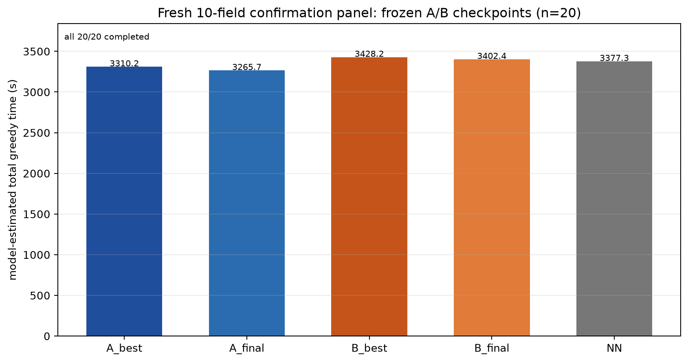

# Fresh 10-field confirmation of frozen A/B models

**No training, no checkpoint selection, no hyperparameter change.**  
All models were frozen before this panel; the same 20 fresh instances were used
for each model and NN.

- Seed block: **1,100,000–1,100,019** (new, 10 fields)
- 20/20 policy and NN episodes completed for every model
- Time: model-estimated total greedy time
- `B − A` positive means **A is better**

## Checkpoints

- A best (validation-selected): `formal_random_instances_s42/ckpt_update_1060.pt`
- A final: `formal_random_instances_s42/ckpt_update_1200.pt`
- B best (validation-selected): `ablation_node_mlp_s42/ckpt_update_760.pt`
- B final: `ablation_node_mlp_s42/ckpt_update_1200.pt`
- NN reference

Checkpoint SHA256s and instance seeds/fingerprints are in `summary.json`.

## Overall means

| model | mean (s) | completed |
|---|---:|---:|
| A best u1060 | 3310.2 | 20/20 |
| **A final u1200** | **3265.7** | 20/20 |
| B best u760 | 3428.2 | 20/20 |
| B final u1200 | 3402.4 | 20/20 |
| NN | 3377.3 | 20/20 |

## Paired confirmation

| comparison | B − A | 95% fixed-20 CI | A better / B better |
|---|---:|---:|---:|
| selected: B u760 − A u1060 | **+118.03 s** | **[+64.24, +170.07]** | **17 / 3** |
| final: B u1200 − A u1200 | **+136.71 s** | **[+104.78, +169.66]** | **19 / 1** |
| A final − A best | **−44.49 s** | [−73.41, −15.84] | A final faster 14/20 |
| B final − B best | −25.82 s | [−59.75, +7.82] | B final faster 11/20 |

The validation-panel gap **is preserved and slightly larger** on this fresh
panel:

- validation-selected gap: +103.6 s → fresh **+118.0 s**
- u1200 gap: +83.0 s → fresh **+136.7 s**

A remains better in both paired comparisons. On these fresh instances A u1200
is also faster than A u1060 (the validation-selected point), while B u1200 vs
B u760 is not clearly separated. No model was reselected after seeing this panel.

## Components

| model | work | nonwork | maneuver | service |
|---|---:|---:|---:|---:|
| A best | 1495.0 | 1444.1 | 371.1 | 0 |
| A final | 1500.5 | 1406.2 | 359.1 | 0 |
| B best | 1498.3 | 1548.4 | 381.6 | 0 |
| B final | 1496.0 | 1528.5 | 377.9 | 0 |
| NN | 1502.9 | 1486.2 | 388.2 | 0 |

B's disadvantage is again mostly nonwork time; necessary work time is nearly
equal.

## Boundary

This is a single paired training seed and a 20-instance fresh confirmation
panel. The intervals are conditional on these 20 instances. It is not a
training-seed significance test and not an official sealed test. The panel was
not used for model selection.
