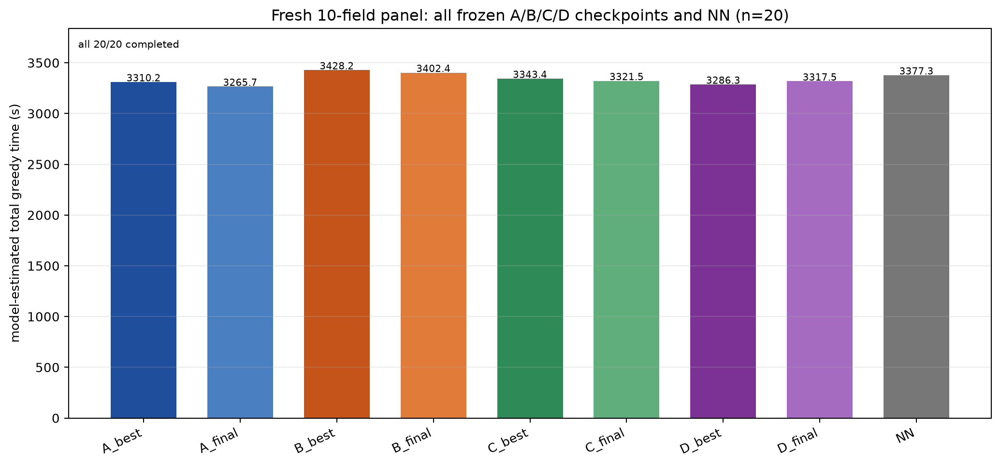

# Fresh 10-field evaluation: all frozen A/B/C/D checkpoints

**No training, no checkpoint reselection, no hyperparameter change.**

- Panel: 20 fresh 10-field instances, seeds **1,100,000–1,100,019**
- This is the previously saved A/B fresh panel; it was not used for C/D model
  selection or training. A/B rows are reused, C/D rows were added.
- All 9 entries (A/B/C/D best and final + NN) completed **20/20**.
- Same instances for every model; all fingerprints match.
- Time is model-estimated total greedy time.

## Model means

| model | mean (s) | completed |
|---|---:|---:|
| A best u1060 | 3310.2 | 20/20 |
| **A final u1200** | **3265.7** | 20/20 |
| B best u760 | 3428.2 | 20/20 |
| B final u1200 | 3402.4 | 20/20 |
| C best u1020 | 3343.4 | 20/20 |
| C final u1200 | 3321.5 | 20/20 |
| D best u900 | 3286.3 | 20/20 |
| D final u1200 | 3317.5 | 20/20 |
| NN | 3377.3 | 20/20 |

## Pre-fixed primary comparisons

Difference is **ablation − A**; positive means A better. CI is an
**instance-level paired bootstrap over the 20 fixed instances**; it does not
include checkpoint-selection uncertainty.

| comparison | difference | 95% bootstrap CI | A better / other better |
|---|---:|---:|---:|
| **A best u1060 vs C best u1020** | **+33.21 s** | **[−8.78, +73.73]** | **13 / 7** |
| **A best u1060 vs D best u900** | **−23.90 s** | **[−60.05, +12.42]** | **8 / 12** |
| A final u1200 vs C final u1200 | **+55.74 s** | **[+26.48, +87.50]** | **15 / 5** |
| A final u1200 vs D final u1200 | **+51.77 s** | **[+20.21, +84.93]** | **16 / 4** |
| A best vs B best (context) | +118.03 s | [+63.21, +170.66] | 17 / 3 |
| A final vs B final (context) | +136.71 s | [+104.61, +169.26] | 19 / 1 |

## What this means

- The **final-checkpoint** comparisons continue to favor A for both C and D:
  the intervals exclude zero.
- The **validation-selected** comparisons do **not** reproduce a clear A gain:
  - C best is 33.2 s slower than A best, but the interval crosses zero and A
    wins only 13/20;
  - D best is **23.9 s faster** than A best, but the interval also crosses zero
    and D wins 12/20.
- Therefore the validation-panel selected-checkpoint gap is **not confirmed**
  as a stable independent result for C/D. The final-checkpoint direction is
  consistent with A being better, but the selected-checkpoint comparison is
  inconclusive on this 20-instance panel.
- A final u1200 is also faster than A best u1060 on this panel; no model was
  reselected after seeing these results.
- A/B remain clearly separated in A's favor; C/D do not show the same
  selected-checkpoint clarity.
- This is one paired training seed and a 20-instance panel; it is not a
  training-seed significance test and not an official sealed test.

## Components

| model | work | nonwork | maneuver | service |
|---|---:|---:|---:|---:|
| A best | 1495.0 | 1444.1 | 371.1 | 0 |
| A final | 1500.5 | 1406.2 | 359.1 | 0 |
| B best | 1498.3 | 1548.4 | 381.6 | 0 |
| B final | 1496.0 | 1528.5 | 377.9 | 0 |
| C best | 1500.8 | 1462.6 | 380.0 | 0 |
| C final | 1499.3 | 1455.9 | 366.3 | 0 |
| D best | 1498.8 | 1419.8 | 367.8 | 0 |
| D final | 1500.6 | 1448.1 | 368.8 | 0 |
| NN | 1502.9 | 1486.2 | 388.2 | 0 |

Rows: `rows.csv`; hashes and per-instance pairs: `summary.json`.
