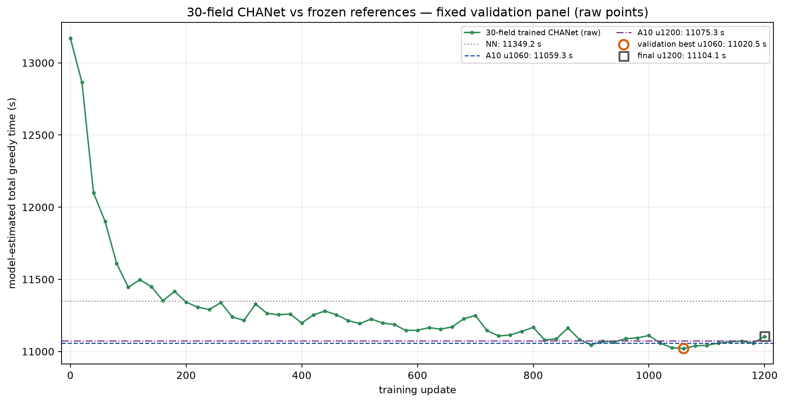

# Random 30-field full-episode CHANet — final result

**Single training seed42. Development-panel evaluation. No sealed test.**

- Branch: `codex/episode-rollout-30fields`
- Launch SHA: `dd4fac9c9c1108ae8358dc2dce4f00eed6cdcfce`
- Start: 2026-11-07 21:02:30 +08:00
- End: 2026-11-09 08:46:48 +08:00
- Wall: **35 h 44 m 18 s**
- Training accounting: **32 h 17 m 29 s**
- Episodes: **19,200**
- Transitions: **1,082,044**
- Optimizer steps: **19,200** (16/update)
- Failures: **0**; truncations: **0**
- Geometry retries: **799**, all expected placement failures; no failed episode

## Frozen setup

- Full CHANet, random initialization, no old model and no smoke resume
- 30 fresh 30-field instances per update, 4 complete episodes/rank × 4 GPUs
- actor LR 1e-4; critic LR 0.003; LR schedule none
- time reward; gamma 1.0; original GAE/PPO/entropy schedule
- UAV randomize off; speed 8 m/s; coverage width 10 m
- `max_episode_steps=500`; smoke observed ~60 steps, no truncation
- checkpoint every 10; update0 + every 20 greedy evaluation
- diagnostic panel 10 fixed instances (observation only)
- validation panel 30 fixed instances (selection only)
- panels and seed namespaces never sampled for training

Panel seed blocks:

- diagnostic: `1,310,000–1,310,009`
- validation: `1,320,000–1,320,029`
- training base: `1,330,000,000`
- geometry audit: `1,300,000–1,300,099`

## Validation-panel result

| model | update | mean time | completed |
|---|---:|---:|---:|
| **new 30-field model (validation best)** | **u1060** | **11,020.5 s** | **30/30** |
| new 30-field model final | u1200 | 11,104.1 s | 30/30 |
| NN | — | 11,349.2 s | 30/30 |
| A10 u1060 | — | 11,059.3 s | 30/30 |
| A10 u1200 | — | 11,075.3 s | 30/30 |

Diagnostic panel (not used for selection):

| model | update | mean time |
|---|---:|---:|
| new model | u1060 | 10,637.8 s |
| new final | u1200 | 10,759.4 s |
| A10 u1060 | — | 10,716.5 s |
| A10 u1200 | — | 10,657.3 s |
| NN | — | 10,929.3 s |

## Paired comparisons — `baseline − candidate`

Positive means the new 30-field model is faster. CI is an instance-level paired
bootstrap over the fixed panel; it does not treat instances as training repeats.

| comparison | difference | 95% bootstrap CI | new wins / baseline wins |
|---|---:|---:|---:|
| **new best vs NN** | **+328.73 s** | **[+254.10, +403.98]** | **29 / 1** |
| **new best vs A10 u1060** | **+38.79 s** | **[−29.40, +103.76]** | **19 / 11** |
| new best vs A10 u1200 | +54.83 s | [−24.13, +135.02] | 17 / 13 |
| new final vs NN | +245.11 s | [+160.22, +327.76] | 26 / 4 |
| **new final vs A10 u1200** | **−28.79 s** | **[−91.40, +33.91]** | **13 / 17** |

### Interpretation

- The 30-field model is **clearly better than NN** at both the selected and final
  points.
- It **does not clearly beat the old 10-field A model**:
  - selected checkpoint is 38.8 s faster on average, but the interval crosses
    zero and only 19/30 instances favor it;
  - final u1200 is 28.8 s **slower** than A10 u1200, interval also crosses zero.
- Best and final are not consistent: the validation-selected u1060 is 83.6 s
  faster than final u1200.
- Therefore direct 30-field training did not demonstrate a robust same-scale
  improvement over the frozen 10-field model on this development panel.

## Time components and operational counts — validation

| model | work | nonwork | maneuver | service | visits | resupplies | distance |
|---|---:|---:|---:|---:|---:|---:|---:|
| new best u1060 | 4385.6 | 5729.0 | 905.8 | 0 | 55.3 | 20.8 | 80,917 m |
| new final u1200 | 4386.7 | 5810.8 | 906.5 | 0 | 57.0 | 20.8 | 81,581 m |
| A10 u1060 | 4389.8 | 5756.3 | 913.2 | 0 | 56.2 | 20.8 | 81,169 m |
| A10 u1200 | 4390.6 | 5778.8 | 905.9 | 0 | 56.4 | 20.8 | 81,355 m |
| NN | 4391.5 | 5989.8 | 967.9 | 0 | 61.2 | 20.8 | 83,050 m |

The small selected-checkpoint gain over A10 u1060 comes mostly from lower
nonwork and maneuver time, with nearly identical work time. The final point
does not retain that gain.

## Raw artifacts and replay

- `new_validation_curve.csv`, `new_diagnostic_curve.csv`
- `new_train_log.csv`
- `new_run_summary.json`
- `new_resolved_config.json`
- `new_validation_vs_references.png`, `new_diagnostic_vs_references.png`
- `reference_rows.csv`, `reference_summary.json`
- `comparison.json` (hashes, per-instance pairs, all components)
- 61 diagnostic and 61 validation evaluation JSON files in the persistent run
  directory, each with full action sequences and state summaries
- every evaluation row passed action replay; all panel rows completed

Persistent root:

`/home/ps/Desktop/Graph_planning/graph-uav-experiments/episode30/formal_random_instances_s42/`

## Checkpoints

- validation-selected best: `ckpt_update_1060.pt`
- final: `ckpt_update_1200.pt`
- old references:
  - `episode10/formal_random_instances_s42/ckpt_update_1060.pt`
  - `episode10/formal_random_instances_s42/ckpt_update_1200.pt`

Full SHA256 values are in `comparison.json`.

## Boundary

This is one paired training seed on a development panel. It directly tests
same-scale 30-field training against a frozen cross-scale 10-field policy; it
does not establish cross-training-seed significance. No sealed test, extra
seed, extra ablation, or budget extension was run.
