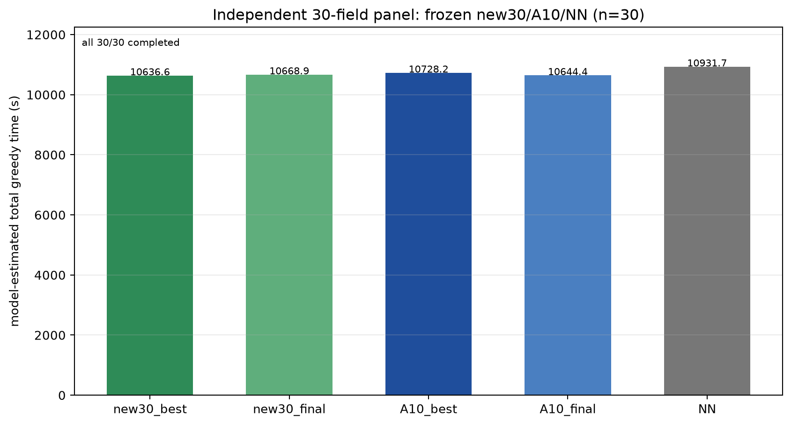

# Independent 30-field evaluation of frozen new30 vs A10 vs NN

**One-shot panel, frozen models, no training and no model selection.**

- Panel: **30 fresh 30-field instances**, base seed 1,340,000
- Accepted seeds: 1,340,000–1,340,032 excluding 1,340,002, 1,340,012 and
  1,340,019 (three geometry-placement failures; recorded)
- All models completed **30/30**; every action replay matched.
- Panel was generated after all models were frozen and was not used for
  checkpoint selection or training.

## Means

| model | update | mean | completed |
|---|---:|---:|---:|
| **new 30-field best** | u1060 | **10,636.6 s** | 30/30 |
| new 30-field final | u1200 | 10,668.9 s | 30/30 |
| A10 best | u1060 | 10,728.2 s | 30/30 |
| A10 final | u1200 | 10,644.4 s | 30/30 |
| NN | — | 10,931.7 s | 30/30 |

## Paired comparisons — `baseline − candidate`

Positive means the new 30-field model is faster. CI is an instance-level
paired bootstrap over the 30 fixed instances.

| comparison | difference | 95% CI | new wins / baseline wins |
|---|---:|---:|---:|
| **new best vs A10 best** | **+91.59 s** | **[+32.32, +150.91]** | **21 / 9** |
| **new final vs A10 final** | **−24.52 s** | **[−88.59, +42.40]** | **12 / 18** |
| new best vs A10 final | +7.84 s | [−53.58, +72.05] | 13 / 17 |
| new final vs A10 best | +59.23 s | [+0.49, +115.34] | 18 / 12 |
| new best vs NN | +295.12 s | [+215.70, +377.62] | 28 / 2 |
| new final vs NN | +262.76 s | [+186.85, +342.96] | 28 / 2 |

## Interpretation

- The **validation-selected** new30 checkpoint retains its advantage on this
  independent panel: **+91.6 s**, CI excludes zero, 21/30 wins.
- The **final** comparison does not: new final is **24.5 s slower** than
  A10 final, with an interval crossing zero (12/30 wins).
- The selected and final results are therefore not consistent; the selected
  checkpoint supports a same-scale training advantage, the final does not.
- New models still clearly beat NN (roughly 263–295 s, 28/30 wins).
- This is one independent panel and one training seed; it is not a sealed test
  and is not a training-seed significance claim.

## Components

| model | work | nonwork | maneuver | service | visits | resupplies | distance |
|---|---:|---:|---:|---:|---:|---:|---:|
| new best | 4253.6 | 5469.1 | 913.9 | 0 | 55.0 | 20.2 | 77,782 m |
| new final | 4253.3 | 5500.7 | 914.9 | 0 | 57.3 | 20.2 | 78,032 m |
| A10 best | 4248.8 | 5561.5 | 917.9 | 0 | 54.6 | 20.2 | 78,482 m |
| A10 final | 4264.3 | 5488.7 | 891.4 | 0 | 55.3 | 20.2 | 78,024 m |
| NN | 4267.6 | 5720.0 | 944.2 | 0 | 60.1 | 20.2 | 79,900 m |

The selected new30 model's gain is mainly lower nonwork/maneuver time; the
final's nonwork is slightly higher than A10 final and its maneuver time is
higher, explaining the reversal.

## Artifacts

- `summary.json` — all paired rows, CIs, hashes
- `rows.csv` — per-instance results
- `independent_panel_log.json` — seeds/fingerprints/failures
- Full action sequences in persistent
  `episode30/independent_eval_s42/actions_rank*.json`
- Checkpoints: new30 u1060/u1200 hashes `48cc6a43…` / `3fbd50d3…`;
  A10 u1060/u1200 hashes `82d67f41…` / `10adbffc…`

No sealed test, extra seed, retraining or model reselection was performed.
