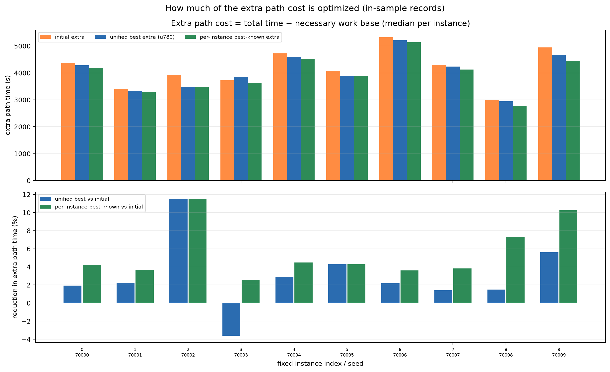

# 去掉必要作业路径后的额外路径成本

**目标：只看转移、地内转弯等额外路径成本；必要地块往复作业路径从每个实例中扣除。**

## 0. 口径

时间账本：

`total_time = time_work_base + time_nonwork_base + time_maneuver_extra + time_service`

- `time_work_base`：地块内必要的往复作业路径时间；
- `time_nonwork_base`：转场/进出连接/补给返航等非作业段；
- `time_maneuver_extra`：转向/机动附加时间；
- `time_service = 0`。

本表把每个实例的 `time_work_base` 固定为该实例在全部可恢复采样/评估记录中的**中位数**，
然后：

> **extra = total_time − time_work_base = nonwork + maneuver**

- 对同一个实例，所有策略都减去同一个常数；**策略间节省量不受这个常数选择影响**。
- 但绝对 extra 和百分比会受 `time_work_base` 的轻微变化影响。实测每个实例的 work base
  在记录中的极差约 **66–118 s**（均值 90.5 s），所以“必要路径固定”只是近似。
- 不使用最小值/最大值作为分母；中位数更稳健。若改用最小 work base，统一/最优节省占比
  分别约为 3.05% / 5.51%，与下表 3.09% / 5.57% 基本一致。

## 1. 总体结果

| 参照 | 总时间均值 | 必要 work base 均值 | extra 均值 | extra 占总时间 |
|---|---:|---:|---:|---:|
| NN | 7104.3 | — | 4193.3 | 59.0% |
| 初始模型 | 7089.3 | 2911.0 | 4178.3 | 58.9% |
| 统一 best（u780） | 6960.4 | 2911.0 | 4049.3 | 58.2% |
| 逐实例 best known（事后选择） | 6856.7 | 2911.0 | 3945.7 | 57.5% |

> **必要作业路径约占总时间 41%；额外路径约 59%。**

优化量（相对初始模型的 extra）：

| 策略 | extra 节省 | 占初始 extra | 占总时间 |
|---|---:|---:|---:|
| 统一 best (u780) | **128.9 s** | **3.09%** | 1.82% |
| 逐实例 best known | **232.6 s** | **5.57%** | 3.28% |

- 只看额外路径，统一模型的优化也只有 **3.1%**。
- 逐实例事后选择可到 **5.6%**，最大单实例 **10.3%**（实例 9，507.1 s）。
- best known 相对统一 best 再低 103.7 s，即统一 extra 的 2.56%。

因此：

> **去掉必要作业路径后，“可优化比例”比总时间视角更大，但仍然只有 3–6%，不是数量级提升。**

## 2. 逐实例 extra 与节省

| idx | seed | work median | initial extra | unified extra | best-known extra | unified 节省 | best-known 节省 | unified % | best % |
|---:|---:|---:|---:|---:|---:|---:|---:|---:|---:|
| 0 | 70000 | 2882.9 | 4361.3 | 4277.4 | 4178.3 | +84.0 | +183.0 | 1.93% | 4.20% |
| 1 | 70001 | 2771.0 | 3407.6 | 3331.6 | 3282.8 | +76.0 | +124.8 | 2.23% | 3.66% |
| 2 | 70002 | 2459.2 | 3930.0 | 3477.1 | 3477.1 | +453.0 | +453.0 | 11.53% | 11.53% |
| 3 | 70003 | 3011.2 | 3725.7 | 3860.1 | 3630.4 | **−134.3** | +95.3 | −3.61% | 2.56% |
| 4 | 70004 | 2886.9 | 4725.7 | 4589.1 | 4514.2 | +136.6 | +211.5 | 2.89% | 4.48% |
| 5 | 70005 | 3045.9 | 4071.1 | 3895.9 | 3895.9 | +175.2 | +175.2 | 4.30% | 4.30% |
| 6 | 70006 | 3156.7 | 5328.0 | 5211.6 | 5136.0 | +116.4 | +192.1 | 2.18% | 3.60% |
| 7 | 70007 | 2898.1 | 4291.9 | 4231.8 | 4128.1 | +60.1 | +163.8 | 1.40% | 3.82% |
| 8 | 70008 | 2873.8 | 2992.1 | 2947.8 | 2772.2 | +44.3 | +219.9 | 1.48% | 7.35% |
| 9 | 70009 | 3124.5 | 4949.1 | 4671.1 | 4442.0 | +277.9 | +507.1 | 5.62% | 10.25% |

- 统一 best 在实例 3 上甚至变差（+134.3 s extra），但在 2、9 等实例上改善明显。
- best known 在所有实例都不差于初始；实例 2、9 的节省最大。
- 这些 extra 差异主要来自 nonwork + maneuver 的总和；没有动作序列，不能进一步把每个实例的差值拆成“转场”还是“地内转弯”。

## 3. 解释与边界

- **必要往复路径固定是近似，不是严格恒等**：记录中的 work base 极差均值 90.5 s。
  本表用中位数扣除，策略间节省量对常数选择不敏感；百分比有小幅口径差异。
- best known 是**事后逐实例选择**，不是统一策略，不是可部署结果，也不是理论上界。
- 没有动作序列，不能重放或证明这些 extra 解可实现。
- 统一 best 仍来自原 update 780 的十实例平均选择；额外路径视角不改变这个选择。
- 当前数据只能说明：**额外路径的可优化比例小（统一 3.1%，事后 5.6%）**，
  不能说明“多训练会突破”；也不能把 extra 差值全部归因于转场或转弯，因为没有逐段动作记录。

## 4. 结论

> 在固定十实例、扣除地块内必要往复作业路径后，统一模型只降低了约 **3.1%** 的额外路径成本；
> 事后逐实例选择最多到 **5.6%**。可优化空间确实比总时间视角更清楚，但仍是一个小比例，
> 而且 best known 不是可部署策略。

下一步如果继续，应优先保存**可重放的动作序列**，再区分转场与地内转弯；在此之前，
不适合用“额外路径仍有很大空间”作为扩训练的假设。

## 5. 文件

- [extra_path_summary.json](fixed_instance_overfit/extra_path_summary.json)
- [extra_path_per_instance.csv](fixed_instance_overfit/extra_path_per_instance.csv)
- [extra_path_costs.png](fixed_instance_overfit/extra_path_costs.png)
- [best-known 说明](fixed_instance_overfit_known_best.md)
