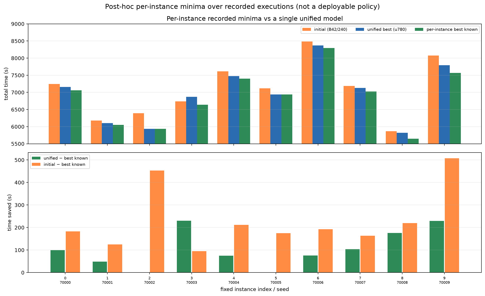

# 已记录执行中的逐实例最好已知成绩

**不训练、不新增 rollout；只整理已有采样和 greedy 结果。**

## 0. 结论先行

- 在固定十实例、全部已记录执行中，逐实例事后最小值均值 **6856.7 s**。
- 同一个统一模型（原 update 780，按十实例平均选出的 best）为 **6960.4 s**。
- 逐实例事后选择相对统一模型平均再低 **103.7 s**，10 个实例中 **8 个**有更低的已记录执行，2 个与统一 best 相同。
- 最大单实例差距 **229.7 s**；这不是一个可部署策略的成绩，而是“记录里已经出现过”的最低点。
- 因此：**已经采样到一些比单一统一模型更好的完整解，但现有记录没有保存动作序列，不能直接重放或部署。**

## 1. 口径与限制

这张表合并了：

- 原过拟合实验的 960 条采样轨迹（6 个 checkpoint ×10 实例×16 次）；
- seed42/seed43 短实验的 480 条采样轨迹（每组 3 端点×10×8）；
- 原始 6 个 checkpoint 的 greedy 逐实例结果；
- 两个短实验全部 7 个 greedy 节点的逐实例结果。

每个实例共 **178 条**已记录执行（重复的 start 点计入各 run 的实际记录；没有额外采样）。

**关键限制**：

- 每个实例的最小值来自**不同 checkpoint、不同采样轨迹或不同 run**；
- 它是**事后逐实例选择**，不是统一策略，也不是可直接部署的模型；
- 不是泛化结果，不是理论最优值，不是改进空间上限；
- 采样记录只有成本，没有动作序列；greedy 评估 JSON 也没有保存完整路线动作。
  因而这些“更好成绩”**不能声称可以重放**，只能作为成绩记录和下一步设计依据。

## 2. 逐实例结果

| idx | seed | NN | 初始模型 | 统一 best (u780) | 逐实例 best known | 来源 | 统一−best known |
|---:|---:|---:|---:|---:|---:|---|---:|
| 0 | 70000 | 7356.8 | 7244.2 | 7160.3 | **7061.2** | 原采样 u780 rep1 | +99.1 |
| 1 | 70001 | 6132.5 | 6178.6 | 6102.6 | **6053.8** | 原 greedy u580 | +48.8 |
| 2 | 70002 | 6084.8 | 6389.2 | 5936.3 | 5936.3 | 原 greedy u780 | 0.0 |
| 3 | 70003 | 7021.9 | 6736.9 | 6871.3 | **6641.6** | 原 greedy u460 | +229.7 |
| 4 | 70004 | 7652.3 | 7612.7 | 7476.0 | **7401.1** | 原采样 u460 rep1 | +74.9 |
| 5 | 70005 | 7246.3 | 7116.9 | 6941.8 | 6941.8 | 原 greedy u780 | 0.0 |
| 6 | 70006 | 8626.9 | 8484.7 | 8368.3 | **8292.6** | seed42 control greedy u40 | +75.7 |
| 7 | 70007 | 7147.4 | 7190.0 | 7129.9 | **7026.2** | seed42 control greedy u40 | +103.7 |
| 8 | 70008 | 5907.8 | 5865.9 | 5821.6 | **5646.0** | 原采样 u780 rep9 | +175.6 |
| 9 | 70009 | 7866.8 | 8073.5 | 7795.6 | **7566.5** | seed43 control greedy u20 | +229.1 |

均值：

| 参照 | 均值 (s) |
|---|---:|
| NN | 7104.3 |
| 初始模型 | 7089.3 |
| 统一 best (u780) | 6960.4 |
| 逐实例 best known | **6856.7** |

## 3. 这说明什么

**支持**：

- 已有记录里确实存在比统一 best 更低的完整执行；平均差 103.7 s，8/10 实例。
- 差距不是只来自一个异常实例：多个来源、多个实例都有几十到二百多秒的差距。
- 因此“继续只加训练轮数”不一定是唯一方向；**保留/选择/学习已有好解**值得成为下一项问题。

**不能支持**：

- 不能把 6856.7 s 当作一个可部署策略的成绩；
- 不能认为是任何模型“已经达到”的水平；
- 不能当作 maximum 或改进上限；
- 不能声称这些解可以重放，因为没有保存动作序列。
- 8/10 是事后逐实例选择，不是统一模型在 10 个实例上的结果。

## 4. 下一步建议（不启动训练）

在下一笔算力之前，先明确选择哪条路线：

1. **先补“可重放的完整解”记录**：未来采样/评估保存动作序列、checkpoint、实例和成本；
   这样才能验证 best-known 解是否可重放，而不是只有分数。
2. **若继续训练**，目标应从“平均更低”改成“保留已找到的完整好解”，并预先指定统一 checkpoint 选择规则，
   不能逐实例挑不同 checkpoint 拼成一个不存在的模型。
3. **若做直接搜索**，需要预算上限和与现有 178 条执行可比的记录规则；本轮不启动。

当前不追加第三个 seed，也不追加 120 updates。

## 5. 文件

- [known_best_per_instance.json](fixed_instance_overfit/known_best_per_instance.json)
- [known_best_per_instance.csv](fixed_instance_overfit/known_best_per_instance.csv)
- [known_best_per_instance.png](fixed_instance_overfit/known_best_per_instance.png)
- 采样原始记录：[sampled_rows.csv](fixed_instance_overfit/sampled_rows.csv)
- 短实验报告：[seed42](fixed_instance_overfit_short_screen.md)、[seed43](fixed_instance_overfit_short_screen_seed43.md)
