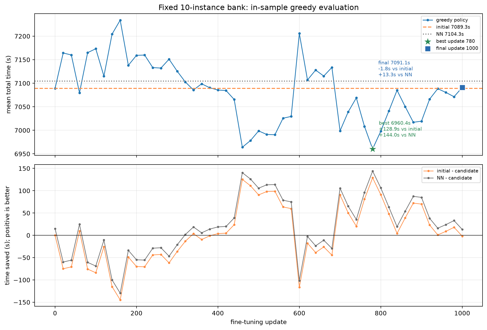
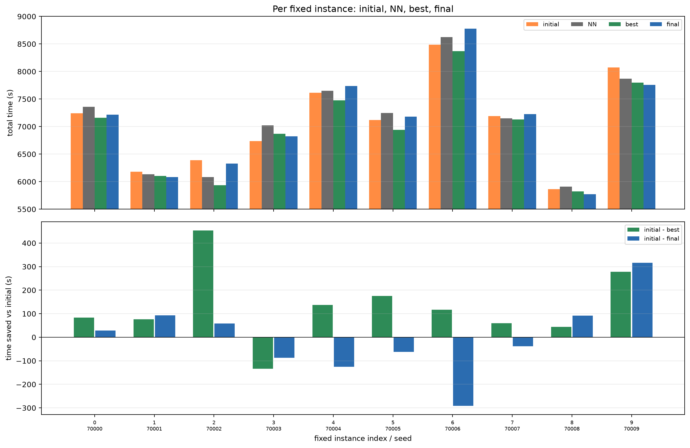
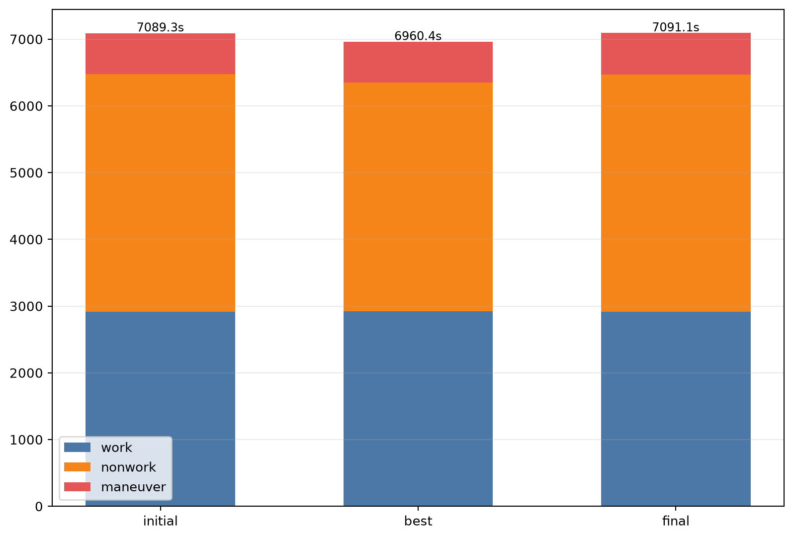

# 固定 10 个 20 地块实例：已有模型微调结果

**分支 `codex/fixed-instance-overfit` · 代码 `b15c3cf` · 1 个训练种子（42）**

> 这是**训练集上的 in-sample 拟合诊断**，不是 sealed 测试，不是泛化结果，也不是理论最优值。
> 时间指标：**“模型估计的飞行时间，含机动损耗，不含未建模的补给服务及起降耗时”**。

## 0. 结论先行

- 原模型（B_seed42 update 240）在这 10 个实例上已经略优于 NN：
  `NN − initial = +15.1 s`。
- 最好 checkpoint 是 **update 780**：
  - 6960.4 s；
  - 比原模型快 **128.9 s**（逐实例相对改善均值 1.81%）；
  - 比 NN 快 **144.0 s**（1.99%）；
  - 对原模型 **9 胜 / 1 负**，对 NN **10 胜 / 0 负**。
- **最后 checkpoint（update 1000）为 7091.1 s**：
  - 比原模型慢 **1.8 s**，基本回到起点；
  - 比 NN 只快 **13.3 s**；
  - 对原模型 5 胜 / 5 负，对 NN 6 胜 / 4 负。
- 因而：
  - **模型有能力在这批固定任务上找到更好的策略**；
  - 但这份收益**没有保持到训练结束**，best 与 final 的差距是 **130.7 s**；
  - best 是从 51 个 in-sample 评估点中选出的最大值，存在**选择乐观偏差**，不能当成无偏的“过拟合上界”。
- 改善不是所有实例均匀获得：best 的改善总量的 **70.3% 来自 3 个实例**，最大单实例贡献 **453.0 s**；同时有 1 个实例变差（−134.3 s）。

## 1. 运行与冻结信息

| 项目 | 值 |
|---|---|
| 起点 | `B_seed42` update 240 |
| 起点 SHA256 | `71cfda4f20805e553888854ebd12ba47b6244fbe25ce7ae0a62f7cdf8faa7560` |
| 固定 bank | 10 个实例，seed 70000–70009，全部 20 fields |
| bank SHA256 前缀 | `e288e4146b57b00…`（manifest） |
| 训练预算 | 1000 updates × 128 steps/rank，4×RTX 5090 DDP |
| 评估 | 每 20 updates，完整 10 个实例，greedy decoding |
| 全部评估点 | **51 个（update 0,20,…,1000），每点 10/10 完成** |
| 最优 checkpoint | **update 780** |
| 最后 checkpoint | **update 1000** |

smoke 使用同一 bank 和原始权重、2 updates、eval every 1，update 0/1/2 均 10/10 完成；
正式训练**没有从 smoke 权重续训**，而是重新从原始 checkpoint 开始。

## 2. 两条基线、best 与 final

| policy | mean time (s) | completion | 相对 initial | 相对 NN |
|---|---:|---:|---:|---:|
| NN | 7104.3 | 10/10 | −15.1 | 0 |
| initial (B42/240) | 7089.3 | 10/10 | 0 | +15.1 |
| **best (update 780)** | **6960.4** | 10/10 | **+128.9** | **+144.0** |
| final (update 1000) | 7091.1 | 10/10 | −1.8 | +13.3 |

符号统一为 `baseline − candidate`，正值表示 candidate 更快。

## 3. 学习曲线（不平滑、保留真实评估点）

- 蓝线是 10 个固定实例上的完整 greedy 评估均值；没有平滑、没有边界填充。
- 橙线/灰线是 initial 与 NN 的水平。
- 星号是 update 780（best），方块是 update 1000（final）。
- 曲线明显非单调：update 600 附近有一次大回退，update 780 达到最低，随后 final 又回到初始附近。
- 因此不能用“best 点”代替“训练结束时的模型”，也不能用“final 差”否认中间确实曾达到更好策略。

## 4. 逐实例改善

| idx | seed | initial | NN | best | final | initial−best | NN−best | initial−final | NN−final |
|---:|---:|---:|---:|---:|---:|---:|---:|---:|---:|
| 0 | 70000 | 7244.2 | 7356.8 | 7160.3 | 7215.6 | +84.0 | +196.5 | +28.6 | +141.1 |
| 1 | 70001 | 6178.6 | 6132.5 | 6102.6 | 6086.0 | +76.0 | +29.9 | +92.6 | +46.5 |
| 2 | 70002 | 6389.2 | 6084.8 | 5936.3 | 6331.0 | **+453.0** | +148.5 | +58.2 | −246.2 |
| 3 | 70003 | 6736.9 | 7021.9 | 6871.3 | 6824.6 | **−134.3** | +150.7 | −87.7 | +197.3 |
| 4 | 70004 | 7612.7 | 7652.3 | 7476.0 | 7738.5 | +136.6 | +176.3 | −125.8 | −86.2 |
| 5 | 70005 | 7116.9 | 7246.3 | 6941.8 | 7179.0 | +175.2 | +304.5 | −62.1 | +67.3 |
| 6 | 70006 | 8484.7 | 8626.9 | 8368.3 | 8776.1 | +116.4 | +258.6 | **−291.4** | −149.2 |
| 7 | 70007 | 7190.0 | 7147.4 | 7129.9 | 7228.4 | +60.1 | +17.5 | −38.4 | −81.1 |
| 8 | 70008 | 5865.9 | 5907.8 | 5821.6 | 5774.5 | +44.3 | +86.2 | +91.4 | +133.3 |
| 9 | 70009 | 8073.5 | 7866.8 | 7795.6 | 7756.9 | +277.9 | +71.2 | +316.7 | +109.9 |

- best 的改善总和 1289.1 s；top-3 实例贡献 906.1 s（70.3%），最大实例 70002 贡献 453.0 s（35.1%）。
- best 不是“所有实例都变好”：70003 比初始慢 134.3 s。
- final 的 5 个改善被 5 个退步抵消，其中 70006 单独退步 291.4 s；这说明最终 checkpoint 的收益不稳定，而不是所有实例同步改善。

完整 CSV：[per_instance.csv](fixed_instance_overfit/per_instance.csv)。

## 5. 时间分项

| 均值 | total | work | nonwork | maneuver | service | distance | visits | resupplies |
|---|---:|---:|---:|---:|---:|---:|---:|---:|
| initial | 7089.3 | 2911.8 | 3561.8 | 615.6 | 0 | 51789.2 | 35.6 | 13.4 |
| best 780 | 6960.4 | 2924.9 | 3427.6 | 607.9 | 0 | 50820.0 | 36.9 | 13.4 |
| final 1000 | 7091.1 | 2915.9 | 3552.1 | 623.1 | 0 | 51744.0 | 36.6 | 13.4 |

best − initial：

- total **−128.9 s**；
- work **+13.1 s**（略增）；
- nonwork **−134.2 s**（几乎全部收益）；
- maneuver **−7.8 s**（不是主要来源）；
- distance **−969.2 m**；visits +1.3；resupply 不变。

所以这不是“转弯机动大幅变好”，而是**非工作段/转场时间下降**；工作段甚至略增。

final − initial：

- total **+1.8 s**；
- work +4.0、nonwork −9.7、maneuver +7.4；
- 距离 −45.2 m；
- 基本回到初始模型。

## 6. 解释边界

1. **这是 in-sample**：10 个实例同时用于训练和评估；不能报告为泛化或 sealed 结果。
2. **best 有选择偏差**：从 51 个评估点中取最小值；即使全部是同一训练集，也会偏高。final 是固定预算终点，更接近“训练结束时的真实状态”，但也不代表无偏泛化。
3. **一个种子**：不能把 128.9 s 或 130.7 s 的 best-final 差当成稳定可复现的效应。
4. **best-final 差距很大**：说明当前训练/评估过程对 checkpoint 选择敏感，不能用 best 点代替模型能力，也不能用 final 点否认中间的可拟合性。
5. 本轮**没有**改 reward、网络或超参数，也没有访问 sealed 集；这些是后续才需要决定的实验设计。

当前证据支持的定位：

> 在固定 10×20 任务上，现有架构/更新**能找到一个更好的策略**，但收益集中在少数实例，且**没有在训练结束时保持**；best 与 final 的差异足以主导“是否超过原模型”的结论。

## 7. 后续有界诊断

greedy vs 采样平均（0/460/580/600/780/1000，每实例 16 次）：
[fixed_instance_overfit_sampled_diagnostic.md](fixed_instance_overfit_sampled_diagnostic.md)。

## 8. 文件

- 运行目录（本工作站）：`/tmp/fixed-instance-overfit/coverage_env/results/overfit20/run_seed42`
- [best.json](/tmp/fixed-instance-overfit/coverage_env/results/overfit20/run_seed42/best.json)
- [learning_curve.csv](fixed_instance_overfit/learning_curve.csv)
- [per_instance.csv](fixed_instance_overfit/per_instance.csv)
- [results_summary.json](fixed_instance_overfit/results_summary.json)
