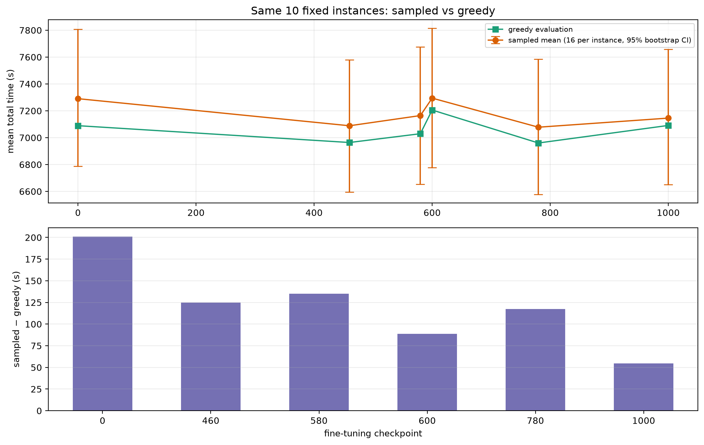
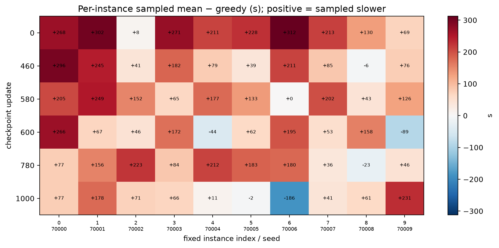

# 固定 10×20 实例：greedy vs 采样的有界诊断

**checkpoint：0、460、580、600、780、1000；每实例 16 次采样，不用 best-of-16。**

## 0. 结论先行

- **不是只有一个幸运点**：greedy 在 460–580 和 700–900 两个区间连续优于原模型；采样的平均成本也显示出同方向的阶段性改善与回退。
- **最终收益丢失不只是 greedy 解码**：
  - 780→1000，greedy 变慢 **130.7 s**；
  - 同一批固定随机种子下，采样平均也变慢 **67.8 s**（固定十实例 95% CI [+48.6, +87.3]）。
- **但 greedy 确实贡献了很大一部分最终退化**：
  - 采样平均从初始到 final 仍改善 **144.7 s**（固定十实例 95% CI [−164.3, −123.7]）；
  - greedy 从初始到 final 只差 **+1.8 s**（基本回到起点）。
  - 也就是说，final 的策略分布平均仍优于初始，但 greedy 的排名/选择没有把这份平均优势保留下来；同时分布本身也比 780 的最佳状态退步了约 68 s。
  - 注意：在固定十实例口径下，final greedy 仍比采样平均快 **54.6 s [42.0, 67.4]**；不是“随机采样更好”。
- **不是 critic 崩溃**：本区间实际 LR 恒为 `3e-4`，KL 约 `0.018–0.027`，clip 约 `0.15–0.17`，EV 约 `0.93–0.98`；没有 v1 式尖峰。600 的回退发生时 critic/EV 并未明显恶化。
- 下一步应直接检验 **actor 更新幅度**，不再扩大解码诊断；没有证据支持立即扩网络、提高转弯权重或单纯延长训练。
- **本轮无法启动建议的低学习率配对续训**：原始 `/tmp/fixed-instance-overfit` 工作区已被清理，
  `ckpt_update_780.pt` 和固定 bank 不在本地或 Git 中；我没有用 final1000、新 780 或其他模型静默替代。

## 1. 设置

- 使用既有 `run_seed42` 的 6 个 checkpoint；不重新训练。
- 固定 bank：10 个实例，seed 70000–70009，全部 20 fields。
- 每个 checkpoint：每个实例 16 次完整采样任务，共 **160 episodes/checkpoint、960 episodes**；全部 **160/160 完成**。
- 每次 episode 使用固定任务随机种子（900000 + instance×16 + replicate），同一 checkpoint 内不挑最好结果；报告均值、SE；主区间固定十实例、只重采样每实例轨迹；跨实例层次区间仅作次要说明。
- greedy 成本直接取同一 checkpoint 的既有 10 实例完整评估。
- 时间指标：**模型估计的飞行时间，含机动损耗，不含未建模的补给服务及起降耗时**。

## 2. greedy vs 采样平均

| update | greedy (s) | sampled mean (s) | fixed-10 95% CI（仅实例内重采样） | sampled − greedy (fixed-10 95% CI) |
|---:|---:|---:|---:|---:|
| 0 | 7089.3 | 7290.3 | [7274.6, 7306.0] | **+201.1** [185.4, 216.7] |
| 460 | 6964.0 | 7088.8 | [7075.0, 7102.8] | +124.7 [111.0, 138.8] |
| 580 | 7029.4 | 7164.4 | [7147.4, 7180.6] | +135.1 [118.0, 151.2] |
| 600 | 7205.8 | 7294.5 | [7278.4, 7310.5] | +88.6 [72.6, 104.7] |
| 780 | 6960.4 | 7077.9 | [7065.6, 7090.2] | +117.5 [105.2, 129.8] |
| 1000 | 7091.1 | 7145.9 | [7133.1, 7158.5] | **+54.6 [42.0, 67.4]** |

- sampled 平均始终高于 greedy（即采样平均更慢），因为 greedy 选的是分布里的高概率/高排名动作；这不是异常。
- 关键是 **sampled − greedy 从 201.1 s 缩到 54.6 s**：final 的 greedy 相对其采样分布的领先变小。
- 在**固定这十个实例**、只重采样每实例轨迹的口径下，final 的 sampled−greedy 为 **+54.6 s [42.0, 67.4]**：
  final greedy **仍明显优于随机采样平均**。跨实例的层次 bootstrap 区间会宽得多且包含零，但它回答的是“换一批实例”的不确定性，不是本实验的首要问题；两者不能混用。
- best(780) 的对应固定十实例区间为 **+117.5 [105.2, 129.8]**。

## 3. 阶段变化：greedy 与采样同向，但幅度不同

| 阶段 | greedy 变化 | sampled 平均变化（固定十实例，仅实例内重采样） |
|---|---:|---:|
| initial → 460 | −125.3 s | **−201.7 s** [−221.6, −181.4] |
| 460 → 580 | +65.5 s | +75.8 s [+53.3, +97.5] |
| 580 → 600 | +176.3 s | **+129.9 s** [+108.5, +150.7] |
| 780 → 1000 | +130.7 s | **+67.8 s** [+48.6, +87.3] |
| initial → final | **+1.8 s** | **−144.7 s** [−164.3, −123.7] |

- 580→600 的回退在 greedy 和采样平均上**同时出现**；这更像 actor/更新过程的变化，而不是单纯 greedy 排名。
- 780→1000 也是两者同时变慢，但采样平均只退化 67.8 s，greedy 退化 130.7 s；因此 final 的额外损失有一部分来自 greedy 选择/排名。
- initial→final：采样平均仍改善 144.7 s，greedy 基本持平；这是“期望表现 vs greedy 部署”的最直接分离。
- 但 final greedy 仍优于随机采样平均 54.6 s；所以这是**两层同时发生**，不是“greedy 坏了、采样更好”的简单替换关系。

## 4. 逐实例差异

- 大多数实例的 sampled−greedy 为正（采样更慢），但 final 的实例 70006 是明显例外：
  - final greedy 8776.1 s；
  - final sampled 平均 8589.6 s（比 greedy 快 186.5 s）。
  这直接显示 final 在该实例上的 greedy 选择并不代表分布的平均质量。
- 这不是“所有实例都被 greedy 解码毁掉”：final 仍有 70006 这类显著个例，但 overall sampled 平均仍比 greedy 慢 54.6 s。

## 5. 训练日志对齐

实际配置：`lr_schedule=none`，actor LR `3e-4`，`entropy_coef` 从 `0.01` 退火到 `0`。

| update | actor LR | entropy coef | approx KL | clip fraction | critic loss | EV |
|---:|---:|---:|---:|---:|---:|---:|
| 460 | 3e-4 | 0.00611 | 0.0178 | 0.162 | 3.53 | 0.980 |
| 580 | 3e-4 | 0.00478 | 0.0266 | 0.167 | 11.70 | 0.931 |
| 600 | 3e-4 | 0.00455 | 0.0219 | 0.169 | 8.04 | 0.950 |
| 780 | 3e-4 | 0.00255 | 0.0216 | 0.150 | 3.12 | 0.981 |
| 1000 | 3e-4 | 0.00011 | 0.0267 | 0.153 | 6.70 | 0.959 |

- **600 回退时** critic 11.7→8.0、EV 0.931→0.950，并未恶化；不支持“600 崩掉是 critic 失效”。
- **780→1000** critic 3.12→6.70、EV 0.981→0.959，有轻微价值拟合变差，但 EV 仍 0.96；不足以单独解释 greedy 的 130.7 s 回退。
- KL/clip 没有爆量；实际 LR 恒定，不是学习率调度切换造成的。
- 这仍只是相关性；本轮没有做干预实验，不能据此断言 critic 或学习率是原因。

## 6. 每卡/每实例曝光

`evaluation/update_1000.json` 的累计 usage（4 卡求和）：

- 每个实例 `starts` 都约 **1600**（所有实例均被抽到）；
- `transitions` 范围 **47,264–55,117**；
- 完成 episode 数 **1,174–1,255**；
- 总计 512,000 transitions、16,000 starts。

starts 并不偏少，但 transitions 因 episode 长度不同而相差约 16%；固定实例集合并不等于每次更新对十实例等权。完整逐 rank/实例表见
[rank_instance_usage.csv](fixed_instance_overfit/rank_instance_usage.csv)。

## 6.1 统计口径修正

- **首要口径**：固定十个实例，只在每个实例内重采样 16 条轨迹。回答“就这十个任务，采样平均是否改变”。
- **次要口径**：同时重采样实例和轨迹，回答“换一批实例是否仍如此”；区间更宽，不能拿来判断固定面板的采样误差。
- 上表均使用首要口径；原文中的跨实例层次区间不再作为“final 是否仍优于采样”的判据。
- 即使固定面板区间较窄，也只说明这十个任务上的采样误差；不能推断跨训练种子可复现。

## 7. 判读

现在可以把“收益丢失”拆成两部分：

1. **actor/分布本身**：780→1000 sampled 平均变慢 67.8 s（CI 正），说明不只是 greedy；同时 580→600 的 sampled 回退也成立。
2. **greedy 部署/排名**：final sampled 平均仍比 initial 改善 144.7 s，而 greedy final 与 initial 持平；greedy 相对 sampled 的优势从 201 s 缩到 55 s，且 final 实例 70006 的 greedy 明显差于采样平均。

因此：

- 不能再说“final 的退化完全是随机噪声”；
- 也不能再说“只是 greedy 解码问题”；
- 更准确的定位是：**策略分布有阶段性学习，但最终 actor 分布相对 best 退步；greedy 排名/动作选择又额外丢失了一部分分布平均优势**。
- 没有证据把主因归到 critic、学习率、网络容量或转弯权重；也不能把分离定性为“动作排序实现错误”。
- final 的 greedy 仍明显优于随机采样平均（固定十实例 +54.6 s [42.0, 67.4]）；实例 70006 的例外不足以支持改用随机采样部署。
- 下一步应只做**actor 更新幅度**的配对干预，而不是继续扩大解码诊断、扩网络或再加 1000 updates。

## 8. 下一实验：低 actor-LR 配对续训（当前被缺失 checkpoint 阻塞）

计划保持网络、reward、critic、bank、rollout、PPO 参数、熵时间表和解码不变，从**同一个 update 780**
分叉到 781–1000：

| | control | experiment |
|---|---|---|
| actor LR | 3e-4 | 3e-5 |
| critic LR | 原值 | 原值 |
| optimizer 状态 | 从 780 恢复 | 同左 |
| RNG / 熵进度 | 从 780 恢复 | 同左 |
| 终点 | 1000 | 1000 |

主结果用固定终点，另保留冻结 780 作为第三参照；不再从 checkpoint 串中选最低值作为主要证据。
若预算允许，再做三个配对续训种子。

**阻塞**：原始 run 目录（含 `ckpt_update_780.pt`、bank 和 rank_runtime）随 `/tmp` 工作区清理而丢失；
远端分支只保存了报告、曲线和采样 CSV。无法从原始 780 启动，也不能把 final1000、新训练的 780 或其他
权重当作同一个起点。需要先恢复/重建该 checkpoint 和 bank，或明确接受一个**新的 780** 并标注它不是原起点。

## 9. 产物

- [sampled_conditional_ci.json](fixed_instance_overfit/sampled_conditional_ci.json)（固定十实例口径）
- [sampled_summary.json](fixed_instance_overfit/sampled_summary.json)（含跨实例层次区间，非首要口径）
- [sampled_per_instance.csv](fixed_instance_overfit/sampled_per_instance.csv)
- [sampled_rows.csv](fixed_instance_overfit/sampled_rows.csv)
- [rank_instance_usage.csv](fixed_instance_overfit/rank_instance_usage.csv)
- [sampled_vs_greedy.png](fixed_instance_overfit/sampled_vs_greedy.png)
- [sampled_per_instance_delta.png](fixed_instance_overfit/sampled_per_instance_delta.png)

本诊断没有改 reward、网络、优化器或训练预算，也没有再训练。
