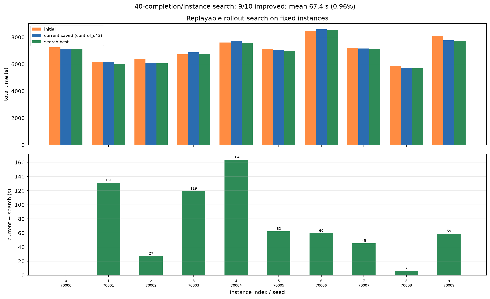

# 不训练的额外路径搜索诊断

**固定十个实例 · 可重放基准 · 40 次完整补全/实例 · 无训练、无新增模型**

## 0. 结论

- 从当前实际保存的最好模型（control_s43@60）出发，使用**保留前缀、替换一个动作、固定 NN 补完**的 rollout 搜索：
  - 10 个实例中 **9 个找到更完整方案**；
  - 平均从 **7030.6 s → 6963.2 s**，改善 **67.4 s（0.96%）**；
  - 最大单实例改善 **163.7 s**，唯一未改善的实例是 0。
- 这个搜索最好值几乎追平原丢失 u780 的 **6960.4 s**，但**不是**原 u780，也没有恢复原实验。
- 历史 **6856.7 s** 是逐实例事后选择、无动作序列，**没有作为搜索起点**。
- 当前简单下界 **不能被证明为有效**，因此：
  - **不能**说问题接近饱和；
  - 也不能说“再多训练就能突破”；
  - 只能说明在这 400 次补全预算内，**存在可重放的小幅改进**。

## 1. 基准与可重放性

| 基准 | 说明 | 均值 |
|---|---|---:|
| NN | 固定启发式 | 7104.3 |
| 初始模型 | B42/240 | 7089.3 |
| 当前实际保存最好模型 | short `control_s43` u60 | **7030.6** |
| 原 u780 | **已丢失，无法重放** | 历史 6960.4，不作基准 |
| 历史 6856.7 | 无动作序列 | 不启动、不作起点 |

每个基准都在新环境中从动作序列重放：

- NN、初始、当前模型各 10 条；
- 完整动作序列、实例指纹、每步状态摘要（位置/朝向/能耗/载荷/覆盖/状态摘要）已保存；
- 重放均完成任务，成本与原始执行一致（实例 1 覆盖率为 0.997，符合原评估的完成口径）。

## 2. 搜索设置

- 只改一步：保留真实前缀动作，替换动作，再用固定 NN 补完。
- 候选分布：
  - 门选择：同地块，替换入口/出口；
  - 地块选择：换目标地块，每块选代表门。
- 每个实例 2 轮 ×5 个前缀（早/中/晚）×4 个候选（2 门 +2 地块）= **40 次完整补全**。
- 硬预算：每实例 5 min、总 50 min；实际每实例 **81.8–163.6 s**，无实例触顶。
- 实际搜索时间：**约 18–19 min**（不含基准/重放）。
- 找到更好方案时保存；第二轮从新方案继续；**旧方案始终保留**。
- 只做单动作修改；预算没有余量做连续两动作。

## 3. 逐实例结果

| 实例 | seed | NN | 初始 | 当前保存 | 搜索最好 | 改善 | 搜索 completed |
|---:|---:|---:|---:|---:|---:|---:|---|
| 0 | 70000 | 7356.8 | 7244.2 | 7149.9 | 7149.9 | 0.0 | 10/10 |
| 1 | 70001 | 6132.5 | 6178.6 | 6155.4 | **6024.1** | **131.3** | 10/10 |
| 2 | 70002 | 6084.8 | 6389.2 | 6098.3 | **6071.1** | **27.3** | 10/10 |
| 3 | 70003 | 7021.9 | 6736.9 | 6880.2 | **6760.8** | **119.4** | 10/10 |
| 4 | 70004 | 7652.3 | 7612.7 | 7731.5 | **7567.7** | **163.7** | 10/10 |
| 5 | 70005 | 7246.3 | 7116.9 | 7065.3 | **7003.0** | **62.4** | 10/10 |
| 6 | 70006 | 8626.9 | 8484.7 | 8581.4 | **8521.8** | **59.6** | 10/10 |
| 7 | 70007 | 7147.4 | 7190.0 | 7167.8 | **7122.5** | **45.3** | 10/10 |
| 8 | 70008 | 5907.8 | 5865.9 | 5702.3 | **5695.7** | **6.6** | 10/10 |
| 9 | 70009 | 7866.8 | 8073.5 | 7774.1 | **7715.2** | **58.9** | 10/10 |
| **均值** | | **7104.3** | **7089.3** | **7030.6** | **6963.2** | **67.4** | |

- 9/10 改善；实例 0 没有找到更好方案。
- 8/10 改善超过 1%；实例 8 仅 6.6 s。
- 改善最大的是实例 4（163.7 s），其次实例 1（131.3 s）、实例 3（119.4 s）。
- 搜索最好均值 6963.2 s，与原 u780 的 6960.4 s 相差 **2.8 s**；这是巧合接近，**不是复现**。

## 4. 下界审查：L_work 不能证明

候选：

\[
L_{\mathrm{work}}=\frac{A_{\mathrm{task}}}{w v}
\]

本环境的 `A_task`（地块面积）与 `w=10`、`v=8` 可计算，例如实例 0：

\[
L_{\mathrm{work}} \approx 2850.7\ \mathrm{s}.
\]

但**不能直接把 `L_work` 当作已证明的有效下界**：

- `A_task` 是地块面积；完成判定使用网格点/离散覆盖，网格单元面积赋值可能使有限路径的“覆盖面积”略超过物理扫幅；
- 需要证明任意可行执行都至少需要 `A_task/(w v)` 的作业距离；当前代码审查不能严格证明这一点；
- 因此 `L_work` 只能标记为**理想作业参考值**，不能用于“已证明最优性差距”。
- 即使把它当作有效下界，它离搜索上界约 4000 s，是一个很松的下界，无法证明空间小。
- 地块中心 TSP、覆盖/转场独立下界相加都未证明有效，本轮不使用。

**结果：没有有效下界，所以“上下界差距”不能填。**

## 5. 判读

搜索均值改善 0.96%，略低于事先举例的 1% 工程阈值；但 9/10 改善，且搜索追上历史 u780 的均值。正确表述是：

> **在这 400 次完整补全的有限搜索中，确实找到了可重放的更好方案；但改善幅度约 1%，且没有有效下界，不能判断空间大小，也不能据此恢复长训练。**

按预先规则：

- 搜索找到了一些改进 → **说明当前策略并非局部不可改进**；
- 但没有有效下界 → **不能得出接近饱和**；
- 预算已用完且没有继续改善的趋势证据 → **不自动加码**；
- 下一步若要继续，应优先研究“如何保留/选择这些完整方案”，或明确批准更高搜索预算；不是直接回到长时间训练。

## 6. 产物与预算

- 搜索：10 实例 ×40 次 = **400 次完整补全**；另有 20 次 smoke。
- 搜索时间约 **18–19 min**；最慢单实例 163.6 s；均未超过 5 min/50 min 硬限制。
- 所有搜索最好方案 **10/10 重放完成**（实例 1 覆盖率 0.997，与原完成口径一致）。
- 动作序列、实例指纹、每步摘要、成本和配置：
  - [search_final_table.json](fixed_instance_overfit/search_final_table.json)
  - [search_formal_results.json](fixed_instance_overfit/search_formal_results.json)
  - [search_baseline_traces.json](fixed_instance_overfit/search_baseline_traces.json)
  - [search_final_table.csv](fixed_instance_overfit/search_final_table.csv)
- 原始 u780 缺失，未重训；历史 6856.7 无动作序列，未用作起点。
- 当前无训练进程。
