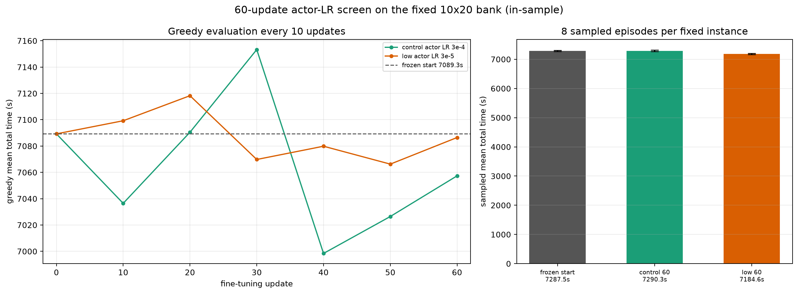

# 60-update actor-LR screen on the fixed 10×20 bank

**B42/240 · 10 fixed instances · fresh optimizer for both arms · in-sample only**

## 0. Result in one table

| endpoint | greedy (s) | greedy vs start | 8-sample mean (s) | sampled vs start |
|---|---:|---:|---:|---:|
| frozen start (B42/240) | 7089.3 | 0 | 7287.5 | 0 |
| control, actor LR 3e-4 | **7057.4** | **+31.9** | 7290.3 | +2.8 |
| low, actor LR 3e-5 | 7086.5 | +2.8 | **7184.6** | **−102.9** |

Key: lower is better. Sampled differences are fixed-ten conditional (8 trajectories per instance; all 80/80 complete).

- **Low LR did not improve greedy** (7086.5 vs control 7057.4, i.e. 29.1 s slower than control; only +2.8 vs start).
- **Low LR did improve the sampled average**: −105.7 s vs control [−134.3, −77.7], and −102.9 vs start [−129.7, −77.3].
- **Control’s greedy improved, but its sampled average did not**: +2.8 s [−29.4, +34.6].
- This is a **metric divergence**, not a clean stability win. Under the pre-agreed rule (“低 LR 同时优于起点和控制组” on both the fixed endpoint and sampled average), this screen **does not justify extending to 120 updates**.

## 1. Setup

- Start: `B_seed42` update 240, SHA256 `71cfda4f20805e553888854ebd12ba47b6244fbe25ce7ae0a62f7cdf8faa7560`.
- Bank: 10 fixed instances, seeds 70000–70009, all 20 fields; `instances.pt` SHA256 `48382c40d40a71ac…` (same content hash prefix as the lost original bank record).
- Both arms: new Adam optimizer (not the original optimizer state), same entropy schedule and target budget 60; only actor LR differs:
  - control `3e-4`;
  - low `3e-5`.
- Greedy evaluation at update 0/10/20/30/40/50/60, all 10/10 complete.
- Sampling: start, control-60, low-60; 8 complete episodes per instance; no best-of-8.
- This is a **new short fine-tune**, not a continuation of the lost update-780 run.

## 2. Greedy curve

| update | control greedy (s) | control vs start | low greedy (s) | low vs start |
|---:|---:|---:|---:|---:|
| 0 | 7089.3 | 0 | 7089.3 | 0 |
| 10 | 7036.5 | +52.8 | 7099.2 | −10.0 |
| 20 | 7090.5 | −1.2 | 7118.3 | −29.0 |
| 30 | 7153.3 | −64.0 | 7069.8 | +19.5 |
| 40 | 6998.4 | +90.9 | 7079.9 | +9.4 |
| 50 | 7026.5 | +62.8 | 7066.3 | +23.0 |
| 60 | **7057.4** | **+31.9** | 7086.5 | +2.8 |

- Control has larger swings: best 6998.4 at 40, worst 7153.3 at 30; final 7057.4.
- Low is much flatter: 7066.3–7118.3; final 7086.5.
- **Flatter is not automatically better**: low’s final greedy is 29.1 s slower than control, and only 2.8 s better than the frozen start.

## 3. Sampled endpoints

| endpoint | sampled mean (s) | fixed-ten 95% CI | vs start | vs control |
|---|---:|---:|---:|---:|
| start | 7287.5 | [7264.1, 7310.6] | — | — |
| control 60 | 7290.3 | [7266.8, 7315.5] | +2.8 [−29.4, +34.6] | — |
| low 60 | **7184.6** | [7164.5, 7204.3] | **−102.9 [−129.7, −77.3]** | **−105.7 [−134.3, −77.7]** |

- Low LR improves the sampled average on the same ten instances; the paired interval excludes zero.
- Control does not improve the sampled average.
- Greedy and sampling therefore point in **different directions**:
  - control: better greedy, no sampled gain;
  - low: better sampled average, no greedy gain.

This is exactly why the decision cannot be “low LR is stable” without qualification.

## 4. Did low LR merely freeze the model?

No. Actor parameter distance from the start (all actor tensors, L2):

| arm | relative L2 | max abs | actor SHA256 prefix |
|---|---:|---:|---|
| control | 10.75% | 0.0510 | `5a9662d8ceb78f2a` |
| low | 1.71% | 0.00722 | `ddc0f907180bc70d` |

- Low LR changed parameters much less, but it did change them; it is not a frozen copy.
- Actual actor LR was constant `3e-4` vs `3e-5`; entropy coefficient in both runs reached 0 at update 60.
- Last-update diagnostics:

| arm | actor LR | entropy coef | approx KL | clip fraction | critic loss | EV |
|---|---:|---:|---:|---:|---:|---:|
| control | 3e-4 | 0.0 | 0.0384 | 0.219 | 6.43 | 0.956 |
| low | 3e-5 | 0.0 | −0.00034 | 0.0137 | 2.92 | 0.978 |

The low arm is close to a “small-update” regime (KL ≈ 0, clip ≈ 1.4%), but the sampled gain is not mirrored in greedy, so it cannot be called a stability fix.

## 5. Decision under the pre-agreed rule

The proposed extension criterion was: low LR improves **both** the fixed endpoint and the sampled average relative to start and control.

Observed:

- low vs start: greedy +2.8 s, sampled **−102.9 s**;
- low vs control: greedy **−29.1 s** (worse), sampled **−105.7 s** (better).

So the result is **mixed**:

- **No extension to 120 updates** under the stated rule.
- Do not call “stability solved”; the curves and metrics disagree.
- Do not call “low LR useless” either: it produced a real sampled-average gain with a much smaller actor change, but not a greedy gain.
- Do not call “control learned a better deployable policy” without qualification: control’s sampled average did not improve.

If the research question is **deployment/greedy performance**, control is better at this 60-update endpoint. If the question is **expected sampled cost**, low is better. They are different targets.

## 6. Improvement space (limited statement)

This screen only says:

- a 60-update new fine-tune from B42/240 can reach **7057.4 s greedy** (control) or **7184.6 s sampled mean** (low);
- relative to start: control greedy 0.45%, low sampled 1.4%;
- neither result represents a maximum, and the two metrics do not identify the same checkpoint.

The lost original 780 (6960.4 s greedy) remains a separate historical in-sample observation; it is not reproduced or continued here.

## 7. Persistence and recovery

- No original 780 checkpoint or original bank was recoverable; the long new-780 rebuild was **stopped and archived**, not used.
- Persistent root: `/home/ps/Desktop/Graph_planning/graph-uav-experiments/overfit20/`.
- B42/240, bank manifest/instances, both arm endpoints and source runs have independent backups under `backups/`.
- Restore check from backup passed for both 60-update checkpoints: identical file SHA256, actor SHA256, update_count 60, optimizer state present.
- Checkpoint SHA256:
  - control: `998acaa57e5141ad…`
  - low: `146ef0ec3ef567ea…`

## 8. Files

- [short_sampled_endpoints.json](fixed_instance_overfit/short_sampled_endpoints.json)
- [short_control_curve.csv](fixed_instance_overfit/short_control_curve.csv)
- [short_low_curve.csv](fixed_instance_overfit/short_low_curve.csv)
- [short_lr_screen.png](fixed_instance_overfit/short_lr_screen.png)
- Persistent runs:
  - `/home/ps/Desktop/Graph_planning/graph-uav-experiments/overfit20/short/control_s42`
  - `/home/ps/Desktop/Graph_planning/graph-uav-experiments/overfit20/short/lr3e5_s42`
