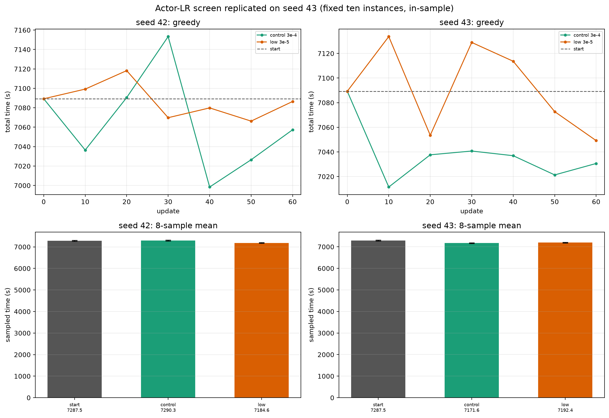

# Seed 43 replication: 60-update actor-LR screen

**Same B42/240 start, same fixed 10×20 bank, same fresh optimizer/entropy/rollout/eval as seed 42; only seed and actor LR differ.**

## 0. Bottom line

- Seed 43 **reproduces the low-LR sampled improvement over start**: start−low **+95.1 s [67.5, 123.3]**, 10/10 instances.
- But it **does not reproduce low LR being better than control**:
  - control−low = **−20.7 s [−42.3, +1.1]** (control slightly faster; direction reverses from seed 42);
  - greedy: control 7030.6 s, low 7049.2 s (control 18.6 s faster).
- Seed 43 also reverses the volatility pattern: control is the smoother curve here; low is more volatile.
- Under the pre-agreed rule, **direction reversal/unclear → do not expand training; retain seed dependence**. No 120-update extension.

**Do not pool the two seeds' trajectories into one confidence interval.** The two rows are separate training-seed replications from the same pretrained start.

## 1. Greedy endpoints and curves

| arm | seed42 final | seed43 final | seed43 start−final | seed43 range | seed43 std | seed43 max adjacent regression | seed43 MAD from start |
|---|---:|---:|---:|---:|---:|---:|---:|
| control | 7057.4 | **7030.6** | **+58.6** | 77.8 | 24.7 | +26.2 | 51.0 |
| low | 7086.5 | 7049.2 | +40.1 | 84.5 | 34.8 | +75.4 | 28.7 |

Seed43 greedy sequence:

- control: 7089.3 → 7011.5 → 7037.7 → 7040.7 → 7036.9 → 7021.3 → **7030.6**
- low: 7089.3 → 7133.7 → 7053.5 → 7128.9 → 7113.7 → 7072.7 → **7049.2**

- Both improve over start; **control improves more**.
- Seed42: low was flatter; seed43: control is flatter. The “low LR is smoother” observation is **not stable across seeds**.
- Seven nodes and one paired training per seed remain descriptive only.

## 2. Endpoint sampling (8 per instance)

| candidate | seed42 sampled | seed43 sampled | seed43 CI | seed43 start−candidate | seed43 control−candidate |
|---|---:|---:|---:|---:|---:|
| start | 7287.5 | 7287.5 | [7264.1, 7310.6] | — | — |
| control | 7290.3 | **7171.6** | [7152.6, 7191.2] | **+115.8 [87.5, 144.6]** | — |
| low | 7184.6 | 7192.4 | [7175.9, 7209.5] | **+95.1 [67.5, 123.3]** | **−20.7 [−42.3, +1.1]** |

Sign: baseline − candidate; positive = candidate faster. Intervals are fixed-ten conditional (only within-instance trajectories resampled; same 8 sampling seeds).

- Seed43 low does improve the sampled average vs start; 10/10 instances.
- Seed43 control improves even more; 9/10 instances.
- Low is **not better than control** in seed43; the point estimate is 20.7 s worse, with CI touching zero.
- Seed42 result (control−low +105.7) and seed43 result (control−low −20.7) have **opposite signs**. This is a seed-dependent result, not a repeatable low-LR advantage.

Per-instance seed43:

- start−low: all 10 positive; max 196.0 s.
- start−control: 9/10 positive; one −2.7 s.
- control−low: 5/10 positive, 5/10 negative; not a consistent per-task advantage.

## 3. Did low LR freeze the model?

| arm | seed42 actor relative L2 | seed43 actor relative L2 | seed43 max abs | seed43 actor SHA prefix |
|---|---:|---:|---:|---|
| control | 10.75% | 8.33% | 0.0517 | `95409bb39c034d78` |
| low | 1.71% | 1.89% | 0.00629 | `c0503d04d4eb113d` |

Low LR again changes parameters much less but is not frozen. Seed43 last-update diagnostics:

| arm | actor LR | entropy coef | approx KL | clip fraction | critic loss | EV |
|---|---:|---:|---:|---:|---:|---:|
| control | 3e-4 | 0.0 | 0.0303 | 0.127 | 7.26 | 0.959 |
| low | 3e-5 | 0.0 | −0.00518 | 0.0137 | 4.36 | 0.975 |

Both entropy schedules end at 0 by update 60; this remains a **short-budget** schedule and cannot explain the old 1000-update run’s 600/1000 behavior.

## 4. Two-seed comparison without pooling

| quantity | seed42 | seed43 | consistent? |
|---|---:|---:|---|
| low − start sampled improvement | +102.9 s | +95.1 s | **yes, both positive** |
| control − start sampled improvement | −2.8 s | +115.8 s | **no** |
| low − control sampled advantage | +105.7 s | −20.7 s | **no, sign reverses** |
| low greedy vs control | −29.1 s (worse) | −18.6 s (worse) | **yes, low worse** |
| low actor relative change | 1.71% | 1.89% | **yes, small** |
| low vs control volatility | low smoother | control smoother | **no** |

So the only two-seed-consistent statements are:

1. low LR makes much smaller actor updates than control;
2. low LR does not improve greedy relative to control in either seed.

The seed42 sampled advantage of low over control **did not replicate**.

## 5. Decision

Per the pre-agreed rule:

- low is not better than start and control on both metrics;
- the low−control sampled direction reverses between seeds;
- therefore **do not extend, do not add seeds automatically, do not change reward/network**.

The short-screen result is now:

> **Low actor LR has a repeatable sampled improvement over the shared start, but not a repeatable advantage over control; its deployment/greedy effect is absent or negative relative to control. Stability remains seed-dependent and unproven.**

No new training was started after this replication. Full checkpoints and backups are in the persistent directory.

## 6. Files

- [seed42 report](fixed_instance_overfit_short_screen.md)
- [seed43 sample summary](fixed_instance_overfit/short_sampled_endpoints_s43.json)
- [seed43 paired stats](fixed_instance_overfit/short_paired_stats_s43.json)
- [seed43 per-instance](fixed_instance_overfit/short_paired_per_instance_s43.csv)
- [seed43 control curve](fixed_instance_overfit/short_control_curve_s43.csv)
- [seed43 low curve](fixed_instance_overfit/short_low_curve_s43.csv)
- [two-seed figure](fixed_instance_overfit/short_lr_screen_2seeds.png)
- Runs: `/home/ps/Desktop/Graph_planning/graph-uav-experiments/overfit20/short/control_s43`, `.../lr3e5_s43`
