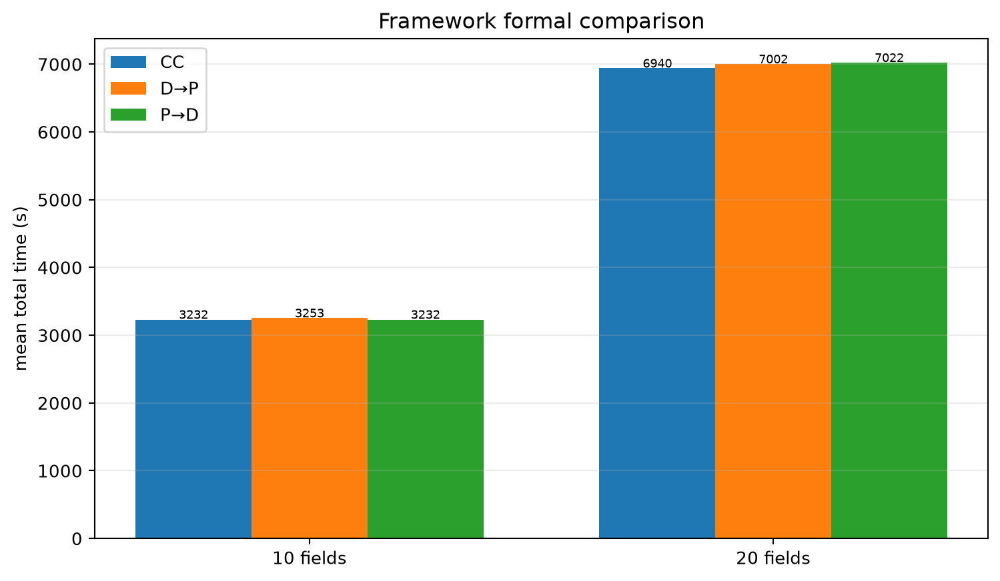
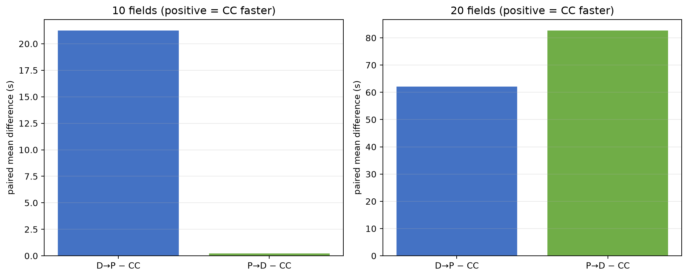
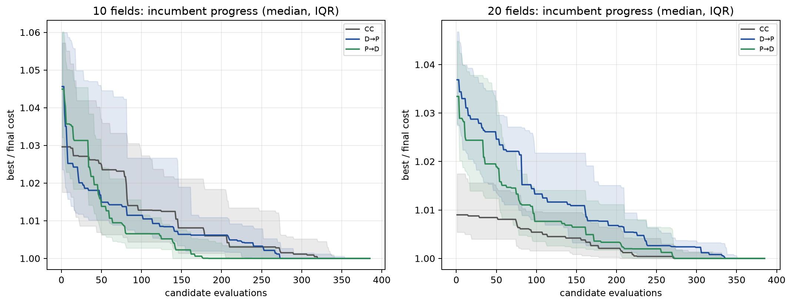
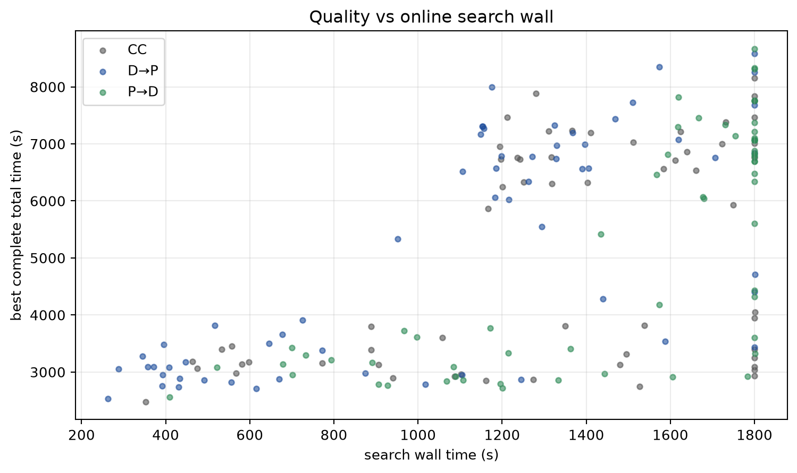

# Framework formal comparison: 10 and 20 fields

**CC, D→P, P→D on shared frozen snapshots; seed42; fixed budget.**
No RL training, no parameter changes after seeing formal results, no 30-field
extension.

## Provenance and gates

- Framework baseline: `b018b89`
- D→P coverage-filter fix: `47fdf97`
- P→D deterministic decode cache: `15b3bfd`
- Acceptance/report commit: `a218997`
- Method:
  **“嵌套GA，每次最多385次候选评估或1800秒搜索时间，先到者停止。”**
- 10-field panel: 30 archived snapshots, seeds 1,500,000–1,500,029
- 20-field panel: 30 archived snapshots, seeds 1,800,000–1,800,029
- No snapshots were regenerated or reset. Each scale has 30 instances × 3
  methods = 90 method searches; both scales = 180 results.
- Formal acceptance receipt: `passed=true`, `domain_verified=true`,
  `search_exercised=true` on 3 new formal-area instances (1,900,400–1,900,402).
- Tests: **62 passed** after the D→P coverage fix and cache.
- No overlap between acceptance and formal panels.

### Original D→P failure

The first formal-area acceptance failed with
`ValueError: Planned strokes do not cover assigned grid points`. The fix filters
incomplete explicit-region sweeps before cost selection. The original failing
instance was rerun with full budget: D→P cost **3184.68 s**, 385 evaluations,
6 complete outer rounds, exact independent replay. The fresh 9-search acceptance
then passed.

### P→D decode cache

Profiling on 1900401 showed that contextual division and connected components
were negligible, while repeated gate planning/validation cost **16.92 s** and a
complete execution **2.38 s** per candidate. The implementation now caches, for
one unchanged outer visit/weight chromosome within one inner quota, only:

- contextual regions and ownership;
- connected repair/task list;
- full-resource feasible gate sets.

It never caches environment state, position, resources, actual gates, paths or
costs. Every inner candidate still executes a complete task on a fresh
environment. Cache is cleared at each new outer candidate; first computation is
inside the wall timer. Fixed-chromosome equivalence was exact for regions,
actions, components, completion and total cost; a full 16-evaluation inner quota
gave 15 hits/1 miss and one execution cost 3768.18 s. The first P→D acceptance
search completed 385 evaluations / 6 outer rounds with 360 hits/25 misses.

## Completion and search budget

| scale | method | completed | wall-limit | mean eval | mean outer rounds | min rounds | mean search |
|---:|---|---:|---:|---:|---:|---:|---:|
| 10 | CC | 30/30 | 7 | 361.8 | 5.50 | 2 | 1140 s |
| 10 | D→P | 30/30 | 3 | 373.0 | 5.77 | 3 | 762 s |
| 10 | P→D | 30/30 | 4 | 368.2 | 5.67 | 2 | 1155 s |
| 20 | CC | 30/30 | 6 | 376.7 | 5.73 | 3 | 1491 s |
| 20 | D→P | 30/30 | 4 | 380.2 | 5.83 | 4 | 1369 s |
| 20 | P→D | 30/30 | 19 | 337.4 | 4.90 | 3 | 1745 s |

No task failures. Wall-limited searches retain a complete incumbent and count in
all statistics. Not every run completed six outer rounds; no convergence or
“all six rounds” claim is made. P→D at 20 fields is the most budget-limited
(19/30 wall), but every run completed at least three outer rounds.

Coverage metric: mean **0.9985** (10) and **0.9996** (20); minimum
**0.9826** / **0.9893**. Completion is the execution gate; the coverage ratio is
reported separately rather than rounded to 100%.

## Main results

All rows are means over all 30 paired instances. Positive differences mean
**CC is faster** (`other − CC`).

### 10 fields

| method | total | work | nonwork | maneuver | service | deducted* |
|---|---:|---:|---:|---:|---:|---:|
| CC | **3231.76** | 1452.05 | 1425.96 | 353.74 | 0 | **1779.71** |
| D→P | 3252.99 | 1444.76 | 1485.97 | 322.26 | 0 | 1808.22 |
| P→D | 3231.96 | 1440.65 | 1475.63 | 315.68 | 0 | 1791.31 |

| comparison | mean | median | 95% paired bootstrap CI | slower/faster/ties | relative | raw p | Holm p |
|---|---:|---:|---:|---:|---:|---:|---:|
| D→P − CC | **+21.23 s** | −8.89 | **[−44.50, +95.97]** | 14/16/0 | +0.66% | 0.578 | 1.000 |
| P→D − CC | **+0.21 s** | −31.17 | **[−53.56, +57.63]** | 12/18/0 | +0.006% | 0.981 | 1.000 |

\*Deducted = nonwork + maneuver + service.

### 20 fields

| method | total | work | nonwork | maneuver | service | deducted* |
|---|---:|---:|---:|---:|---:|---:|
| CC | **6939.65** | 2946.39 | 3378.20 | 615.06 | 0 | **3993.26** |
| D→P | 7001.73 | 2926.66 | 3547.52 | 527.54 | 0 | 4075.06 |
| P→D | 7022.28 | 2928.80 | 3559.25 | 534.23 | 0 | 4093.48 |

| comparison | mean | median | 95% paired bootstrap CI | slower/faster/ties | relative | raw p | Holm p |
|---|---:|---:|---:|---:|---:|---:|---:|
| D→P − CC | **+62.07 s** | +59.54 | **[−42.50, +166.70]** | 21/9/0 | +0.89% | 0.249 | 0.748 |
| P→D − CC | **+82.63 s** | +56.69 | **[−14.44, +184.37]** | 19/11/0 | +1.19% | 0.100 | 0.399 |

The four primary tests were Holm-adjusted together. All CIs cross zero; there
is **no statistically demonstrated difference** between either framework and CC
at either scale. The signs lean toward CC at 20 fields, especially the mean, but
the intervals are compatible with both directions. This is not an equivalence
result and does not establish superiority of any framework.

## Search progress and compute

- D→P at 10 fields is the cheapest search: mean **762 s/search**; P→D is
  **1155 s**; CC is **1140 s**.
- At 20 fields: D→P **1369 s**, P→D **1745 s**, CC **1491 s**.
- Total new D→P/P→D search wall: **150,937 s = 41.93 h**.
- CC search wall shown above is historical; **60 CC results were reused**, not
  rerun. Formal new compute therefore excludes the historical ~21.9 h CC search.
- Formal replay: all 180 method results verified by independent action replay.
- P→D cache mean hits: **344.2 (10)** / **315.0 (20)**, mean misses **24.0/22.5**;
  mean cached decode work avoided **5539.9 s / 5513.1 s per search**. These are
  saved decode computations, not wall-clock guarantees.

## Repair, partition and diversity audit

| metric | 10 fields | 20 fields |
|---|---:|---:|
| P→D repair-added visits mean | 1.2 | 1.67 |
| P→D max added visits | 4 | 4 |
| P→D local geometry probes mean | 5074 | 8637 |
| P→D area error abs mean / max (m²) | 1.60 / 50 | 0.49 / 50 |
| P→D distinct chromosomes mean | 17.7 | 16.9 |
| P→D distinct partitions mean | 17.3 | 16.6 |
| D→P preprocess seconds mean | 15.9 | 13.6 |
| D→P probes mean | 186 | 353 |
| D→P distinct chromosomes mean | 17.3 | 18.5 |
| D→P distinct complete costs mean | 325.1 | 333.9 |

D→P prepartition is frozen once per instance and does not change during the
search; P→D divisions vary with the outer visit/weight chromosome. The
chromosome and partition diversity counts are not collapsed to a single
“converged” solution. P→D area-share errors are small on average but reach 50
m² on individual regions; repair can add up to four visits. No encoding change
was observed to erase all search variation.

## CC reuse

- 60 CC results (30 per scale) were reused after validating snapshot SHA256,
  physical-config fingerprint, full search config, complete-incumbent status and
  independent replay.
- No CC result was rerun for the formal table.
- Adapter provenance and source/target hashes are in
  `cc_adapter10_manifest.json` and `cc_adapter20_manifest.json`.
- The historical CC search times are reported for compute context but are not
  added as new compute.

## Interpretation boundaries

- One GA search seed (42) and one RL training seed; 30 instances are the paired
  unit. CIs describe instance differences, not search/training-seed uncertainty.
- CC, D→P and P→D share the physical executor, resource/time model, coverage and
  completion rules, but their partition/encoding methods differ by design.
- The methods are adapted baselines, not a line-by-line reproduction of any
  paper; no claim of global optimality.
- No sealed test, 30-field extension, added seed or budget was run.
- The 10/20 panels are separate scale reports; no pooled cross-scale mean is
  presented.

## Artifacts

Persistent raw results:
`/home/ps/Desktop/Graph_planning/graph-uav-experiments/framework/formal10_run/`
and `formal20_run/` (90 method JSONs each, contracts, audit, replays).
Acceptance/cache evidence:
`.../framework/acceptance10/run3/` plus `profile_stages_1900401.json`,
`cache_equivalence.json`, `cache_inner.json`.

Committed summaries and plots are in this directory; hashes are in
`artifact_hashes.json`.
