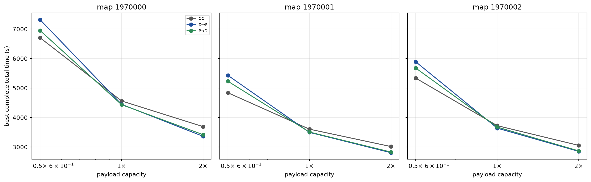
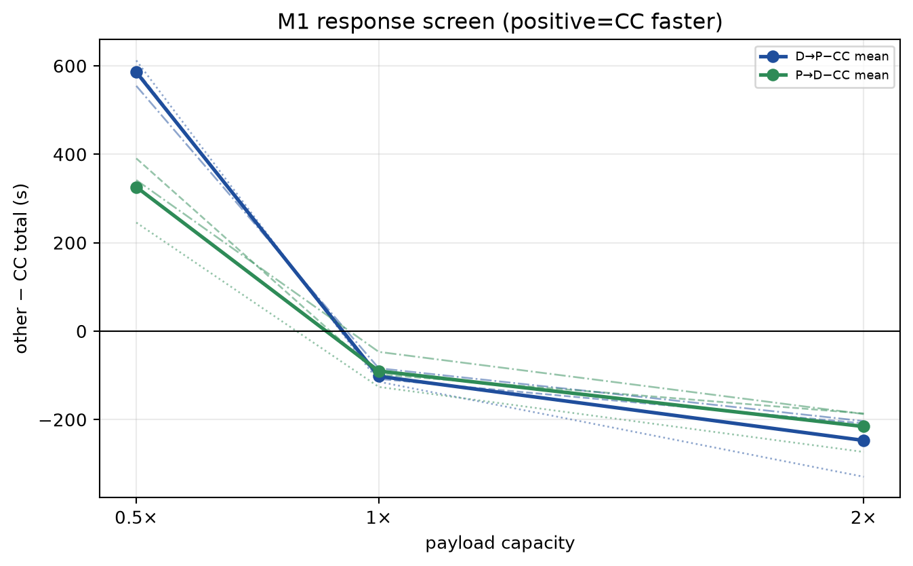
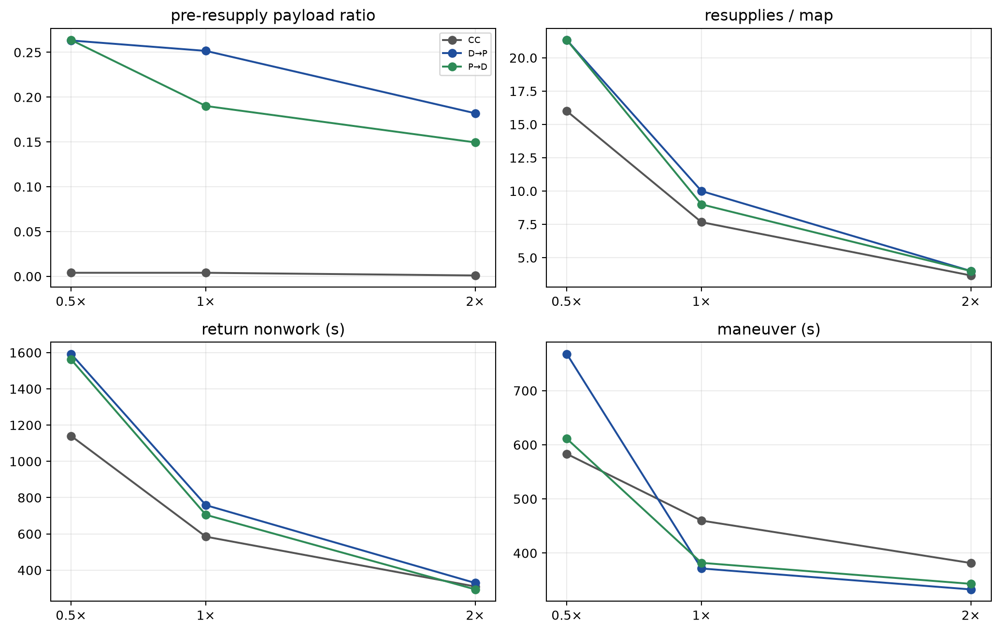

# M1 payload capacity response screen

**Development experiment; 3 maps only. No M2, no training, no added seed.**

## Setup

- Maps: 3 new fixed 10-field snapshots, seeds **1,970,000–1,970,002**, formal area.
- Payload: 0.5×, 1×, 2× of the snapshot's original 50-unit max payload:
  **25 / 50 / 100**.
- Methods: CC, D→P, P→D.
- Search seed42; outer4/scored6, inner8/2, 385 evaluations or 1800 s; max_steps500.
- 27 cells. All 27 completed; **0 failures**.
- Recorded search wall: **38,534.7 s = 10.70 h**. Global ceiling 13.5 h; no stop.
- One initial calibration search was discarded by a harness manifest-key bug; one harness
  print bug occurred after five cells, but those five results were saved and reused.
  The lost calibration search is disclosed as harness overhead; it is not in the 27 results.

## Capacity correctness

For every cell the run summary contains the actual capacity (25/50/100), not just a factor.
D→P/P→D were constructed fresh at each capacity; no original-capacity partition, gate set,
repair result or decode cache was reused. CC also started from a fresh snapshot copy.
Every complete incumbent was independently replayed; no ledger mismatch or exception occurred.

## Results

Total time (s):

| map | capacity | CC | D→P | P→D |
|---:|---:|---:|---:|---:|
| 1970000 | 0.5× | 6705.4 | 7317.5 | 6950.9 |
| 1970000 | 1× | 4560.7 | 4446.2 | 4434.5 |
| 1970000 | 2× | 3690.2 | 3360.8 | 3416.9 |
| 1970001 | 0.5× | 4839.3 | 5429.5 | 5229.9 |
| 1970001 | 1× | 3604.2 | 3496.2 | 3506.4 |
| 1970001 | 2× | 3014.3 | 2805.6 | 2828.1 |
| 1970002 | 0.5× | 5336.0 | 5890.5 | 5677.6 |
| 1970002 | 1× | 3722.7 | 3638.6 | 3675.7 |
| 1970002 | 2× | 3053.4 | 2849.8 | 2865.8 |

### Primary interaction

Differences are other − CC; positive means CC faster.

| capacity | D→P−CC mean | P→D−CC mean | per-map D/P−CC |
|---:|---:|---:|---|
| 0.5× | **+585.6 s** | **+325.9 s** | all three maps positive |
| 1× | **−102.2 s** | **−90.3 s** | all three maps negative |
| 2× | **−247.2 s** | **−215.7 s** | all three maps negative |

Descriptive endpoint interaction (0.5× minus 2×):

- D→P: **585.6 − (−247.2) = 832.8 s**
- P→D: **325.9 − (−215.7) = 541.6 s**

Relative to 1×, the same contrasts are +687.8/−145.0 s (D→P) and +416.2/−125.4 s
(P→D). The sign **reverses on every one of the three maps**: at 0.5× CC is faster; at
1×/2× D/P is faster. These are three-map observations, not a confirmed population
effect. With only three maps, no population p-value or CI is claimed.

### Search budget is a measured confound

Mean candidate evaluations by cell:

| capacity | CC | D→P | P→D |
|---:|---:|---:|---:|
| 0.5× | 184.7 | 170.3 | 110.7 |
| 1× | 294.3 | 385.0 | 297.7 |
| 2× | 360.0 | 385.0 | 374.7 |

**All nine 0.5× searches hit the 1800 s wall.** On instance 1970000, D→P at 0.5×
had only **54 evaluations**, below the 65 needed for initialization plus the initial outer
population. Low-load results are therefore results under the fixed online budget, not a
clean decomposition of capacity-matching alone.

### Mechanism response

| capacity | comparison | resupply diff | return nonwork diff | maneuver diff | pre-resupply payload residual diff |
|---:|---|---:|---:|---:|---:|
| 0.5× | D→P−CC | +5.33 | +452.3 | +184.6 | +0.26 |
| 0.5× | P→D−CC | +5.33 | +421.4 | +28.1 | +0.26 |
| 1× | D→P−CC | +2.33 | +174.0 | −88.5 | +0.25 |
| 1× | P→D−CC | +1.33 | +120.6 | −78.0 | +0.19 |
| 2× | D→P−CC | +0.33 | +19.4 | −48.7 | +0.18 |
| 2× | P→D−CC | +0.33 | −16.1 | −38.4 | +0.15 |

At 0.5× D/P makes many more resupplies and returns, and its maneuver cost is *higher*;
at 2× the resupply gap nearly vanishes and D/P maneuver is lower. The path-cost structure
itself changes with capacity, so “CC always trades more maneuver for fewer resupplies”
is not a fixed rule. The pattern is consistent with capacity matching plus return cost,
but the experiment does not prove causality and does not establish a monotonic
“lower payload favors CC” law.

## Answers to the layered M1 questions

**Primary:** payload capacity does change the framework total-time difference in this
small screen; the direction reverses between 0.5× and 1×/2×. This is a development
interaction, not a population inference.

**Mechanism:** the reversal is accompanied by corresponding changes in resupply frequency,
pre-return payload residual, return nonwork and maneuver. The pattern is consistent with
capacity matching plus extra return cost; it does not prove that those terms cause the
total difference.

No claim is made that D/P is generally better or worse, or that the 2× result generalizes.

## Compute and limits

- Recorded 27-search wall: 10.70 h; plus one discarded ~0.5 h calibration search.
- All searches were sequential; no parallel resource contention.
- Three maps, one search seed and one RL seed. This is an exploratory response screen,
  not M2.
- Search-budget differences are reported as a covariate; they are not used to declare the
  mechanism proven or rejected.
- No payload experiment beyond 0.5/1/2, no base relocation, no M2.

## Artifacts

Persistent raw results:
`/home/ps/Desktop/Graph_planning/graph-uav-experiments/framework/m1_payload/`

- `payload_cells.csv`, `payload_effects.csv`, `payload_summary.json`
- `cost_response.png`, `difference_response.png`, `mechanism_response.png`
- map manifest/generation log/config
- full result JSONs and replay checks in `results/`
