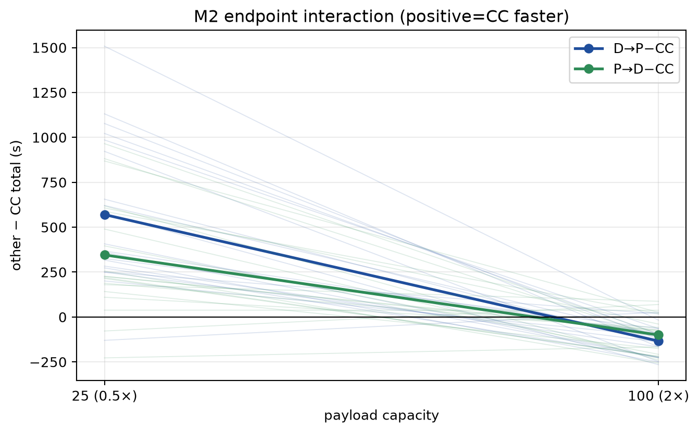
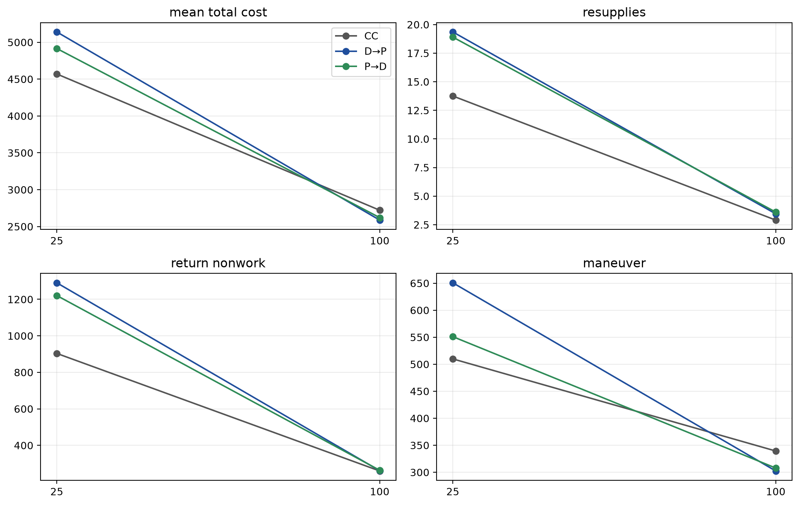
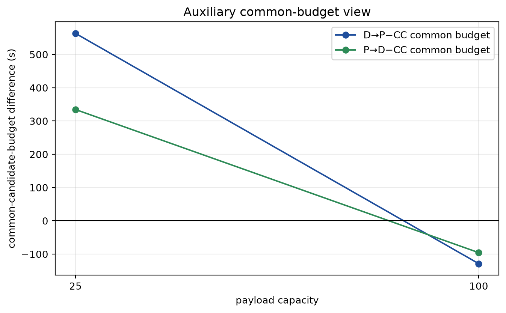

# M2 payload endpoint validation

**Independent follow-up to M1. Two endpoints (25,100), 20 new maps, 120 searches.**
This is not M3; no additional capacity, seed, map or tuning.

## Design and provenance

- 20 new fixed 10-field maps: **1,980,000–1,980,019**, no overlap with M1 maps.
- Endpoints: **25** (0.5×) and **100** (2×) payload units, selected after the M1
  development screen. This selection is disclosed; M1 and M2 are not one preregistered
  sample.
- CC, D→P, P→D; same map, energy capacity, time/cost model.
- seed42; outer4/scored6, inner8/2; max 385 evaluations or 1800 s; max_steps500.
- 120 cells. All **120/120** completed; 0 failures.
- Search wall: **40.74 h**. Every complete incumbent was independently replayed.
- Capacity is in each result; D→P/P→D were rebuilt fresh at each capacity, with no
  original-capacity partition/gate/cache reuse.

## Endpoint results

Mean total time (s):

| capacity | CC | D→P | P→D |
|---:|---:|---:|---:|
| 25 | 4569.3 | 5139.3 | 4914.8 |
| 100 | 2720.7 | 2586.9 | 2620.7 |

Differences are other−CC; positive = CC faster.

| capacity | D→P−CC | P→D−CC | D→P slower/faster | P→D slower/faster |
|---:|---:|---:|---:|---:|
| 25 | **+570.1 s** | **+345.5 s** | 19/1 | 18/2 |
| 100 | **−133.8 s** | **−100.0 s** | 2/18 | 5/15 |

### Primary interactions

For each map, `I = d25 − d100`:

| interaction | mean | 95% map-bootstrap CI | positive/negative maps | raw p | Holm p |
|---|---:|---:|---:|---:|---:|
| D→P | **+703.9 s** | **[+527.6,+883.8]** | 19/1 | 0.0002 | **0.0004** |
| P→D | **+445.5 s** | **[+299.9,+593.5]** | 18/2 | 0.0002 | **0.0004** |

The M1 direction replicated on 20 new maps: CC is faster at low payload, D/P is faster at
high payload, and the endpoint interaction is positive with CIs excluding zero. The two
interaction tests were Holm-adjusted together. These intervals resample **whole maps**, not
candidate evaluations; they do not establish performance outside these maps.

## Mechanism

| capacity | method | resupplies | departures | coverage/trip | pre-resupply payload ratio | return nonwork | maneuver | nonreturn nonwork |
|---:|---|---:|---:|---:|---:|---:|---:|---:|
| 25 | CC | 13.75 | 14.75 | 8091 | 0.00 | 903.4 | 509.8 | 1626.6 |
| 25 | D→P | 19.35 | 20.35 | 5909 | 0.29 | 1290.2 | 650.6 | 1692.6 |
| 25 | P→D | 18.90 | 19.90 | 6030 | 0.28 | 1220.5 | 550.9 | 1634.9 |
| 100 | CC | 2.90 | 3.90 | 30704 | 0.00 | 259.6 | 339.3 | 618.9 |
| 100 | D→P | 3.45 | 4.45 | 27071 | 0.17 | 260.9 | 302.4 | 531.4 |
| 100 | P→D | 3.60 | 4.60 | 26148 | 0.17 | 263.3 | 307.8 | 558.3 |

At 25, D/P has roughly **5.6/5.2 more resupplies**, much higher return nonwork, and higher
maneuver; CC is faster. At 100, the resupply gap shrinks to **0.55/0.70**, return nonwork is
nearly equal, D/P has lower non-return nonwork and lower maneuver, and D/P is faster. CC’s
pre-resupply payload is essentially exhausted at both capacities; D/P returns with about
17–29% payload remaining. The path-cost structure itself changes with capacity.

This supports a **capacity-match / return-cost** interpretation, but it does not isolate
that mechanism from search-budget effects or prove causality.

## Search budget and common-candidate auxiliary

| capacity | method | mean evaluations | wall-limit | mean full outer rounds | mean search time |
|---:|---|---:|---:|---:|---:|
| 25 | CC | 232.5 | 14/20 | 3.30 | 1630 s |
| 25 | D→P | 215.2 | 14/20 | 2.95 | 1532 s |
| 25 | P→D | 179.3 | 18/20 | 2.30 | 1738 s |
| 100 | CC | 368.8 | 4/20 | 5.65 | 1068 s |
| 100 | D→P | 385.0 | 0/20 | 6.00 | 395 s |
| 100 | P→D | 383.4 | 1/20 | 5.95 | 970 s |

The 25 endpoint is strongly wall-limited; the 100 endpoint is mostly evaluation-limited.
This is a real confound: the primary result is conditional on fixed online budget.

A read-only common-candidate-budget check used each map/capacity’s minimum completed
evaluation count across methods and the saved incumbent curves; no runs were added:

| capacity | D→P−CC common-budget | P→D−CC common-budget |
|---:|---:|---:|
| 25 | **+563.3 s** | **+334.5 s** |
| 100 | **−128.9 s** | **−95.8 s** |

The reversal persists under this auxiliary common-candidate view, but this does not remove
the wall-time/search-difficulty confound or establish a causal capacity effect.

## Interpretation

- **Conditional advantage, not universal superiority:** CC is favored at 25; D/P is
  favored at 100. All conclusions are fixed-budget results on these 20 maps.
- The low/high mechanics move in the expected direction: extra resupply/return cost at 25,
  and lower D/P non-return/maneuver cost at 100.
- M1→M2 endpoints were selected after seeing M1; M2 is an independent-map follow-up, not
  a fully preregistered first-stage confirmation.
- No M3, no additional capacities, no RL training.

## Artifacts

- `m2_cells.csv`, `m2_summary.json`
- `interaction.png`, `mechanism.png`, `common_budget.png`
- map manifest/generation log/config
- `run_summary.json`, tests, run log
- Raw 120 results and replay traces remain in the persistent framework directory.
