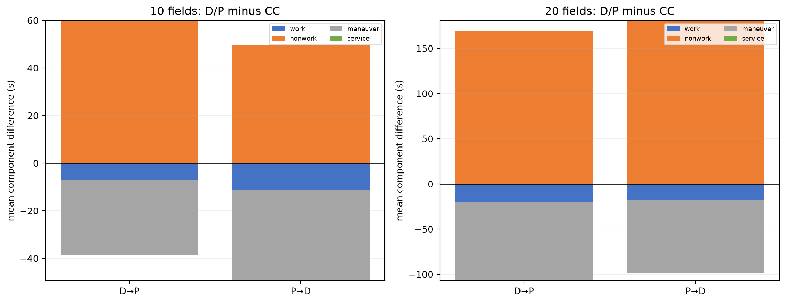
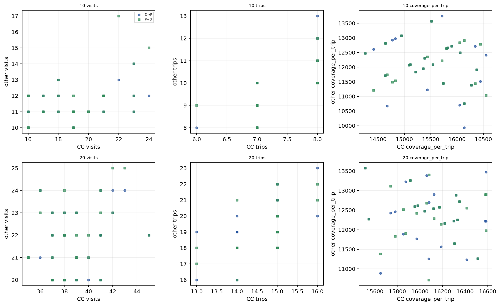
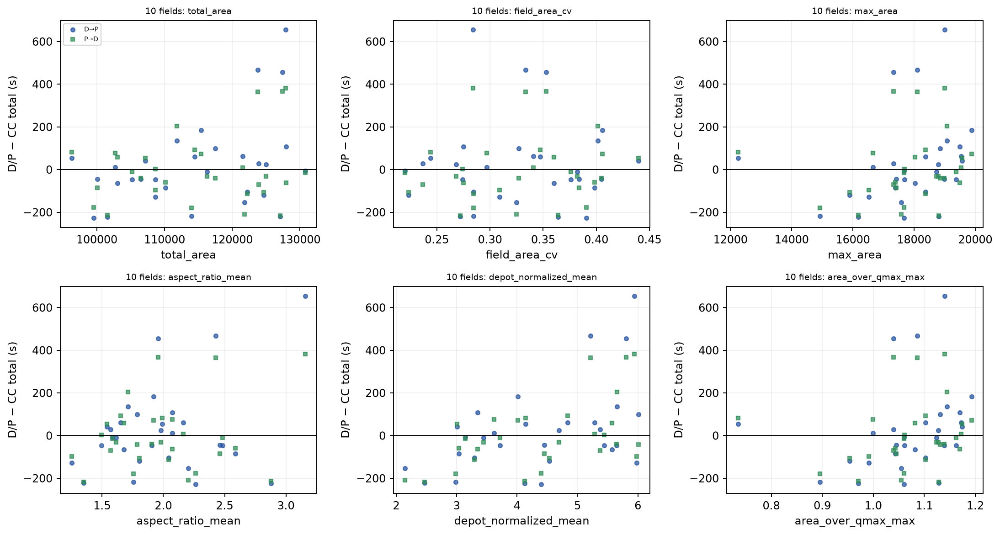
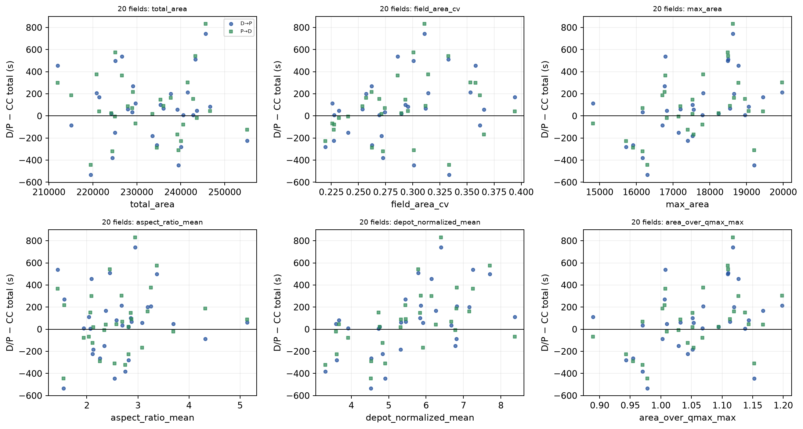
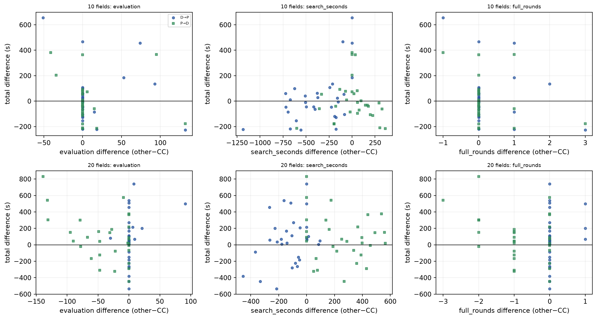

# M0: trajectory mechanism diagnosis for the framework formal experiment

**Read-only replay of archived CC, D→P and P→D actions. No new GA candidates, no new RL
policy, no changed plans, no payload experiment, no M1.**

## Scope and data

- Input formal report commit: `cc7fd27`
- 10-field panel: 30 frozen snapshots, seeds 1,500,000–1,500,029
- 20-field panel: 30 frozen snapshots, seeds 1,800,000–1,800,029
- 180 archived complete-method traces (30 × 3 methods × 2 scales)
- Snapshots, manifests, configurations and result identities were read from:
  - `framework/formal10_manifest.json`
  - `framework/formal20_manifest.json`
  - `framework/formal10_run/` and `formal20_run/`
- `framework_mechanism_experiment_design.md` was not present; M0 follows the supplied
  prompt and stops before M1/M2.

No file was regenerated or reset. The original result JSON and snapshots were not modified.

## Replay and closure

Trace adapters:

- CC: match archived `(field, entry, exit)` action to the current legal CC action
  candidate, then execute the original area action (never re-plan it).
- D→P/P→D: parse the saved explicit-region plan; execute the exact saved plan, or the saved
  pre-refill plan path when `resupply_before` is true. No region is regenerated.

Measured run:

- 6-trace timing sample: **6.52 s**
- projected/full 180 replays: **273.62 s** (4.56 min), well under the 4 h threshold
- 180/180 archived traces completed and returned to depot
- maximum archived-summary difference: **0.0** for the tested ledger fields
- maximum time-closure error: **2.73e-12 s**
- ledger total: **3,739 visits, 2,382 trips, 2,382 events**
- every field had **0 uncovered points** at the end
- no replay error, program exception, missing action, or non-finite value

The ledger's visit + event components and trip components close to the archived total:
maximum absolute visit+event closure error **2.73e-12 s**; maximum trip closure error
**2.73e-12 s**. Cost categories are work, nonwork, maneuver, service, and return/resupply;
none are filled by estimation.

## Mechanism results

All effects are **D/P − CC**, instance-paired. **Positive means CC faster.** CIs are
10,000 instance bootstrap intervals. No p-values are reported for this exploratory
mechanism family; the formal cost tests and their Holm correction are in the formal report.

### Operational structure (means; differences with 95% CI)

| scale | method | visits | trips | resupplies | coverage/trip | return distance | return time |
|---:|---|---:|---:|---:|---:|---:|---:|
| 10 | CC | 19.13 | 7.43 | 7.43 | 15505 | 3771 | 475 |
| 10 | D→P | 11.33 | 9.60 | 9.60 | 12114 | 4981 | 629 |
| 10 | P→D | 11.63 | 9.53 | 9.53 | 12118 | 4900 | 619 |
| 20 | CC | 38.87 | 14.63 | 14.63 | 16105 | 9975 | 1254 |
| 20 | D→P | 21.67 | 19.13 | 19.13 | 12355 | 12581 | 1587 |
| 20 | P→D | 22.00 | 19.07 | 19.07 | 12393 | 12596 | 1591 |

Paired differences:

| metric | 10 D→P−CC | 10 P→D−CC | 20 D→P−CC | 20 P→D−CC |
|---|---:|---:|---:|---:|
| visits | −7.8 [−8.5,−7.0] | −7.5 [−8.2,−6.8] | −17.2 [−18.0,−16.4] | −16.9 [−17.7,−16.0] |
| trips | +2.17 [+1.83,+2.53] | +2.10 [+1.87,+2.33] | +4.50 [+4.10,+4.93] | +4.43 [+4.07,+4.83] |
| resupplies | +2.17 [+1.83,+2.53] | +2.10 [+1.87,+2.33] | +4.50 [+4.10,+4.93] | +4.43 [+4.07,+4.83] |
| coverage/trip | −3391 [−3832,−2960] | −3387 [−3726,−3064] | −3750 [−4030,−3475] | −3712 [−3962,−3459] |
| return distance | +1210 [+920,+1504] | +1128 [+950,+1305] | +2607 [+2221,+3031] | +2621 [+2221,+3074] |
| return time | +153 [+117,+190] | +143 [+121,+165] | +333 [+284,+386] | +336 [+286,+394] |

D→P/P→D have **fewer coverage visits but more depot trips/resupplies**, lower coverage
per trip, and longer return distance/time. CC has more visits but fewer trips.

### Cost decomposition

| scale | comparison | total | work | nonwork | maneuver | service | total−work |
|---:|---|---:|---:|---:|---:|---:|---:|
| 10 | D→P−CC | +21.2 [−45.7,+97.3] | −7.3 [−13.8,−0.9] | +60.0 [+1.6,+126.3] | −31.5 [−47.2,−15.2] | 0 | +28.5 [−38.2,+105.7] |
| 10 | P→D−CC | +0.2 [−53.5,+60.0] | −11.4 [−18.1,−4.8] | +49.7 [−0.4,+105.4] | −38.1 [−52.3,−23.5] | 0 | +11.6 [−42.6,+72.3] |
| 20 | D→P−CC | +62.1 [−38.1,+167.9] | −19.7 [−29.8,−9.6] | +169.3 [+76.1,+265.9] | −87.5 [−103.5,−69.7] | 0 | +81.8 [−19.1,+188.1] |
| 20 | P→D−CC | +82.6 [−11.9,+183.8] | −17.6 [−27.7,−7.5] | +181.0 [+94.4,+272.1] | −80.8 [−94.9,−65.9] | 0 | +100.2 [+5.9,+201.7] |

The components sum to the total difference. D/P's nonwork penalty is partly offset by
lower work and maneuver; total cost differences are not demonstrated.

### Resupply state

| scale | method | pre-resupply energy ratio | pre-resupply payload ratio |
|---:|---|---:|---:|
| 10 | CC | 0.633 | 0.004 |
| 10 | D→P | 0.735 | 0.273 |
| 10 | P→D | 0.733 | 0.268 |
| 20 | CC | 0.628 | 0.004 |
| 20 | D→P | 0.726 | 0.259 |
| 20 | P→D | 0.724 | 0.255 |

CC resupplies with essentially depleted payload; D→P/P→D return with roughly a quarter
of payload still aboard. This is **not automatically waste**: the remaining payload may be
unusable for the next fixed/region task under energy or return-reserve constraints.
D→P/P→D resupply triggers are all `fixed_region_requires_refill`; CC triggers are
`no_feasible_coverage_action`.

### Fragmentation and path structure

- Every assigned region in every best trace has **1 grid-adjacency component**.
- Assigned-area overlap (`assigned−new` / assigned) is **0** for all methods.
- P→D repair adds **1.20 visits (10)** / **1.67 visits (20)** on average, max **4**;
  area-share absolute error mean **1.60/0.49 m²**, max **50 m²**.
- P→D distinct chromosomes/partitions in the search audit: **17.7/17.3 (10)**,
  **16.9/16.6 (20)**.
- D→P prepartitions once; tasks mean **11.3/21.7**; preprocessing **15.9/13.6 s**;
  local probes **186/353**. The result schema stores one fixed task list, not a
  candidate-level partition history, so the implementation is frozen by design but
  the archived JSON alone does not independently prove per-candidate invariance.
- P→D cache: **344.2/315.0 hits**, **24.0/22.5 misses**, saved decode work **5539.9/5513.1 s**
  per search. This reduces repeated decode/probe work but does not eliminate the
  1800 s budget limitation.

Thus the observed CC maneuver difference is **not** explained by disconnected assigned
regions or duplicate-area ownership. CC has more visits and higher transfer exposure;
the data support an association, not a causal decomposition.

## Initial features and exploratory associations

Features were computed only from initial snapshots:

- total and per-field area, area mean/std/CV
- aspect ratio from the **minimum rotated rectangle**
- depot distance and nearest-field distance, normalized by √area
- Qmax = max_payload / payload_per_area and area/Qmax

No feature uses a method outcome. `payload_per_area=0` would make Qmax/ratio null; no such
case occurred here.

Exploratory Pearson associations with the **total** D/P−CC difference (not causal;
no variable selection or p-value search):

| scale | association | r |
|---:|---|---:|
| 10 | depot-normalized mean vs D→P−CC | +0.48 |
| 10 | depot-normalized mean vs P→D−CC | +0.52 |
| 20 | depot-normalized mean vs D→P−CC | +0.55 |
| 20 | nearest-normalized minimum vs D→P−CC | −0.50 |
| 20 | nearest-normalized minimum vs P→D−CC | −0.55 |

Larger/farther/denser-adjacent maps are moderately associated with a larger D/P penalty,
but the panels are 30 maps and these are post-hoc associations.

## Search budget association

At 20 fields P→D has 13 more wall-limit runs on average (+0.43 rate), 39 fewer evaluations
and 0.83 fewer completed outer rounds than CC; D→P has only a small wall/evaluation
difference. At 10 fields the wall differences are small and negative. The same search
budget explanation therefore does not apply uniformly to both methods or scales.

## Selected cases

The 12 cases below are fixed by the 25/50/75 quantiles of the paired total difference
within each scale/comparison; ties by `instance_id`. They are **post-hoc explanatory
cases**, not independent validation.

| scale | comparison | q | instance | difference (s) |
|---:|---|---:|---|---:|
| 10 | D→P−CC | 25 | 1500000 | −104.18 |
| 10 | D→P−CC | 50 | 1500015 | −10.64 |
| 10 | D→P−CC | 75 | 1500008 | +61.36 |
| 10 | P→D−CC | 25 | 1500029 | −96.98 |
| 10 | P→D−CC | 50 | 1500006 | −30.75 |
| 10 | P→D−CC | 75 | 1500020 | +72.18 |
| 20 | D→P−CC | 25 | 1800000 | −151.51 |
| 20 | D→P−CC | 50 | 1800010 | +57.79 |
| 20 | D→P−CC | 75 | 1800013 | +207.07 |
| 20 | P→D−CC | 25 | 1800001 | −78.12 |
| 20 | P→D−CC | 50 | 1800017 | +44.19 |
| 20 | P→D−CC | 75 | 1800018 | +216.30 |

Route plots with common field/depot scales are in [`case_routes/`](case_routes/).
The negative and positive quantiles are both shown; no CC-winner-only selection.

## Counterfactual probe

**Not run.** The three methods do not share one legal decision space at the pre-resupply
state:

- CC: a `CoverageAction` from the current action mask;
- D→P: a frozen `RegionTask` plus its precomputed feasible gate pair;
- P→D: a contextual region assignment/repair plus a gate key.

Using a CC action on a D→P/P→D state would cross decision spaces and would not be a legal
D→P/P→D decoder action. The required probe budget (3600 s) was not used. See
[`counterfactual.json`](counterfactual.json). No early-resupply claim is made.

## Missing/unavailable data

- `framework_mechanism_experiment_design.md` was absent on the remote; not fabricated.
- The archived D→P result contains one fixed task list, not a per-candidate partition log;
  fixed-partition behavior is supported by code/result structure, not a candidate-by-
  candidate audit.
- Counterfactual early-resupply outcomes are unavailable by design as explained above.
- Perimeter/compactness was not computed; region connectivity uses only the original grid
  neighbor graph, not a convex hull proxy.
- All other requested ledger fields were present; unknown values were not coerced to 0.

## A/B/C/D conclusions

### A. Mechanisms supported by existing evidence

1. D→P/P→D trade fewer coverage visits for **more depot trips/resupplies**, lower
   coverage per trip, longer return distance/time, and higher nonwork.
2. CC fills payload much closer to exhaustion before refilling (payload ratio 0.004 vs
   ~0.26–0.27); D/P return with substantial payload remaining and fixed-region refill
   triggers. This is consistent with the next fixed/contextual region not fitting, but
   does not prove an early-resupply error.
3. CC has more visits and higher maneuver; D/P has lower work and maneuver that offset
   much of its nonwork penalty. Total differences remain statistically unresolved in the
   formal intervals.
4. P→D repair changes visit count modestly and has small average area errors; disconnected
   regions and duplicate ownership are not supported as explanations.
5. P→D at 20 fields is the most budget-limited (19/30 wall; fewer evaluations and rounds).
   Statistical uncertainty and compute-budget differences can coexist.

### B. Explanations weakened by the data

- “CC simply makes fewer visits”: false; CC has substantially more visits.
- “CC wins because its regions are more compact/less fragmented”: not supported here;
  all assigned regions are connected and overlap is zero.
- “D/P uses fewer trips”: false; D/P uses more trips/resupplies and has lower coverage
  per trip.
- “The total-cost gap is uniform and significant”: not supported; formal cost CIs cross
  zero at both scales, and the 20-field D/P signs are mixed across instances.
- “P→D repair or search budget alone explains the difference”: repair is modest and the
  budget direction differs between D/P and P→D; neither is a uniform explanation.

### C. Mechanisms still not identified

- Why D/P returns with payload remaining on some instances: energy/return reserve, fixed
  task infeasibility, gate/entry effects, or path/heading costs cannot be separated from
  the archived ledger alone.
- Causal effect of one additional earlier/later resupply on total mission cost.
- Whether CC’s extra visits/maneuver are boundary connections, field-transition choices,
  or sweep geometry; only aggregate path categories are available.
- Generalization beyond one search seed, one RL seed, and these 60 maps.

### D. One priority scenario hypothesis for follow-up

**Resource-scarcity hypothesis:** under uniformly reduced payload capacity (or increased
area/Qmax for the same fleet), D→P/P→D’s extra trips, resupplies and nonwork penalty grow
relative to CC, while CC’s extra visit/transfer cost grows more slowly; therefore the
D/P−CC total difference should increase under scarcity.

**Falsifier:** if the same reduction in Qmax does not increase D/P−CC trips/resupplies or
total cost, or if CC’s nonwork increases at least as much, the hypothesis is rejected.
This is a hypothesis for a future resource experiment, not an M0 result. No such
experiment was run here.

## Reproducibility

Scripts:

- `scripts/maneuver_time/m0_trajectory_diagnosis.py`
- `scripts/maneuver_time/m0_stats.py`
- `scripts/maneuver_time/m0_plots.py`
- `coverage_env/analysis/framework_mechanism.py`
- `coverage_env/tests/test_framework_mechanism.py`

Tests: **67 passed** (framework regression + M0 tests). See `tests_all.log`.

Run time: sample 6.52 s; full 273.62 s. No counterfactual probe time was used.

Artifacts include:

- `visits.csv`, `events.csv`, `trips.csv`, `fields.csv`
- `replay.csv`, `mechanism_instance.csv`, `features_enriched.csv`
- `mechanism_summary.json`, `case_selection.csv`
- `cost_decomposition.png`, `paired_structure.png`, `features_10.png`, `features_20.png`,
  `search_budget.png`, `case_routes/`
- `counterfactual.json`, `artifact_hashes.json`

Raw snapshots, 180 result JSONs and full action traces remain in the persistent framework
directories; this M0 notebook does not rewrite them.

## Stop state

M0 stops here. No M1/M2, no payload-change experiment, no new search seed, no RL training,
and no change to the original framework results.
