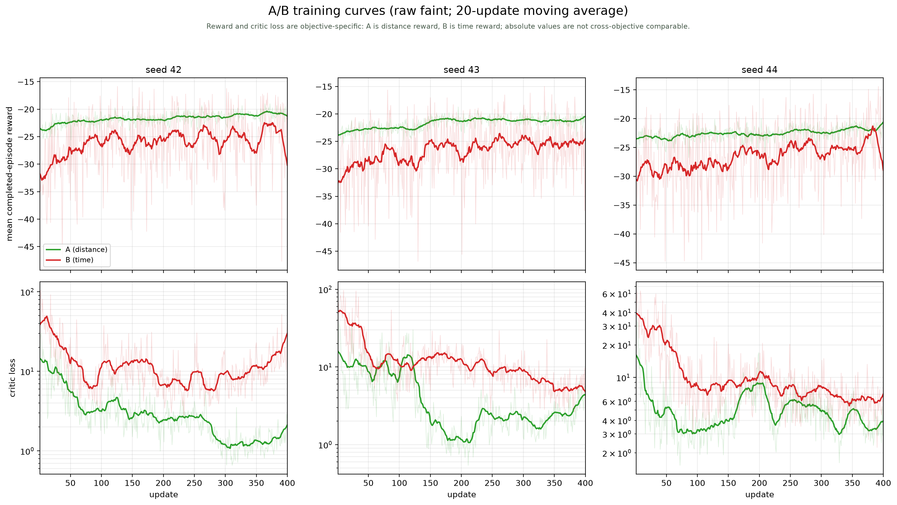
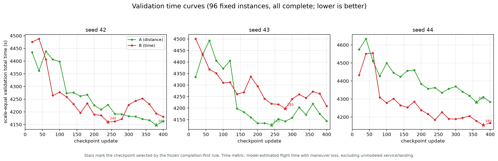

# A/B 训练曲线

数据：修正后 v2 的六个 run（A/B × seed 42/43/44），400 updates、128 rollout steps。
A42 的 1–140、141–200、201–400 日志分别来自暂停前的旧目录、gate v1 目录和 gate v2 目录；
绘图时按 update 拼接，代码版本边界见文档 `maneuver_time_gate_hardening*.md`。

## 训练曲线

- 上排：`mean_ep_reward`，即 rank0 **完成 episode** 的 raw reward 均值；细线为每个 update，粗线为 20-update 移动平均。
- 下排：critic loss，对数纵轴；同样细线为原始值、粗线为移动平均。
- A 是 distance reward，B 是 time reward；**两者绝对高度不可直接比较**，只能看各自随 update 的变化。
- `mean_ep_reward` 是 rank0、仅完成 episode 的指标，不是全局训练指标；`balanced_reward` 也不用于这里。

## 验证时间曲线

- 固定验证集 `40000-40095`，每个 checkpoint 96 个实例；六个 run 的所有 20 个 checkpoint 均 **96/96 完成**。
- 纵轴是规模等权平均 `total_time`；越低越好。星号是冻结规则选中的 checkpoint。
- 选中 update：A42 380、B42 240、A43 240、B43 280、A44 360、B44 380。
- 验证集已反复用于开发/选择，不是 sealed；这里只显示训练过程中的验证趋势，不替代最终测试。

验证曲线与最终测试的方向一致：seed42/43 的 A 在选中点略低，seed44 的 B 明显更低；但验证集只有 96 个实例，不能单独作为最终结论。

时间指标：**“模型估计的飞行时间，含机动损耗，不含未建模的补给服务及起降耗时”**。

## 文件

- [训练日志合并 CSV](maneuver_time_diagnostics/ab_training_logs.csv)
- [验证曲线与选中点 JSON](maneuver_time_diagnostics/ab_curves_data.json)
- [训练曲线 SVG](maneuver_time_diagnostics/ab_training_curves.svg)
- [验证曲线 SVG](maneuver_time_diagnostics/ab_validation_time_curves.svg)
