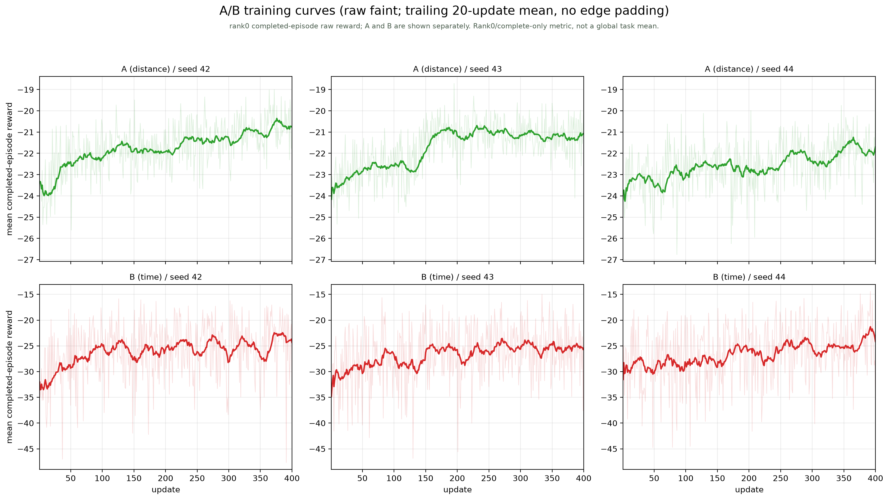
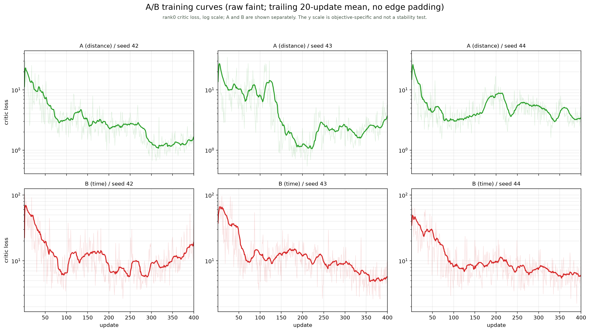
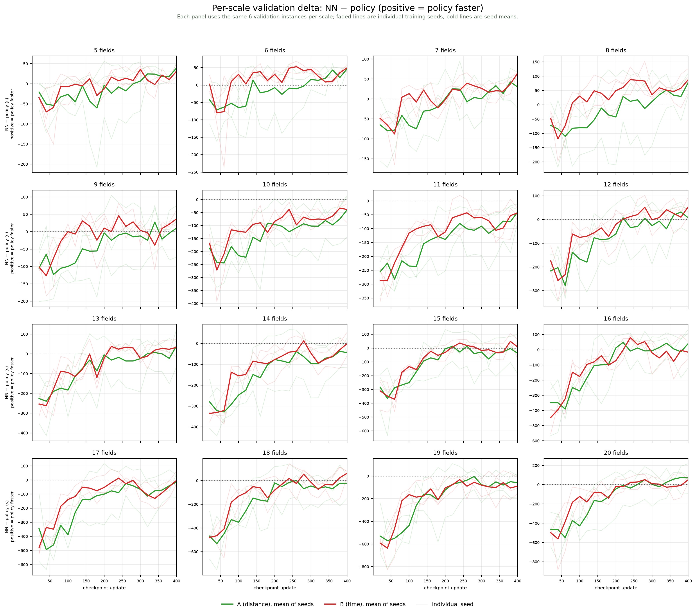

# A/B 训练与固定验证曲线（更正版）

数据：修正后 v2 的六个 run（A/B × seed 42/43/44），400 updates、128 rollout steps。
A42 的 1–140、141–200、201–400 日志分别来自暂停前的旧目录、gate v1 目录和 gate v2 目录；
绘图时按 update 拼接。这里只修正展示与分析，没有改 reward、网络或训练超参数。

## 0. 先更正旧图的两个问题

旧图使用边界复制填充的居中平滑，最后一个平滑点中最后一次 update 约占一半权重，
制造了末端急跌：

| run | 最后原始 reward | 真正最后 20 次均值 | 旧图终点 | 新图终点 |
|---|---:|---:|---:|---:|
| B42 | −33.95 | **−24.33** | −30.17 | **−24.33** |
| B44 | −34.75 | **−24.16** | −28.93 | **−24.16** |

新图改为**不补边的后向移动平均**：每个 update 只平均它之前（含自身）最多 20 个值。
因此末端不再被最后一次低值放大。

另外，`mean_ep_reward` 是 **rank0、仅完成 episode、raw reward** 的均值，同时随
地块规模、面积、布局、完成 episode 数和策略动作变化；它不是四卡全局任务均值，
也不适合用来判断“策略是否整体变差”。

## 1. 固定验证集：六次都在学习，后期收益变小

验证集 `40000-40095`，每次评估 96 个相同实例；所有 checkpoint 均 96/96 完成。
下表是规模等权平均 `total_time`（秒）：

| run | update 20 | update 200 | update 400 | 20→400 节省 | 200→400 |
|---|---:|---:|---:|---:|---:|
| A42 | 4434.5 | 4225.8 | 4162.4 | **272.1 s (6.1%)** | 63.4 s |
| B42 | 4475.1 | 4189.3 | 4180.7 | **294.4 s (6.6%)** | 8.6 s |
| A43 | 4334.4 | 4134.3 | 4144.1 | **190.3 s (4.4%)** | −9.7 s |
| B43 | 4501.1 | 4295.0 | 4208.9 | **292.2 s (6.5%)** | 86.1 s |
| A44 | 4574.7 | 4383.4 | 4283.7 | **291.0 s (6.4%)** | 99.7 s |
| B44 | 4432.2 | 4237.9 | 4166.5 | **265.7 s (6.0%)** | 71.4 s |

注意：update 20 本身已经训练过，不是随机初始化；这里是“训练早期 → 后期”的变化，
不是“初始化 → 后期”。

判断：

- **六个 run 都在学习**，不是“整体没学到东西”。
- B42、A43 在约 200 update 后进入平台/反复；A42、B43、A44、B44 后半仍有净改善但变慢。
- A44 的问题是最终水平仍不够好，不是曲线显示后期全面崩溃。

同一验证集上 NN 的规模等权均值为 **4203.3 s**；选中点：

| run | selected update | validation time (s) |
|---|---:|---:|
| A42 | 380 | 4148.3 |
| B42 | 240 | 4159.6 |
| A43 | 240 | 4126.9 |
| B43 | 280 | 4198.0 |
| A44 | 360 | 4282.4 |
| B44 | 380 | 4155.9 |

这些是验证选择点，不是 1,600 实例最终测试的均值。

## 2. 训练曲线（reward / critic）

### Reward：A/B 分成两排，后向平滑

- 细线：每 update 的原始 `mean_ep_reward`；
- 粗线：**trailing 20-update mean**，最后一点就是真正的最近 20 次平均；
- A/B 纵向分成两排，不再用同一纵轴暗示可跨目标比较；
- rank0、完成 episode 的指标，受任务混合影响，仅用于看趋势。

| run | 前 50 mean | 后 50 mean | 后 50 sample std |
|---|---:|---:|---:|
| A42 | −22.99 | −20.72 | 0.86 |
| B42 | −30.05 | −23.97 | 5.75 |
| A43 | −23.13 | −21.17 | 0.89 |
| B43 | −30.03 | −25.55 | 4.63 |
| A44 | −23.33 | −21.73 | 0.97 |
| B44 | −29.03 | −24.17 | 5.22 |

B 的波动与数百 update 的累计改善同量级，所以原始 reward 曲线很容易看起来像“上下乱跳”。
这是**日志指标波动**，不是梯度方差，也不能直接证明优化器不稳定。

### Critic：分成两排，log 纵轴

| run | 前 50 平均 critic | 后 50 平均 critic | 后 50 平均 EV |
|---|---:|---:|---:|
| A42 | 10.12 | 1.43 | 0.962 |
| B42 | 31.59 | 15.09 | 0.848 |
| A43 | 11.76 | 2.96 | 0.923 |
| B43 | 37.28 | 5.34 | 0.950 |
| A44 | 7.89 | 3.84 | 0.909 |
| B44 | 29.94 | 6.25 | 0.941 |

没有出现 v1 的上万级尖峰；B42 后期的价值拟合仍相对较差，值得单独注意，但不能
把六条曲线统一称为“critic 崩溃”。高 EV 也不保证 critic 能分辨只差几秒的动作优势。

## 3. 固定验证曲线与 NN 水平线

- 虚线：同一 96 个验证实例上的 NN 水平，**4203.3 s**；
- 星号：冻结规则选中的 checkpoint；
- 所有点 96/96 完成；越低越好。

## 4. 逐规模 NN − 策略曲线

- 纵轴 `NN − policy`：正值表示策略在该规模比 NN 快；虚线是 0。
- 每个 panel 同一组 6 个验证实例；淡线是单个训练种子，粗线是三个种子的均值。
- 这能区分“各规模都停滞”与“不同规模改善/退步互相抵消”。

按 seed 平均的逐规模 200→400 变化（正值=变快）：

- A：16 个规模中 **14 个改善、2 个退步**，平均约 +51 s；
- B：**16 个规模全部改善**，平均约 +55 s。

所以平台期**不是**简单的“各规模互相抵消”造成的；更像是：
不同 run 的后期 checkpoint 波动、以及部分规模/种子的局部退步，叠加在小幅净收益上。
这与 update 300–400 六个 checkpoint 的验证极差 34–87 s 一致，领先幅度本身只有几十秒。

## 5. 目前不宜做的调整

当前证据支持“有学习、后期收益小、种子/checkpoint 波动足以影响小领先”，
还不足以支持“网络能力不足”“梯度噪声过大”或“转弯目标无效”。因此先不加网络、
不加转弯权重、不盲目延长训练。

还缺的是**逐 episode 的四卡联合记录**（规模、面积、时间、回报、transition 占比）；
本轮没有重新训练，也不把 rank0 完成 episode 的均值当作训练质量结论。

## 6. 文件

- [训练日志合并 CSV](maneuver_time_diagnostics/ab_training_logs.csv)
- [曲线与逐规模数据 JSON](maneuver_time_diagnostics/ab_curves_data.json)
- [Reward SVG](maneuver_time_diagnostics/ab_reward_curves.svg)
- [Critic SVG](maneuver_time_diagnostics/ab_critic_curves.svg)
- [Validation SVG](maneuver_time_diagnostics/ab_validation_time_curves.svg)
- [Per-scale SVG](maneuver_time_diagnostics/ab_validation_per_scale_nn_delta.svg)
