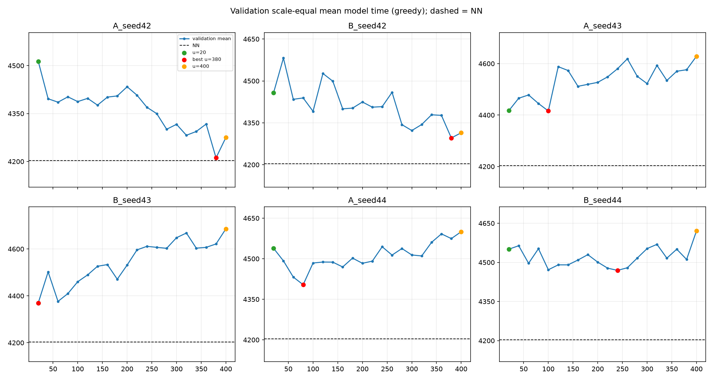
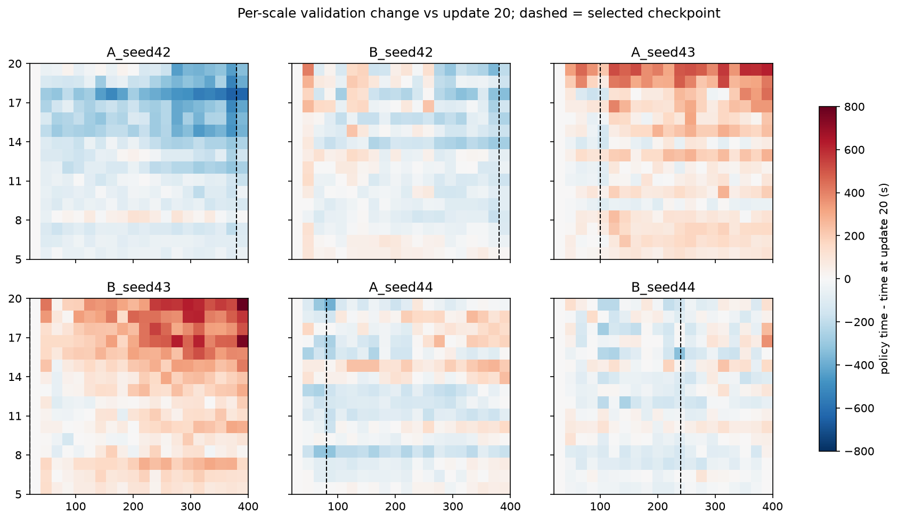
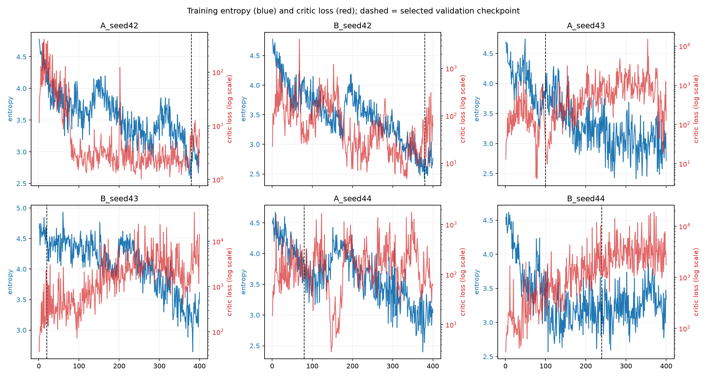
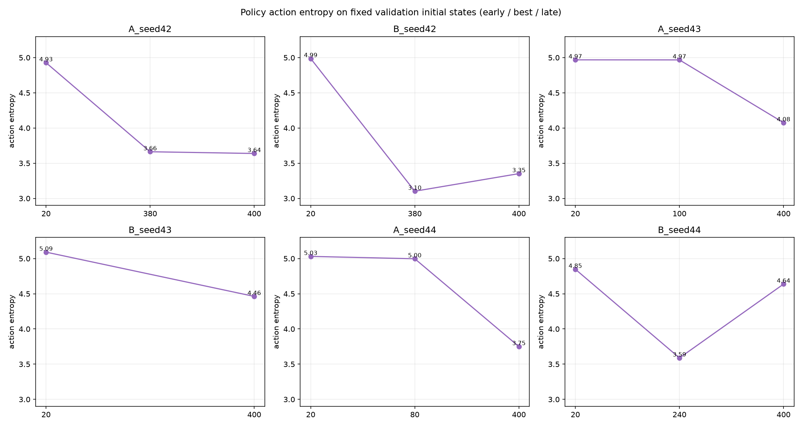
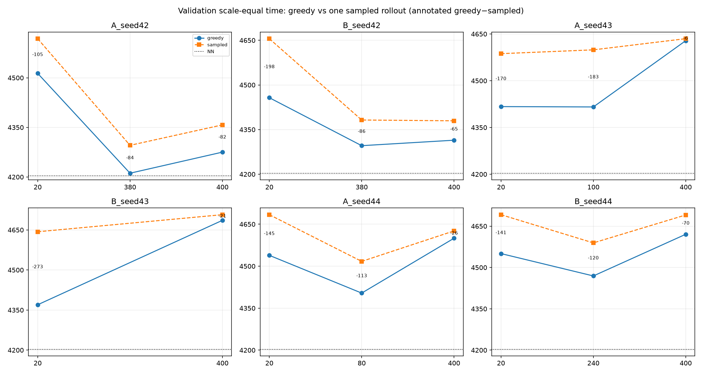

# 机动时间 A/B 训练过程诊断（审计前分析；见顶部更正）

**2026-10-31 · 诊断对象：`869bdd4` 的 6 个正式训练 run**
**数据：验证种子 `40000-40095`（96 实例，5–20 每个规模 6 个）；最终测试集未参与任何选择或调参。**

> 本报告只回答“哪些种子在学习、哪些在退化、退化发生在分布层还是 greedy 解码层”。
> 不新增训练分支，不修改网络/奖励，不提高转弯权重，也不延长训练。

> **审计后更正（2026-10-31，优先阅读）**
>
> 本诊断基于 SHA `869bdd4` 的 6 个正式 run；审计发现这些 run 的 GAE bootstrap
> `next_value` 未使用 `next_state`，丢失 heading 特征（修复 `c390951`）。因此：
>
> 1. B43 的 44,326 critic loss 应称为**价值预测失效迹象**；其可复现来源是
>    next-value 输入错误，不是已证明的“critic 发散”或时间目标问题。
> 2. “最佳 vs update 400”的 5/6 显著性存在**选择偏差**（最佳就是在同一验证集上选的）。
>    固定节点 20→400 的结果是：A42/B42 改善，A43 +211 s、B43 +316 s、B44 +70 s
>    显著变差，A44 +61 s 不显著；不是 5/6 后期退化。
> 3. A43 的 sampled 退化不显著；只能把“greedy 退化远大于 sampled”作为候选信号，
>    不能定性为“greedy 解码失败为主”。
> 4. 规模统计的 7.19% vs 5.45% 是**完成 episode** 占比，不是 reset 或 transition 占比。
>    6 个 run 的 `starts−completed` 恰好都是 1,600 = 400 updates × 4 ranks × 1 个尾片段；
>    `field_counts` 只计完成 episode。audit 的两个 update 中尾片段规模为 6/16/17 与
>    10/13，**不支持**“已证实小规模过采样”；逐 transition 规模未记录，不能据此做平衡采样。
> 5. `balanced_reward` 是 **rank0、仅完成 episode、raw reward 的 per-field-count EMA 的
>    简单平均**，不是实际任务目标；不能用它“变好”推断训练性能改善。
> 6. 6 个正式 A/B run 均受该 bug 影响；最终测试只作为旧权重的历史测量。修复后需重跑，
>    并重新约定 sealed 测试集。
>
> 以下 0–9 节为审计前分析，保留用于对照；涉及价值目标/训练因果的结论以本节和
> `docs/maneuver_time_value_audit.md` 为准。

## 0. 结论摘要

1. **不是一句“验证集噪声”可以解释。** 在 96 个配对验证实例上，5/6 个 run 的
   “最佳 checkpoint vs update 400”配对差 95% CI 不含 0：A42、A43、B43、A44、B44；
   只有 B42 不显著。最佳 update 分别为 A42=380、B42=380、A43=100、B43=20、A44=80、B44=240。
2. **种子分成三类：**
   - **持续学习**：A42、B42。两者从 update 20 到最佳分别改善 302 s、161 s；update 400
     仍显著好于 update 20（A42 −238 s，B42 −143 s）。
   - **先升后降**：A43、A44、B44。最佳分别在 100、80、240；update 400 比最佳差
     212 s、196 s、151 s（均显著）。A43 的 update 400 还比 update 20 差 211 s（显著）。
   - **基本没学起来**：B43。最佳就是第一个 checkpoint（update 20）；update 400 比它差
     316 s（显著），且 critic loss 在 update 387 达到 **44,326**、update 400 的
     explained variance 为 **−0.0015**。
3. **A43 的后期退化主要是 greedy 解码失败，而不是策略分布完全崩掉。**
   - greedy：最佳 100 → 400 慢 212.5 s（CI [−253.9,−171.0]）。
   - 单次采样 rollout：最佳 100 → 400 只慢 35.8 s（CI [−73.5,+1.5]，不显著）。
   - greedy 与 sampled 的差距从 183 s 缩到 6 s，说明后期分布里仍有较好动作，但 argmax
     选不出来。B43 也以 greedy 退化为主（316 s vs sampled 64 s），但其 critic 同时发散。
4. **A44、B44 是分布层退化**：greedy 分别慢 196 s、151 s，sampled 也慢 109 s、101 s。
   B44 的验证态熵反而从 3.59 升到 4.64，critic EV 也从 0.568 升到 0.903，**不能用
   “策略过早集中”或“critic 崩了”解释**；它的后期回归目前更像训练/验证不匹配或优化噪声。
5. **训练指标与验证时间脱节**：每个 run 的 `balanced_reward` 在后期都变好（或持平），
   但 A43/B43/A44/B44 的验证时间变差；训练 reward 不能作为选中依据。
6. **规模采样不是逐 reset 均匀的简单镜像**：reset 仍按 `U{5..20}` 均匀抽，但完成 episode
   的占比偏向小规模（5 地块约 7.19%，20 地块约 5.45%）。这是 128 步固定 rollout 的
   副产物；A42/B42 也受同样影响但仍在学习，所以它是候选因素，不是已证实的唯一原因。
7. **不要据此直接改网络或加转弯惩罚。** 先修/解释 critic 稳定性与 greedy 解码，再决定
   是否值得重训；当前证据不支持“再跑更长”或“把转弯权重加大”。

## 1. 数据与定义

- 验证集：`40000-40095`，每个规模 6 个实例；每 20 updates 的 20 个 checkpoint 全部评估。
- NN 在同一个验证集上的规模等权平均时间为 **4203.3 s**（96/96 完成）。
- “最佳 update”= 20 个 checkpoint 中验证集规模等权平均 `total_time` 最小者；与正式选择
  规则一致。
- 所有配对差都是**同一实例**上的差；CI 按实例重采样（逐规模分层，再规模等权平均），
  不把时间步当独立样本。
- 本报告的“最佳 vs 400”CI 只描述这 96 个验证实例上的 checkpoint 行为；最佳 checkpoint
  本身存在选择偏差（winner's curse），不能把它当成最终测试的无偏估计。
- 最终测试集只在第 7 节做一次**事后一致性对照**，没有用于选择。

## 2. 六条完整验证曲线

完整逐 checkpoint、逐规模数据：
`coverage_env/results/maneuver_time/diagnostics/validation_curves.csv`（1,920 行）
和 `validation_overall_curves.csv`。

| run | update 20 (s) | 最佳 update | 最佳 (s) | update 400 (s) | 400−20 (s) | CI | 最佳−400 (s) | CI |
|---|---:|---:|---:|---:|---:|---|---:|---|
| A_seed42 | 4513.5 | 380 | 4211.4 | 4275.2 | −238.4 | [−275.2,−203.2] | −63.8 | [−84.4,−43.1] |
| B_seed42 | 4457.1 | 380 | 4295.9 | 4314.3 | −142.9 | [−182.9,−104.5] | −18.4 | [−40.2,+3.5] |
| A_seed43 | 4417.0 | 100 | 4415.9 | 4628.5 | **+211.4** | [+169.3,+254.5] | −212.5 | [−253.9,−171.0] |
| B_seed43 | 4369.8 | 20 | 4369.8 | 4685.9 | **+316.2** | [+272.4,+360.9] | −316.2 | [−360.9,−272.4] |
| A_seed44 | 4538.7 | 80 | 4403.9 | 4599.9 | +61.2 | [−1.1,+123.4] | −196.0 | [−236.3,−156.7] |
| B_seed44 | 4550.5 | 240 | 4469.3 | 4620.5 | **+70.1** | [+18.4,+122.7] | −151.2 | [−207.2,−96.4] |

负的“最佳−400”= 最佳比 400 快；负的“400−20”= 400 比 20 快。

**逐规模看**，后期退化主要出现在较大规模（负值 = 最佳比 400 快）：

| run | scale 5 | scale 10 | scale 15 | scale 20 |
|---|---:|---:|---:|---:|
| A_seed42 | −43.3 | −123.4 | −92.9 | −102.7 |
| B_seed42 | +14.4 | −7.9 | −0.9 | −156.4 |
| A_seed43 | −81.7 | −162.7 | −373.4 | −408.9 |
| B_seed43 | −90.0 | −291.6 | −414.8 | −800.1 |
| A_seed44 | −66.3 | −332.3 | −191.1 | −362.6 |
| B_seed44 | −40.9 | −108.8 | −136.1 | −276.6 |

完整 16 个规模 × 20 个 checkpoint 的图在
`validation_scale_heatmaps.png`；A43/B43/A44/B44 在 15–20 地块明显转红，
B43 的 20 地块最严重（最佳 20 → 400 慢约 800 s）。

## 3. 训练指标对齐

训练指标全表：`coverage_env/results/maneuver_time/diagnostics/training_metrics.csv`。

### 3.1 最佳与 400 的指标

| run | train entropy 最佳→400 | critic loss 最佳→400 | explained var 最佳→400 | max critic loss (update) | balanced reward 20–60 → 341–400 |
|---|---:|---:|---:|---:|---:|
| A_seed42 | 2.82→2.99 | 4.9→6.3 | 0.926→0.927 | 412 (13) | −22.99→−21.71 |
| B_seed42 | 2.78→2.76 | 47.6→60.8 | 0.895→0.929 | 4,127 (68) | −28.41→−26.44 |
| A_seed43 | 4.15→2.71 | 38.6→127.3 | 0.440→0.547 | 15,052 (354) | −23.00→−22.95 |
| B_seed43 | 4.44→3.62 | 189.9→**14,400.2** | 0.0955→**−0.0015** | **44,326 (387)** | −29.37→−28.79 |
| A_seed44 | 3.79→3.04 | 79.3→61.1 | 0.892→0.933 | 1,769 (347) | −23.20→−22.61 |
| B_seed44 | 3.02→3.34 | 2,660.6→1,774.3 | 0.568→0.903 | 18,914 (370) | −29.54→−28.60 |

- **B43 是唯一明确的 critic 发散**：update 387 的 critic loss 44,326，update 400 的 EV
  为负；在最佳 update 20 时 EV 也只有 0.0955。它的最大 `return_std`/`advantage_std`
  为 253.8/186.9，远高于 A42（26.0/12.6）和 B42（62.6/43.4）。
- A43 在 354 也有一次 15,052 的 critic 尖峰，EV 在最佳只有 0.440；后期 entropy 从 4.15
  降到 2.71。
- B44 的 critic loss 很高（最大 18,914），但 EV 后期反而升到 0.903；A44 的 EV 也一直较高。
  因此 A44/B44 的验证退化**不能**简单归因于 critic 崩掉。
- `approx_kl` 最大均 < 0.10，`actor_grad_norm` 最大 < 2.5；clip fraction 多在 0.15–0.25，
  最大 0.40。不是“KL/梯度爆炸”型异常，主要异常在 critic 值回归和策略熵。
- **训练 reward 与验证时间脱节**：`balanced_reward` 在 6/6 个 run 的后期都变好或持平，
  但 A43/B43/A44/B44 的验证时间变差。训练 reward 不能用于选 checkpoint。

### 3.2 验证态策略熵（固定 96 个初始状态）

| run | entropy 20 | entropy 最佳 | entropy 400 | top1 400 |
|---|---:|---:|---:|---:|
| A_seed42 | 4.93 | 3.66 | 3.64 | 0.089 |
| B_seed42 | 4.99 | 3.10 | 3.35 | 0.132 |
| A_seed43 | 4.97 | 4.97 | 4.08 | 0.056 |
| B_seed43 | 5.09 | 5.09 | 4.46 | 0.046 |
| A_seed44 | 5.03 | 5.00 | 3.75 | 0.095 |
| B_seed44 | 4.85 | 3.59 | **4.64** | 0.047 |

（可行动作平均约 201.6 个，均匀分布熵约 5.31。）

- A43/A44 的后期退化与**验证态熵下降**同时发生；A42/B42 也下降但性能仍好，
  所以“集中”本身不是充分条件。
- B43 的熵仍较高（4.46），主要异常是 critic。
- B44 的熵**上升**，与“过早集中”相反；其后期退化仍待解释。

## 4. 采样表现 vs greedy 表现

只在验证集上，对每个 run 的 **20 / 最佳 / 400** 三个 checkpoint 做一次单采样 rollout
（96 个实例，全部 96/96 完成），与 greedy 结果对比：

| run | 最佳 update | greedy 最佳 | sampled 最佳 | greedy 400 | sampled 400 | greedy 最佳−400 | sampled 最佳−400 |
|---|---:|---:|---:|---:|---:|---:|---:|
| A_seed42 | 380 | 4211.4 | 4295.7 | 4275.2 | 4357.6 | −63.8 | −61.9 |
| B_seed42 | 380 | 4295.9 | 4382.2 | 4314.3 | 4379.4 | −18.4 | +2.7 |
| A_seed43 | 100 | 4415.9 | 4599.1 | 4628.5 | 4634.9 | **−212.5** | **−35.8** |
| B_seed43 | 20 | 4369.8 | 4643.1 | 4685.9 | 4707.1 | **−316.2** | −63.9 |
| A_seed44 | 80 | 4403.9 | 4517.1 | 4599.9 | 4626.1 | −196.0 | −108.9 |
| B_seed44 | 240 | 4469.3 | 4589.3 | 4620.5 | 4690.7 | −151.2 | −101.4 |

- **A43 是最清楚的 greedy 解码失败**：最佳时 greedy 比 sampled 好 183 s；400 时只差
  6 s（CI 含 0），而 sampled 从最佳到 400 只慢 35.8 s（CI 含 0）。分布里仍有较好动作，
  但 argmax 不再选出来。
- B43 的 greedy 退化（316 s）远大于 sampled（64 s，仍显著）；critic 发散是主因。
- A44/B44 的 sampled 也显著退化（109 s、101 s），属于分布层问题，不只是 greedy。
- A42/B42 的 greedy 与 sampled 同步改善/稳定；A42 的 sampled 最佳−400 也显著（−61.9），
  但其 400 仍显著好于 20，属于“后期轻微回撤”，不是 B43 那种崩溃。

## 5. 规模采样占比

`sampling_share.csv`，按每 20 updates 的 checkpoint 差分统计**完成 episode**：

| 规模 | 5 | 6 | 7 | 8 | 9 | 10 | 11 | 12 | 13 | 14 | 15 | 16 | 17 | 18 | 19 | 20 |
|---|---:|---:|---:|---:|---:|---:|---:|---:|---:|---:|---:|---:|---:|---:|---:|---:|
| episode 占比 | 7.19% | 6.74% | 6.57% | 6.74% | 6.51% | 6.46% | 6.66% | 6.62% | 6.08% | 6.29% | 5.82% | 5.70% | 5.87% | 5.57% | 5.73% | 5.45% |

- **逐 reset 的规模抽取仍是均匀的**（`rng.randint(5,20)`）；偏差来自“完成 episode”：
  128 步 rollout 内，5 地块 episode 更容易结束，20 地块 episode 更容易跨 update。
- 单个 20-update 窗口的占比在 2.15%–10.05% 之间波动（每窗口样本少），但 6 个 run 的
  总体分布一致。
- **没有规模被完全饿死**；但 20 地块的 episode 数比 5 地块少约 24%。它可能是大规模
  后期退化的一个贡献因素，但 A42/B42 在同样采样下仍在学习，所以不能单独归因。
- 逐 transition 的规模占比没有记录，不能把 episode 占比直接当成梯度样本占比。

## 6. 哪些种子在学习、哪些在退化

| run | 模式 | 最佳 update | 曲线形态 | greedy/sampled 结论 | 主要异常 |
|---|---:|---:|---|---|---|
| A_seed42 | distance | 380 | 20→380 改善 302 s；400 仍比 20 好 238 s | 两者同步改善；400 轻微回撤 | 无严重异常 |
| B_seed42 | time | 380 | 20→380 改善 161 s；400 仍比 20 好 143 s | 两者稳定；最佳−400 不显著 | critic 早中期有尖峰，后期稳定 |
| A_seed43 | distance | 100 | 20→100 基本持平；400 明显退化 | **greedy 崩，sampled 基本稳定** | 后期熵 4.97→4.08；critic 尖峰 15k |
| B_seed43 | time | 20 | 从未改善；400 退化 316 s | greedy 和 sampled 都退化，greedy 更重 | **critic loss 44k、EV≈0** |
| A_seed44 | distance | 80 | 20→80 改善 135 s；400 比最佳差 196 s | 两者都退化 | 熵 5.00→3.75；critic EV 高 |
| B_seed44 | time | 240 | 20→240 改善 81 s；400 比最佳差 151 s | 两者都退化 | 熵反而升到 4.64；critic 高但 EV 高 |

**判定：**

- **在学习的：A42、B42。** 但两者最终仍慢于 NN；A42 最接近（验证集比 NN 慢约 8 s，
  最终测试慢 12.6 s）。
- **学了一部分又退化的：A43、A44、B44。** 其中 A43 主要是 greedy 解码失败，
  A44 是分布层 + 熵集中，B44 的机制还不清楚（熵升高、critic EV 升高）。
- **没有有效学习的：B43。** 最佳就是第一个 checkpoint，critic 后期发散；这不是
  “统一模型学不会”的证据，而是该 seed 的优化失败。

## 7. 与最终测试的一致性（仅事后对照，不用于选择）

把验证集“策略−NN”与最终测试“策略−NN”并列，检查选择是否严重乐观：

| run | 验证 策略−NN (s) | 最终测试 策略−NN (s) |
|---|---:|---:|
| A_seed42 | +8.1 | +12.6 |
| B_seed42 | +92.6 | +113.8 |
| A_seed43 | +212.6 | +210.3 |
| B_seed43 | +166.5 | +177.6 |
| A_seed44 | +200.6 | +215.6 |
| B_seed44 | +266.0 | +281.3 |

验证集与最终测试的相对 NN 差值在约 2–21 s 内一致；说明正式选择没有把某个模型
“选飞”，也说明最终测试的负结果不是验证集选择错误造成的。**这只是事后一致性检查；
最终测试没有参与任何选择或调参。**

## 8. 建议

1. **保留 NN 为当前可部署基准**；保留时间模型作为研究目标。当前证据不支持直接提高
   转弯惩罚、扩大网络或把 6 个 run 全部延长。
2. **先修 critic 稳定性**：B43 的 44k critic loss / EV≈0 是明确异常；在新增训练之前，
   优先检查 value target 的尺度、outlier return、GAE 截断和 value clipping。A43 的
   15k 尖峰也应一并检查。
3. **区分解码问题与分布问题**：A43 的 sampled 在最佳/400 基本不变而 greedy 崩，
   应对 A43 这类 checkpoint 做 top-k/采样解码的 regret 诊断；不要只用 greedy 判断
   “策略是否学会”。
4. **早停/峰值选择**：6/6 个 run 的最佳 update 都在 20–380；固定跑满 400 会稳定浪费算力
   并可能退化。正式选择已按验证集选最佳；下一步应把“验证峰值早停”作为训练协议的一部分，
   而不是无条件延长。
5. **大规模采样偏差**：20 地块 episode 占比 5.45% vs 5 地块 7.19%。如果后续仍要做
   统一模型，应做一次**有边界的** per-scale 平衡 rollout 对照；当前还不能断言它是原因。
6. **A/B 目标混淆仍未拆开**：本轮 A/B 同时改变了距离/时间归一化和覆盖抵扣，不能从
   这轮判断“转弯项是否值得建模”。若未来要回答这个问题，应另做只改 reward 组件的
   受控消融；不要在本轮结果上追加解释性训练。

## 9. 产物

- 完整曲线：`coverage_env/results/maneuver_time/diagnostics/validation_curves.csv`
- 总体曲线：`validation_overall_curves.csv`
- 配对 checkpoint 差：`paired_checkpoint_deltas.json`
- 训练指标：`training_metrics.csv`
- 规模采样：`sampling_share.csv`
- 验证态策略熵：`policy_entropy_validation.csv`
- sampled vs greedy：`sampled_validation_rows.json`、`sampled_vs_greedy.json`
- 逐规模最佳 vs 400：`perscale_best_vs_late.json`
- 图：`docs/maneuver_time_diagnostics/`
- 原始数据/模型仍在 `coverage_env/results/`（gitignore），未提交仓库。

**统计边界**：本诊断的验证集配对 CI 很窄，但它只描述 96 个固定验证实例上的
checkpoint 行为；只有 3 个训练种子，不能把很窄的实例 CI 当成“训练方法优劣已高度确定”。
最终 A−B 的 pooled CI 同样只反映六个冻结模型在新实例上的差异，训练种子间符号不一致
本身就是不确定性的一部分。
