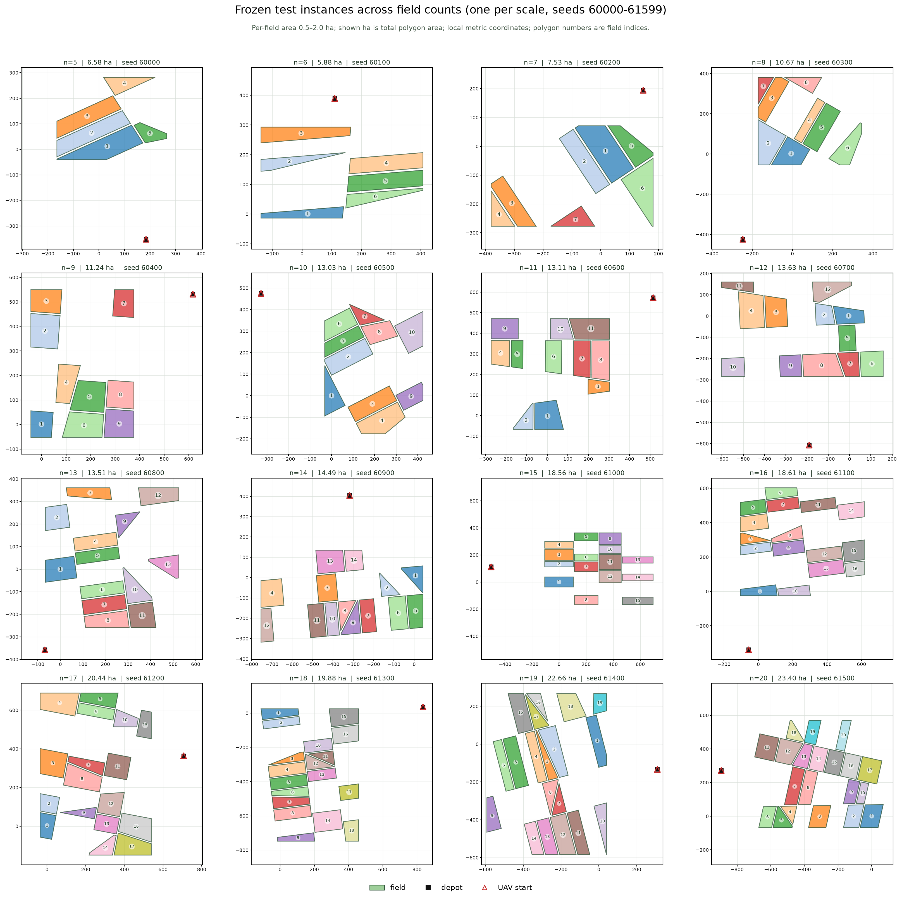
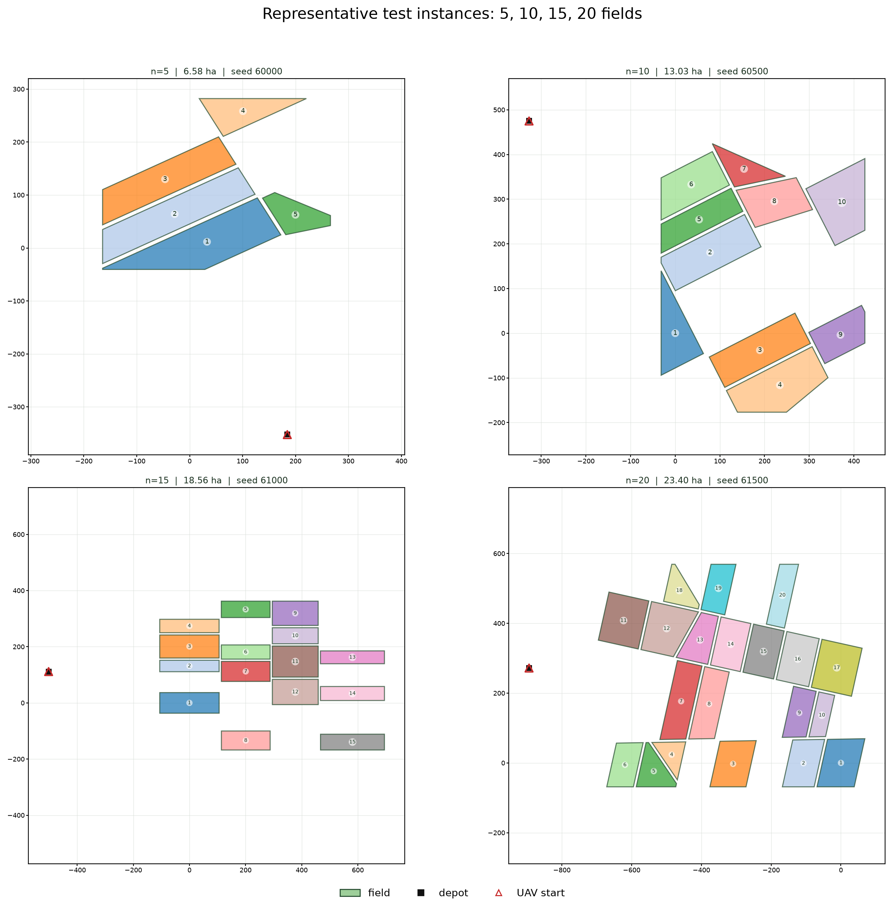

# 不同规模实例的可视化

数据来自 v2 最终测试的冻结种子块 `60000-61599`。每个规模展示该规模的**第一个**测试实例：

- 5 fields → seed 60000，6 → 60100，…，20 → 61500；
- 每个 field 的面积为 0.5–2.0 ha（配置范围）；
- 图中标题的 ha 是**该实例全部多边形面积之和**，因此随 field 数增加；
- 坐标是局部米制坐标；彩色数字是 field 索引；
- 黑色方块是 depot，红色空心三角是 UAV 起点（通常与 depot 重合）。

## 全部 16 个规模

[高分辨率 PNG](maneuver_time_diagnostics/instances_5_to_20.png) ·
[SVG](maneuver_time_diagnostics/instances_5_to_20.svg)

## 5 / 10 / 15 / 20 代表实例

## 面积摘要

| fields | seed | total area (ha) | per-field range (ha) |
|---:|---:|---:|---:|
| 5 | 60000 | 6.58 | 0.56–1.99 |
| 10 | 60500 | 13.03 | 0.61–1.85 |
| 15 | 61000 | 18.56 | 0.86–1.81 |
| 20 | 61500 | 23.40 | 0.53–1.66 |

完整 16 个规模的 seed、总面积、各 field 面积见
[instances_5_to_20.json](maneuver_time_diagnostics/instances_5_to_20.json)。
