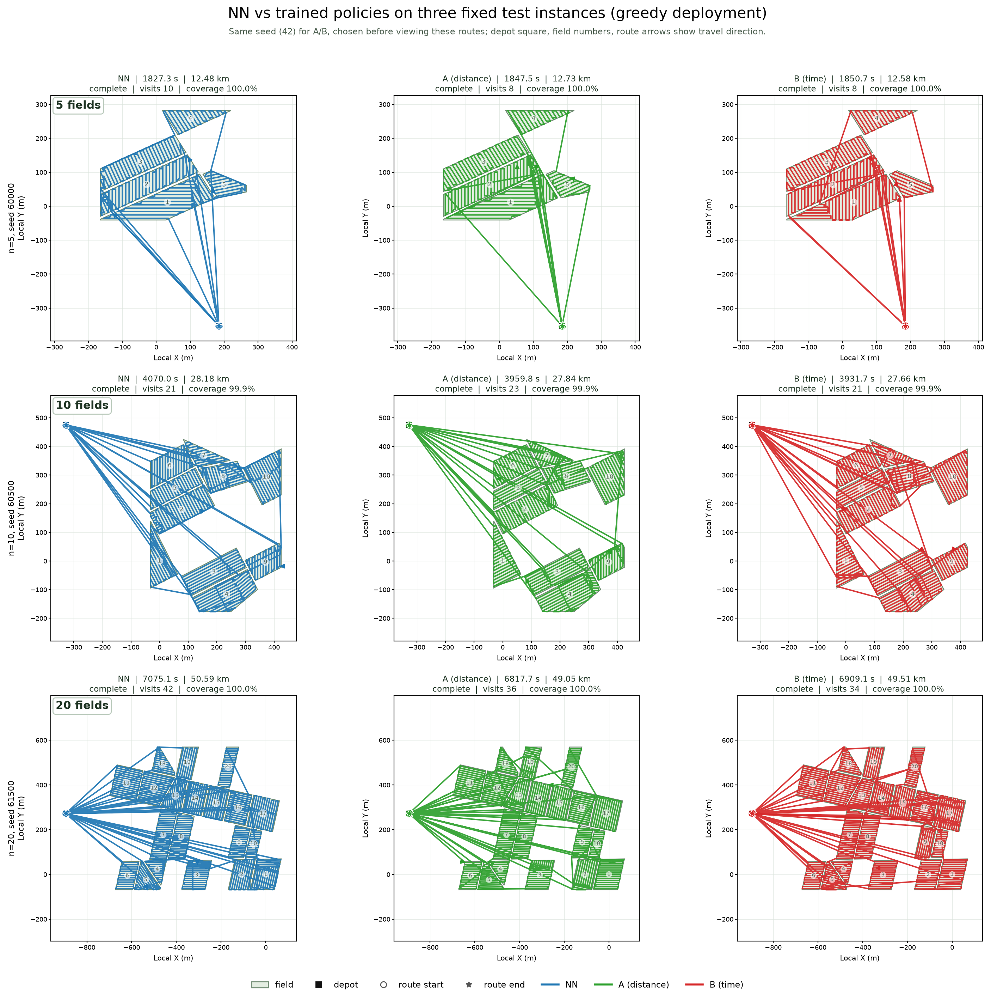
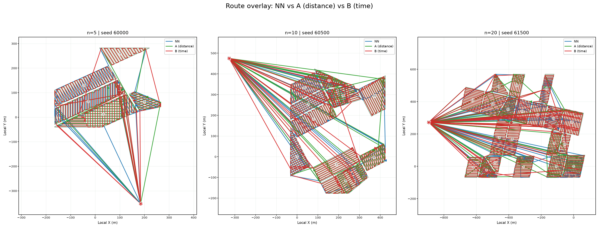

# NN 与训练策略的路线图（固定 3 个规模）

- 实例：最终测试集 `60000-61599` 中每个规模的第一个实例。
  - 5 fields：seed 60000
  - 10 fields：seed 60500
  - 20 fields：seed 61500
- 策略：
  - `NN`：nearest-neighbor baseline；
  - `A (distance)`：A_seed42 的验证选中 checkpoint（update 380）；
  - `B (time)`：B_seed42 的验证选中 checkpoint（update 240）。
- A/B 使用**同一个训练种子 42**，在查看这些路线之前就已登记；不是按最终表现挑选的种子。
- 动作为 **greedy argmax**，与最终测试的部署规则一致。
- 路线包含 field 内部的覆盖往返和 field 之间的转场；箭头表示行进方向；黑方块为 depot，空心圆为起点，星号为终点。

[高分辨率 PNG](maneuver_time_diagnostics/routes_3scales_3policies.png) ·
[SVG](maneuver_time_diagnostics/routes_3scales_3policies.svg)

## 这三个实例上的结果

| scale | policy | time (s) | distance (km) | visits | coverage |
|---:|---|---:|---:|---:|---:|
| 5 | NN | 1827.3 | 12.48 | 10 | 100.0% |
| 5 | A (distance) | 1847.5 | 12.73 | 8 | 100.0% |
| 5 | B (time) | 1850.7 | 12.58 | 8 | 100.0% |
| 10 | NN | 4070.0 | 28.18 | 21 | 99.9% |
| 10 | A (distance) | 3959.8 | 27.84 | 23 | 99.9% |
| 10 | B (time) | 3931.7 | 27.66 | 21 | 99.9% |
| 20 | NN | 7075.1 | 50.59 | 42 | 100.0% |
| 20 | A (distance) | 6817.7 | 49.05 | 36 | 100.0% |
| 20 | B (time) | 6909.1 | 49.51 | 34 | 100.0% |

这只是一组固定实例上的路线示意；单实例结果可以与 1,600 个实例的总体均值方向不同，不能替代最终统计。

## 路线叠加（补充）

叠加图便于看三种策略是否走同一组 field；线条密集，细节以单策略大图为准。

路线点、seed、时间、距离和访问次数：[routes_metrics.json](maneuver_time_diagnostics/routes_metrics.json)
