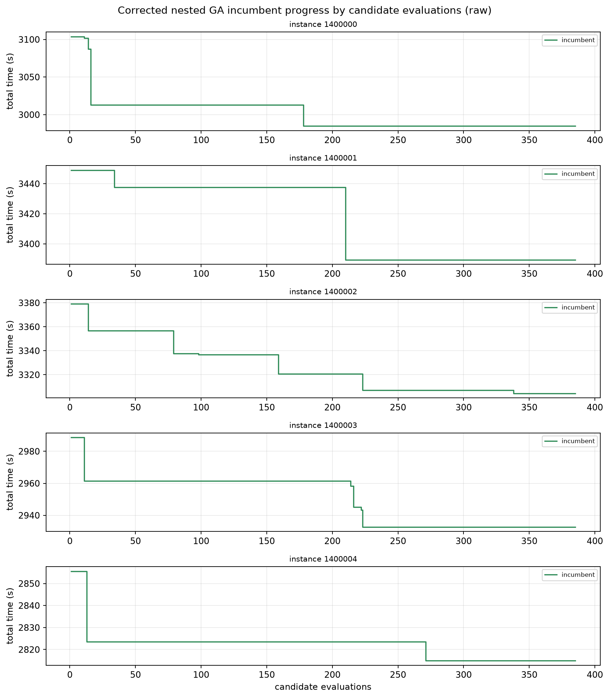
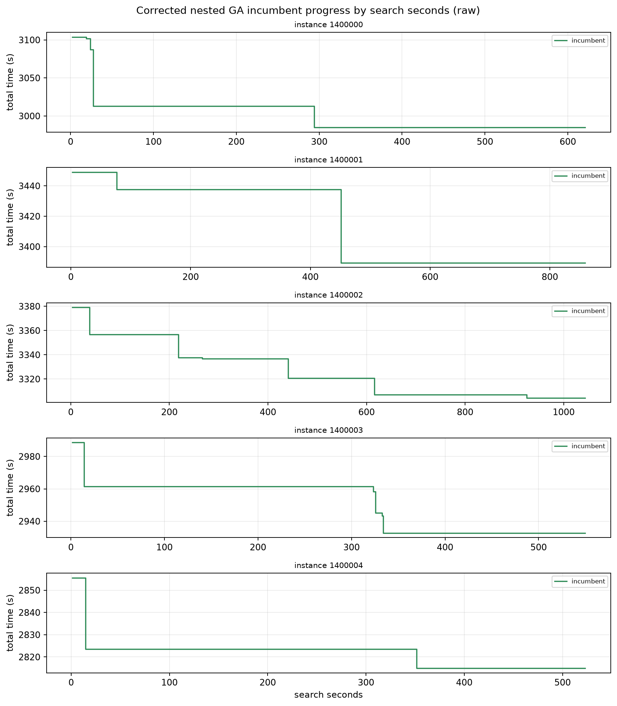
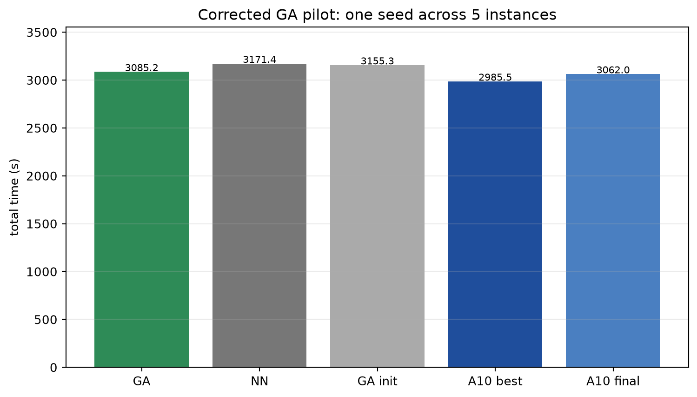

# Corrected nested-GA pilot: 6 scored outer rounds per search

**No RL training. Same five development instances. Development evidence only.**

## Why this rerun exists

The first 8×4 pilot did not reliably finish the initial outer population:
only 6–15 full 16-evaluation inner quotas completed, while an initial outer
population of 8 alone needs 8 quotas. It therefore did **not** adequately test
outer genetic evolution.

The first implementation also only wrote **completed** inner quotas to
`inner_quotas`; a budget-interrupted inner search was dropped from the record.
That made the old “partial quotas = 0” claim a logging artifact, not evidence.
The old data are retained as a development trial but cannot support a
“fully evolved nested GA” claim.

The algorithm base is `136074e`. The recording changes were applied to the
working tree for this pilot; the run metadata records that dirty source state.
The instrumentation commit is recorded separately after this run.

The instrumentation was fixed (records only; no search-rule changes):

- partial inner quota record: generation, candidate, planned/actual evaluations,
  completion flag and interruption reason;
- outer progress record: attempted candidates, completed quotas, whether the
  round completed, children produced and incumbent;
- fallback source counts: initialization, sequence exhaustion, skipped slots;
- history records incumbent refreshes with generation/candidate and source.

This pilot reuses the **same five pickle snapshots**, not regenerated geometry.

## Corrected pilot design

- Outer population **4**, outer scored generations **6**
- Inner population **8**, inner generations **2**
- Planned evaluations: **1 + 4 × 6 × 16 = 385**
- Search seed **42 only**
- wall safety cap **1200 s** (not a target)
- max_steps 500
- Same five seeds 1,400,000–1,400,004
- No RL initialization

## Budget utilization

| metric | mean | range |
|---|---:|---:|
| evaluations | **385** | 385–385 |
| outer scored generations | **6** | 6–6 |
| outer candidates attempted | **24** | 24–24 |
| full inner quotas | **24** | 24–24 |
| partial inner quotas | **0** | 0–0 |
| transitions | 7,807.6 | 6,661–9,550 |
| search wall | 719.2 s | 523.0–1,043.6 |
| replay wall | 1.61 s | 1.02–2.37 |
| fallback steps (best) | 4.0 | 0–12 |
| fallback ratio (best) | 22.5% | 0–75% |
| skipped slots (best) | 15.8 | 0–63 |

All five searches used the full 385-evaluation plan and stopped on
`evaluation_limit`; none hit the 1200 s safety wall. Six outer rounds and all 24
inner quotas completed in every search.

## Corrected results

| instance | GA (seed42) | init improvement | NN | GA init | A10 u1060 | A10 u1200 |
|---:|---:|---:|---:|---:|---:|---:|
| 1400000 | 2984.8 | 119.1 | 3123.8 | 3103.9 | 2894.1 | 3000.1 |
| 1400001 | 3389.4 | 59.6 | 3472.3 | 3449.0 | 3301.4 | 3445.6 |
| 1400002 | 3304.4 | 74.7 | 3339.5 | 3379.1 | 3069.8 | 3245.9 |
| 1400003 | 2932.7 | 56.0 | 3059.2 | 2988.6 | 2826.0 | 2795.2 |
| 1400004 | 2814.9 | 40.7 | 2862.1 | 2855.6 | 2836.2 | 2823.3 |

GA mean: **3085.2 s**. All five improved on initialization.
Mean improvement: **70.0 s**. 22 incumbent refresh events: initialization plus
search updates across outer generations 0–5.

### Main comparison — `baseline − GA`

Positive means GA faster.

| baseline | mean baseline−GA | GA faster |
|---|---:|---:|
| original NN | **+86.1 s** | **5/5** |
| GA action-space initializer | **+70.0 s** | **5/5** |
| A10 u1060 | **−99.8 s** | **1/5** |
| A10 u1200 | **−23.2 s** | **3/5** |

Even with a genuinely completed six-round outer search, GA beats the two
non-learned initializers but remains behind A10 u1060 and A10 u1200 on average.
At u1060 it is faster only on instance 1400004; at u1200 it is faster on 3/5.

Best-of-3 is not used here: the corrected design deliberately ran only seed42.

## Cost components

| model | total | work | nonwork | maneuver | service | nonwork+maneuver+service |
|---|---:|---:|---:|---:|---:|---:|
| corrected GA | 3085.2 | 1438.7 | 1377.3 | 289.9 | 0 | **1642.2** |
| GA init | 3155.3 | 1444.1 | 1403.4 | 307.8 | 0 | 1711.2 |
| NN | 3171.4 | 1440.1 | 1414.4 | 316.9 | 0 | 1731.3 |
| A10 u1060 | 2985.5 | 1423.9 | 1254.4 | 307.1 | 0 | 1561.6 |
| A10 u1200 | 3062.0 | 1424.0 | 1322.9 | 315.1 | 0 | 1638.0 |

The corrected GA closes some of the gap to A10 versus the old pilot, but still
does not exceed it on average.

## Fallback source audit

Corrected best traces contain fallback only from:

- sequence exhaustion: 18 steps total;
- skipped/unavailable slots: 2 steps total;
- initialization: **0** (no retained initialization best).

No corrected best is an initialization-retained trace. Mean fallback ratio is
22.5%; one instance reaches 75%. The fixed completion rule is still material,
but it is measured and belongs to the same completed nested search.

The old run's 100%-fallback case cannot be reclassified retroactively because
the old schema lacked source counts; it is not used as evidence about search
purity.

## Progress and controls

## Online/offline cost

- Five corrected searches: 3,596 s search + 8.1 s replay ≈ **60 min online**.
- Control evaluation reused the same-snapshot results: 20 episodes, ≈1.8 s each.
- RL offline training is separate: A10 10-field training wall **9 h 23 m**.
- No RL model was trained here and no budget was extended.

## Artifacts

Persistent:
`/home/ps/Desktop/Graph_planning/graph-uav-experiments/nested_ga/`

- `pilot10_corrected_s1400000/` — five full corrected search JSONs
- `report10_corrected_s1400000/` — summary, CSV, curves, control comparison
- `pilot10_s1400000/` — original flawed development pilot (retained)
- `controls10_s1400000/` — same-snapshot controls

The corrected JSONs include `outer_records`, partial/full `inner_quotas`,
`fallback_sources`, and refresh events. Every best trace was replayed and
matched.

## Boundary

This is one search seed over five development instances; it is not a
cross-training-seed significance test and not a sealed test. It establishes that
the corrected pilot actually executed six scored outer rounds and 24 full inner
quotas per instance. It does not establish GA optimality or superiority over
CHANet. No 20/30-field experiment, extra seed, or RL training was run.
