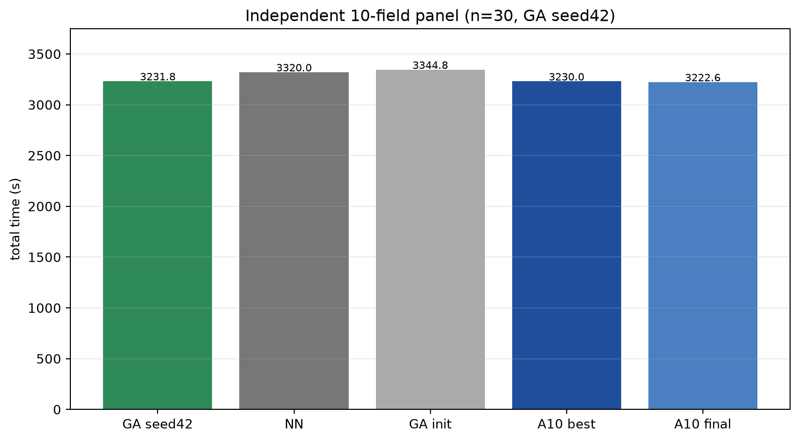
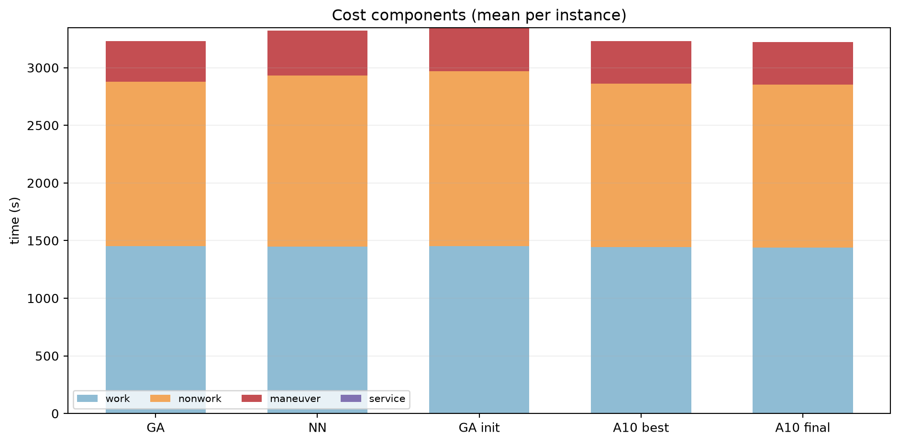
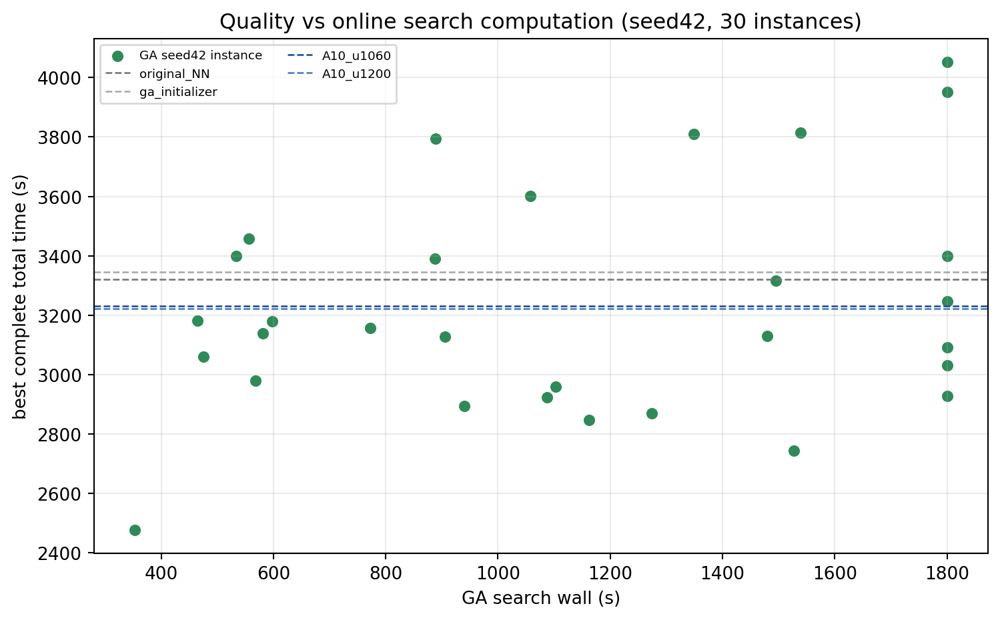
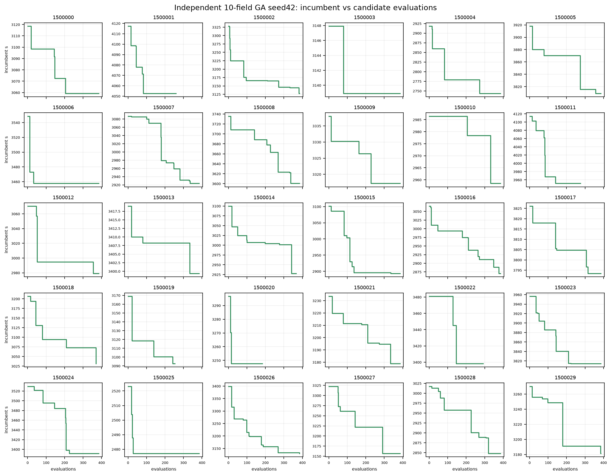

# Independent 10-field nested-GA comparison — seed42

**Single GA search seed, single RL training seed. No sealed test.**

## Provenance

- Algorithm base: `136074e`
- Logging fixes: `d10628b`
- Single-seed budget revision: `a437ccc`
- Independent panel: 30 frozen 10-field instances, seeds **1,500,000–1,500,029**
- Method name: **“嵌套GA，每次最多385次候选评估或1800秒搜索时间，先到者停止。”**
- GA budget: **at most 385 candidate evaluations or 1800 s per search, first reached stops**
- No RL initialization; GA is adapted, not a direct reproduction of the cited paper.
- Panel generation: 30/30 accepted, no geometry failures; exact history-manifest
  collision check found no overlap. Full snapshots, manifest and config are in the
  persistent panel directory.

The corrected pilot audit was also verified: 5 runs contain **24 incumbent
refresh events = 5 initialization + 19 search improvements**; the earlier
“22 / only 1 initialization” report was incorrect.

## Execution

- 30 instances × **seed42 only** = 30 searches
- Seed43/44 partial history is retained separately in
  `historical_seed43_44/` and is excluded from all statistics.
- Controls were run once on the same 30 snapshots before the seed42 queue
  completed and are reused unchanged.

### Task and search completion

- **Task completion: 30/30** (every best incumbent completed and returned).
- **Planned search completion: 23/30** (six outer rounds and 24 full quotas).
- **Wall-limited: 7/30**: 1,500,001, 1,500,011, 1,500,014, 1,500,018,
  1,500,019, 1,500,020, 1,500,022.
- Evaluation-limited: 23/30.
- Wall-limited runs have complete best incumbents and are **not failed paths**.
- No program exceptions, non-finite values, ledger failures or replay mismatches.

### Search budget use

| metric | mean | range |
|---|---:|---:|
| evaluations | 361.8 | 184–385 |
| outer rounds completed | 5.5 | 2–6 |
| full inner quotas | 22.47 | 11–24 |
| partial inner quotas | 0.23 | 0–1 |
| fallback ratio (best trace) | 23.75% | 0–90.48% |
| fallback steps | 4.6 | 0–19 |
| refresh events | 6.6 | 2–13 |
| per-candidate search seconds | 3.41 | 0.92–9.79 |
| search wall | 1140.0 s | 353–1801 s |
| replay wall | 2.77 s | 0.80–10.50 s |

Total search wall: **34,200 s (9.5 h)**; replay **83 s**.
Fallback sources across best traces: sequence exhaustion **127**, skipped slots
**11**, initialization **0**. All counts are recorded; no completion step is
hidden.

## Results

GA is a single seed42 search per instance. No three-seed mean, seed standard
deviation or best-of-3 is reported.

| model | mean total | completed | nonwork+maneuver+service |
|---|---:|---:|---:|
| GA seed42 | **3231.8** | 30/30 | **1779.7** |
| original NN | 3320.0 | 30/30 | 1871.9 |
| GA initializer | 3344.8 | 30/30 | 1892.4 |
| CHANet A10 u1060 | **3230.0** | 30/30 | 1787.6 |
| CHANet A10 u1200 | **3222.6** | 30/30 | 1782.3 |

### Primary comparisons

Sign convention stated explicitly:

- `NN − GA`: positive means GA faster.
- `GA − A10_u1060`: positive means CHANet faster.

| comparison | mean | median | 95% instance bootstrap CI | win/tie/loss | relative | Holm p |
|---|---:|---:|---:|---:|---:|---:|
| NN − GA | **+88.20 s** | +87.59 | **[+54.84, +121.11]** | **24/0/6** | +2.66% | **0.0004** |
| GA − A10 u1060 | **+1.73 s** | −2.64 | **[−29.08, +34.33]** | **14/0/16** | +0.054% | **0.918** |

The NN comparison favors GA clearly. The CHANet u1060 comparison is
**near-parity in the mean, with a CI crossing zero**; the median slightly favors
GA. This is neither a demonstrated GA advantage nor statistical equivalence.

### Auxiliary comparisons

| comparison | mean | 95% CI | win/tie/loss |
|---|---:|---:|---:|
| GA initializer − GA | +113.07 s | [+89.35,+137.48] | 30/0/0 |
| GA − A10 u1200 | +9.19 s | [−15.95,+34.27] | 15/0/15 |

## Cost components

| model | work | nonwork | maneuver | service | total |
|---|---:|---:|---:|---:|---:|
| GA seed42 | 1452.1 | 1426.0 | 353.7 | 0 | 3231.8 |
| NN | 1448.1 | 1483.5 | 388.4 | 0 | 3320.0 |
| GA init | 1452.4 | 1515.6 | 376.9 | 0 | 3344.8 |
| A10 u1060 | 1442.4 | 1419.3 | 368.3 | 0 | 3230.0 |
| A10 u1200 | 1440.3 | 1414.3 | 368.0 | 0 | 3222.6 |

GA has slightly higher work/nonwork than A10 u1060 but lower maneuver; the total
difference is only +1.7 s. The auxiliary deducted cost is slightly lower for GA
(1779.7 vs 1787.6), but the GA fitness remains total time and no alternative
metric was optimized.

## Figures

## Compute accounting

- NN/CHANet control episodes: complete planning-episode wall mean
  **3.1–3.5 s/episode**, including environment execution, excluding model
  loading/offline training.
- GA online searches: 30 × mean 1140 s = **34,200 s (9.5 h)**, plus 83 s replay.
- RL offline training is separate: A10 10-field training wall **9 h 23 m**.
- Model loading and RL training are not included in the GA search timer.

## Boundary

- One GA search seed and one RL training seed; this is not a cross-seed
  significance or equivalence claim.
- 30 instances are the statistical unit. The NN−GA CI is instance-level, not a
  training-seed interval.
- The budget was reduced mid-evaluation from three seeds to seed42; seed42 was
  predetermined and not selected by score. Seed43/44 history is excluded.
- The method is an adapted nested GA, not a direct reproduction.
- No sealed test, 20/30-field run, parameter tuning, extra seed or budget
  extension was performed.

## Artifacts

Persistent base:
`/home/ps/Desktop/Graph_planning/graph-uav-experiments/nested_ga/independent10/`

- `panel/` — 30 snapshots, manifest, hashes, config
- `runs/` — 30 seed42 search JSONs with full traces and audit fields
- `historical_seed43_44/` — excluded historical runs
- `controls/` — same-snapshot controls
- `report_seed42/` — CSV, summary, plots
- `budget_revision_seed42.json` — mid-run budget revision record

All action traces are replay-verified; the best complete incumbent is retained
for both evaluation- and wall-limited searches.
