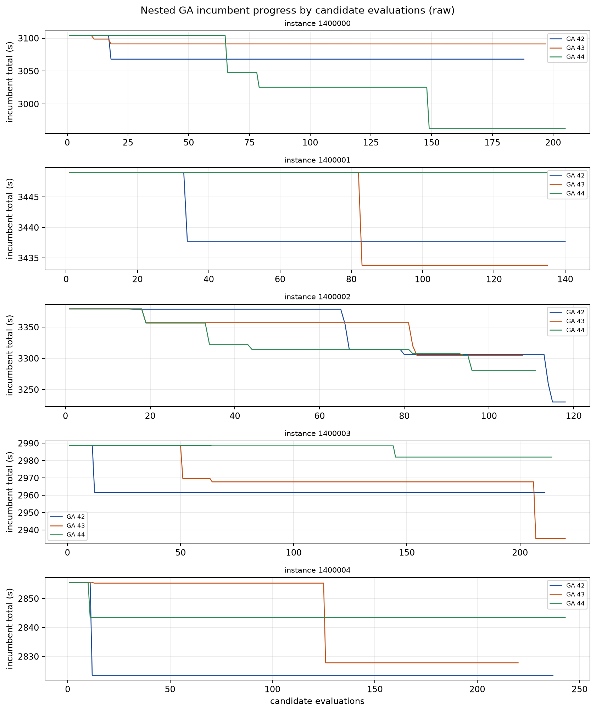
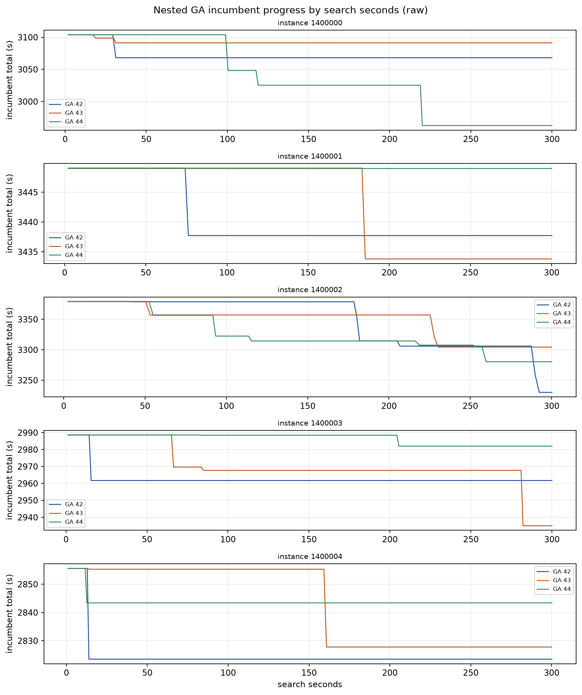

# Nested-GA 10-field pilot: 5 instances × 3 search seeds

> **Post-audit correction (2026-11-09):** these 8×4 results did not reliably
> complete the initial outer population; only 6–15 full inner quotas were scored,
> and the old `inner_quotas` logging omitted partially interrupted quotas.
> They are retained as a development trial, not evidence of a fully evolved
> nested GA. See [`nested_ga_corrected_pilot/README.md`](../nested_ga_corrected_pilot/README.md)
> for a six-round pilot on the same five snapshots.

**No RL training. Development pilot, not a sealed test.**

## Provenance and setup

- Branch: `codex/nested-ga-baseline`
- Code SHA: `136074ee3bdc4c7cf7fb62845fb3de60156558ed`
- Acceptance: 33 required tests passed; same-snapshot control adapter test 1 passed.
- Environment: Python 3.12.3, torch 2.14.1+cu130, numpy 2.5.4, shapely 2.2.0.
- Config SHA256: `eb4bcf6c509eca74612c89d69f53afc68f18cecc5efdde96b9ede25577fe5ced`
  from the frozen 10-field A run: 10 fields, area 5,000–20,000 m², same
  workspace/geometry/UAV/time model. No default-config substitution.
- Smoke: independent instance 1400100, 1 search seed, 5 evaluations; complete,
  returned, replay identical, time ledger closed; **8.46 s search + 1.80 s
  replay**. Smoke is excluded from the development panel.
- Panel: seeds **1,400,000–1,400,004**, five new 10-field instances.
  Exact seed-collision check against existing manifests found no collisions.
  All snapshots and SHA256 are in `development_panel_manifest.json`.
- 3 search seeds per instance, sequential; no RL model initialization.

## Budget utilization

Configured: outer population 8 / 4 generations; inner 8 / 2 generations;
16 evaluations per full inner quota; 500-evaluation or 300-s cap; max_steps 500.

| metric | mean | range |
|---|---:|---:|
| candidate evaluations | 178.8 | 108–243 |
| transitions | 3,453 | 2,554–4,087 |
| search wall | 300.08 s | 300.00–300.21 s |
| replay wall | 1.70 s | 0.97–2.66 s |
| full inner quotas | 10.6 | 6–15 |
| partial inner quotas | 0 | 0 |
| infeasible candidates | 1.0/search | 1 |
| skipped slots in best | 4.5 | 0–16 |
| fallback steps in best | 4.0 | 0–22 |

All 15 searches stopped on the **300 s wall cap**, not the 500-evaluation cap.
All inner quotas that started were full 16-evaluation quotas; the final candidate
at the deadline is the only incomplete one. Evaluation budget is under-used
(108–243 of 500). 14/15 searches improved on initialization; one
(instance 1400001, seed44) found no improvement and its best trace was 100%
fallback (22/22 steps).

Fallback is material: mean **20.2%** of best-trace steps, max **100%**.
This pilot should not yet be described as a clean search-only route optimizer;
completion/fallback behavior needs review before 20/30 fields.

## Results by instance

GA values are across three search seeds; `best-of-3` is a **three-times budget**
diagnostic, not a single-search result.

| instance | GA mean | GA sd | GA range | GA best-of-3 | NN | GA init | A10 u1060 | A10 u1200 |
|---:|---:|---:|---:|---:|---:|---:|---:|---:|
| 1400000 | 3040.7 | 68.6 | 2962.6–3091.2 | 2962.6 | 3123.8 | 3103.9 | 2894.1 | 3000.1 |
| 1400001 | 3440.2 | 7.9 | 3433.8–3449.0 | 3433.8 | 3472.3 | 3449.0 | 3301.4 | 3445.6 |
| 1400002 | 3271.7 | 37.9 | 3230.1–3304.5 | 3230.1 | 3339.5 | 3379.1 | 3069.8 | 3245.9 |
| 1400003 | 2959.6 | 23.6 | 2935.0–2982.0 | 2935.0 | 3059.2 | 2988.6 | 2826.0 | 2795.2 |
| 1400004 | 2831.6 | 10.5 | 2823.5–2843.4 | 2823.5 | 2862.1 | 2855.6 | 2836.2 | 2823.3 |

## Main comparison — `baseline − GA`

Positive means GA is faster. Uses the per-instance three-seed GA mean.

| baseline | control mean (s) | mean baseline−GA (s) | GA-faster instances |
|---|---:|---:|---:|
| original NN | 3171.4 | **+62.7** | **5/5** |
| GA action-space initializer | 3155.3 | **+46.5** | **5/5** |
| A10 u1060 | 2985.5 | **−123.2** | **1/5** |
| A10 u1200 | 3062.0 | **−46.7** | **1/5** |

Overall GA mean across all 15 searches: **3108.7 s**.
Best-of-3 mean: **3077.0 s** (3× budget; still behind A10 best on 4/5).
GA improves over both non-learned initializers but **does not match the frozen
RL controllers** on this pilot.

## Cost components

| model | total | work | nonwork | maneuver | service | nonwork+maneuver+service |
|---|---:|---:|---:|---:|---:|---:|
| GA (3-seed mean) | 3108.7 | 1438.7 | 1373.4 | 296.7 | 0 | **1670.0** |
| GA initializer | 3155.3 | 1444.1 | 1403.4 | 307.8 | 0 | 1711.2 |
| original NN | 3171.4 | 1440.1 | 1414.4 | 316.9 | 0 | 1731.3 |
| A10 u1060 | 2985.5 | 1423.9 | 1254.4 | 307.1 | 0 | **1561.6** |
| A10 u1200 | 3062.0 | 1424.0 | 1322.9 | 315.1 | 0 | **1638.0** |

The auxiliary "deducted straight-spray cost" (nonwork+maneuver+service) is
1670.0 s for GA, between the heuristics and the RL controller. GA fitness remains
total time.

## Progress curves

All points are raw recorded incumbents; no smoothing.

## Online / offline cost

- 15 searches: 4,501 s search + 25.5 s replay ≈ **75.4 min** online.
- Control evaluation: 20 episodes, sequential, ≈1.8 s/episode.
- RL offline training is separate: A10 10-field training wall was **9 h 23 m**;
  this pilot includes no RL training.

The online GA pilot is much cheaper than training a controller, but its result
quality is below the frozen A10 controller. The offline RL cost must not be
hidden when comparing these totals.

## What to adjust before scaling

The 300 s wall cap binds at 108–243 evaluations and prevents use of the 500-eval
budget. All wall-limited searches still complete because of fallback, but one
search was entirely fallback. Before a 20/30-field run:

1. increase the wall cap (or reduce per-candidate cost) so the intended
   evaluation budget is actually usable;
2. measure and reduce fallback reliance, otherwise search quality is confounded
   with completion heuristics.

Do not change these settings retroactively in this report; the pilot above is the
frozen result.

## Artifacts

Persistent base: `/home/ps/Desktop/Graph_planning/graph-uav-experiments/nested_ga/`

- `pilot10_s1400000/` — 5 snapshots, 15 full search JSONs, metadata/config
- `controls10_s1400000/` — same-snapshot control rows, actions, replay summaries
- `report10_s1400000/` — summary, CSVs, progress plots, manifest, environment
- `smoke10_1400100/` — independent smoke

Every search JSON contains the complete best action trace; controls contain
action traces for NN, GA initializer, A10 u1060 and A10 u1200.

## Boundary

Five development instances and three search seeds are not 15 independent tasks
and do not establish cross-training-seed significance. Best-of-3 is a 3× search
budget result. This is not a sealed test and does not establish GA optimality or
final algorithmic superiority. No 20/30-field experiment, budget extension, or RL
training was run.
