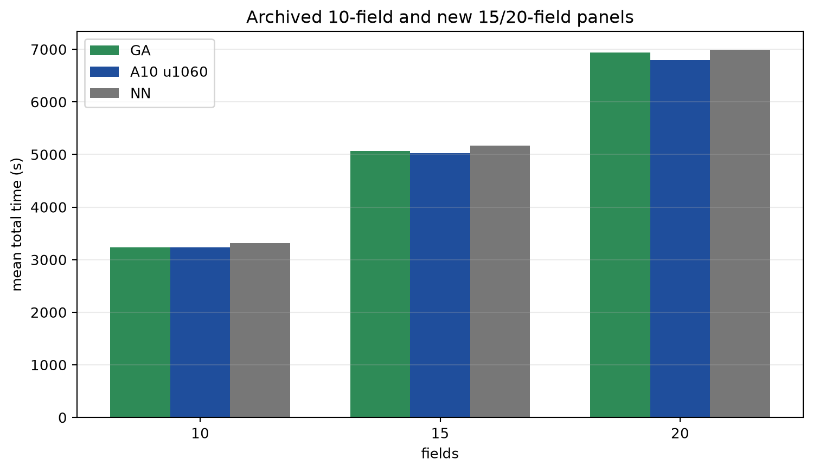
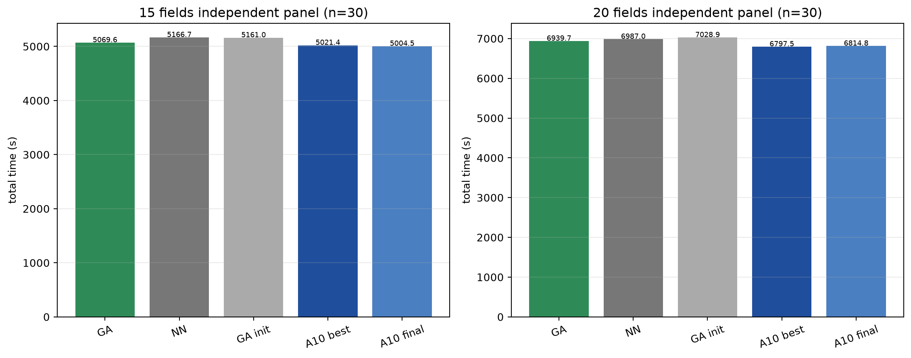
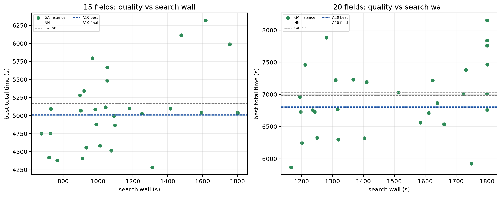

# Nested-GA independent 15/20-field comparison

**Single GA search seed42 per instance; single RL training seed. No sealed test.**
**No RL training, no GA parameter changes, no 30-field model.**

## Provenance and frozen scope

- Baseline SHA: `947f32b4d63449affeb82e94dbcc2db216add65d`
- Frozen protocol: [`nested_ga_scale_protocol.md`](../nested_ga_scale_protocol.md)
- Queue/scale code commit: `6df5ba3`
- Method:
  **“嵌套GA，每次最多385次候选评估或1800秒搜索时间，先到者停止。”**
- 15 fields: 30 new instances, seeds **1,700,000–1,700,029**
- 20 fields: 30 new instances, seeds **1,800,000–1,800,029**
- Both generated successfully with no geometry replacement or seed collision.
- Same area 5,000–20,000 m², workspace, shape/spacing, fixed UAV, time,
  workload, resupply and return/completion rules as A10.
- Full snapshots, manifests, configs and SHA256s were frozen before policy
  evaluation.

CHANet A10 u1060/u1200 were trained on **10-field maps**; all 15/20 results are
cross-scale inference. GA searches each instance online. The 30-field trained
model is excluded.

## Tests and smoke

- Required suites: **34 passed**.
- 15-field smoke: 5 evaluations, complete+returned, ledger closed, replay exact;
  search 9.92 s, replay 1.95 s.
- 20-field smoke: 5 evaluations, complete+returned, ledger closed, replay exact;
  search 20.25 s, replay 4.02 s.
- Smoke instances were outside both formal panels.

## Completion and search budget

| metric | 15 fields | 20 fields |
|---|---:|---:|
| GA searches | 30 | 30 |
| task completion | **30/30** | **30/30** |
| planned search completion | **28/30** | **24/30** |
| wall-limit | **2/30** | **6/30** |
| evaluation-limit | 28/30 | 24/30 |
| evaluations mean (range) | 379.5 (307–385) | 376.7 (203–385) |
| outer rounds mean (range) | 5.87 (4–6) | 5.73 (3–6) |
| full inner quotas mean | 23.6 | 23.4 |
| partial inner quotas mean | 0.07 | 0.20 |
| fallback ratio mean (max) | 27.0% (81.0%) | 29.4% (91.1%) |
| incumbent refreshes total | 168 | 158 |
| per-candidate search seconds | 3.02 | 4.04 |
| total search wall | 33,743 s (9.37 h) | 44,741 s (12.43 h) |
| total replay wall | 82.8 s | 111.2 s |

Wall-limited runs retain a replay-verified best complete incumbent and enter the
formal statistics. They are not task failures.

Fallback sources across best traces:

- 15 fields: sequence exhaustion 218, skipped slots 12, initialization 0
- 20 fields: sequence exhaustion 337, skipped slots 7, initialization 0

The larger scales often complete fewer outer rounds. This reflects the fixed
online budget, not an estimate of GA performance with more time.

## Results — 15 fields

| model | mean total | completed | work | nonwork | maneuver | deducted* |
|---|---:|---:|---:|---:|---:|---:|
| GA seed42 | **5069.6** | 30/30 | 2245.0 | 2349.3 | 475.3 | 2824.6 |
| original NN | 5166.7 | 30/30 | 2244.6 | 2417.6 | 504.4 | 2922.0 |
| GA initializer | 5161.0 | 30/30 | 2246.8 | 2421.2 | 493.1 | 2914.2 |
| CHANet A10 u1060 | **5021.4** | 30/30 | 2234.1 | 2309.3 | 478.1 | **2787.4** |
| CHANet A10 u1200 | **5004.5** | 30/30 | 2234.7 | 2292.4 | 477.5 | **2769.9** |

Primary comparisons (positive direction stated):

| comparison | mean | median | 95% instance bootstrap CI | win/tie/loss | relative | Holms p |
|---|---:|---:|---:|---:|---:|---:|
| `NN − GA` (positive = GA faster) | **+97.10 s** | +103.77 | **[+60.87,+132.83]** | 25/0/5 | +1.88% | **0.0008** |
| `GA − A10 u1060` (positive = CHANet faster) | **+48.14 s** | +70.48 | **[+7.55,+87.89]** | 21/0/9 | +0.96% | **0.0218** |

Auxiliary:

- `A10 u1060 − NN` = **−145.24 s**, A10 faster on 26/30.
- `GA init − GA` = **+91.40 s**, GA faster 30/30.
- `GA − A10 u1200` = **+65.03 s**, A10 final faster 21/30.

## Results — 20 fields

| model | mean total | completed | work | nonwork | maneuver | deducted* |
|---|---:|---:|---:|---:|---:|---:|
| GA seed42 | **6939.6** | 30/30 | 2946.4 | 3378.2 | 615.1 | 3993.3 |
| original NN | 6987.0 | 30/30 | 2938.1 | 3394.7 | 654.3 | 4049.0 |
| GA initializer | 7028.9 | 30/30 | 2950.4 | 3438.9 | 639.7 | 4078.5 |
| CHANet A10 u1060 | **6797.5** | 30/30 | 2923.3 | 3256.2 | 618.0 | **3874.2** |
| CHANet A10 u1200 | **6814.8** | 30/30 | 2928.7 | 3270.8 | 615.4 | **3886.2** |

Primary comparisons:

| comparison | mean | median | 95% instance bootstrap CI | win/tie/loss | relative | Holms p |
|---|---:|---:|---:|---:|---:|---:|
| `NN − GA` (positive = GA faster) | **+47.38 s** | +72.75 | **[+11.95,+81.20]** | 20/0/10 | +0.68% | **0.0168** |
| `GA − A10 u1060` (positive = CHANet faster) | **+142.20 s** | +152.97 | **[+96.78,+186.46]** | 26/0/4 | +2.09% | **0.0006** |

Auxiliary:

- `A10 u1060 − NN` = **−189.58 s**, A10 faster on 28/30.
- `GA init − GA` = **+89.23 s**, GA faster 30/30.
- `GA − A10 u1200` = **+124.83 s**, A10 final faster 27/30.

\* Deducted = nonwork + maneuver + service. GA fitness remains total time.

## All four primary tests and Holm

The four p-values were Holm-adjusted as one family:

| scale | comparison | raw p | Holm p |
|---:|---|---:|---:|
| 15 | NN − GA | 0.0002* | 0.0008 |
| 15 | GA − A10 u1060 | 0.0218 | 0.0218 |
| 20 | NN − GA | 0.0084 | 0.0168 |
| 20 | GA − A10 u1060 | 0.0002* | 0.0006 |

\*Bootstrap resolution floor. Effect intervals above are unadjusted and reported
separately; they are not interpreted as cross-seed or equivalence evidence.

## 10 / 15 / 20 side-by-side

The 10-field row is the archived prior evaluation, not a simultaneous
preregistration.

| fields | GA seed42 | A10 u1060 | original NN |
|---:|---:|---:|---:|
| 10 (archived) | 3231.8 | 3230.0 | 3320.0 |
| 15 | 5069.6 | **5021.4** | 5166.7 |
| 20 | 6939.6 | **6797.5** | 6987.0 |

At 15/20 fields, GA remains better than NN but **CHANet A10 u1060 has a clear
advantage** (48.1 s and 142.2 s mean). This differs from the near-parity at 10
fields. The effect magnitude grows with scale, but this is one search seed and
one RL training seed; no cross-seed stability claim.

Progress curves:

- [`independent15_progress.png`](independent15_progress.png)
- [`independent20_progress.png`](independent20_progress.png)

## Online and offline cost

- GA online: 15-field 9.37 h search + replay; 20-field 12.43 h search + replay;
  total **≈21.8 h** search, within the authorized 30 h.
- NN/CHANet control wall: 15-field **3.0–3.6 s/episode**; 20-field
  **4.0–4.6 s/episode**, including environment execution but excluding model
  loading.
- RL offline training separately: A10 10-field training wall **9 h 23 m**; not
  included in the control episode wall.
- No model forward is compared directly with a full GA search.

Hardware: Linux workstation, RTX GPUs via the existing `.venv`; the GA search is
CPU-bound and run sequentially; CHANet controls use the GPU.

## Boundary

- GA is an adapted nested GA, not a direct reproduction of the cited paper.
- One GA search seed and one RL training seed; 30 instances are the paired unit,
  not 30 training replicates.
- 15/20 CHANet results are cross-scale inference from a 10-field-trained model.
- No 30-field model, no extra seed, no parameter change, no budget extension and
  no sealed test.

## Artifacts

Persistent roots:

- `/home/ps/Desktop/Graph_planning/graph-uav-experiments/nested_ga/independent15/`
- `/home/ps/Desktop/Graph_planning/graph-uav-experiments/nested_ga/independent20/`
- `/home/ps/Desktop/Graph_planning/graph-uav-experiments/nested_ga/scale_report_seed42/`

Raw CSVs: `independent15_*` and `independent20_*`; control rows/summaries;
panel manifests/logs; queue logs; model hashes; plot files.

All best action traces and replay results remain in each run JSON; no successful-
subset filtering or fallback hiding was applied.
